# IGrasp

> [!IMPORTANT]
> **IGrasp is AI-generated and conscientiously prompted.**
> The point of this repository is not to learn how to build this app: it is a "disposable" app.
> The point of the app is to help you understand the structure of big, long-term projects.

IGrasp is a desktop app for Windows and Linux that shows **only the markdown files** of a project,
in their folder hierarchy, with a reading experience designed for one job: keeping a clear human
understanding of a project whose documentation is increasingly written and maintained by AI agents.
No Confluence, no editor plugin, no note-taking vault — just the project's own docs, live.

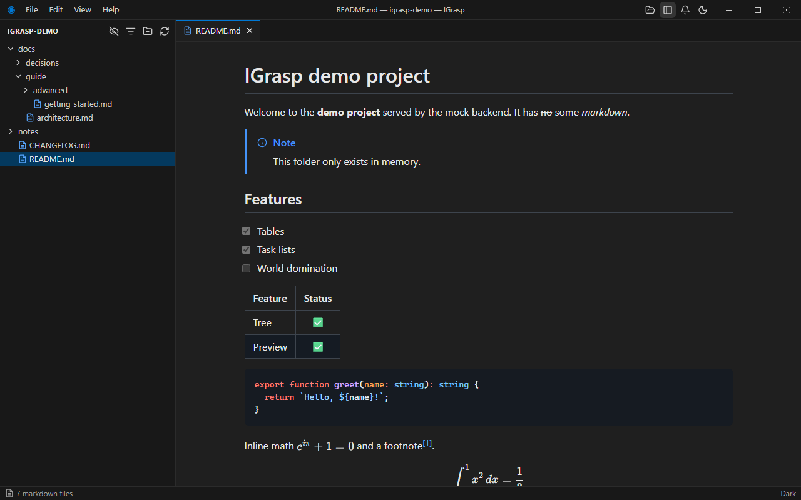

| | |
|---|---|
| 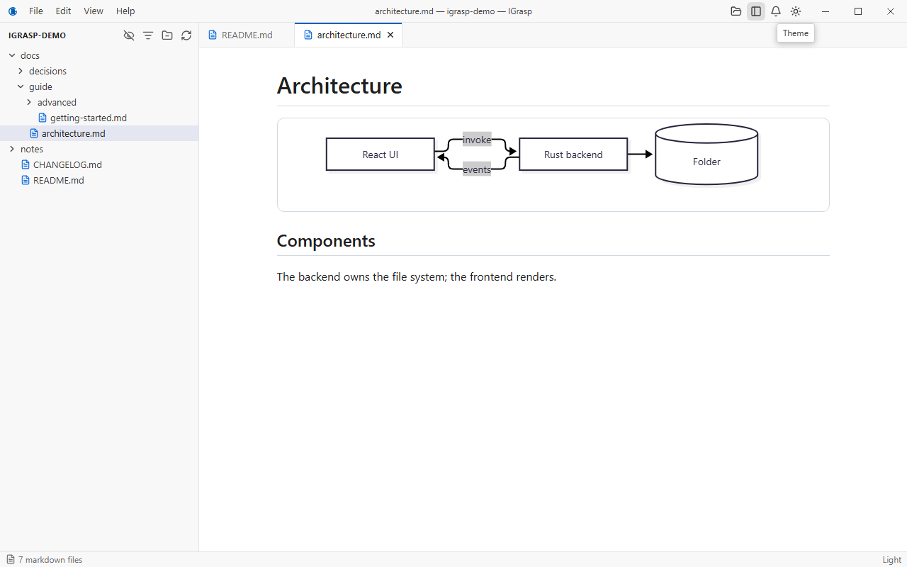 | 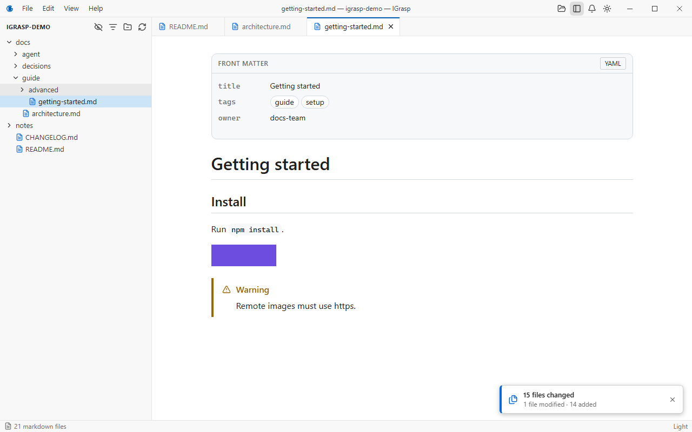 |
| 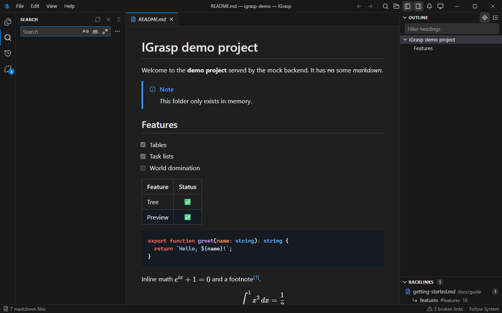 | 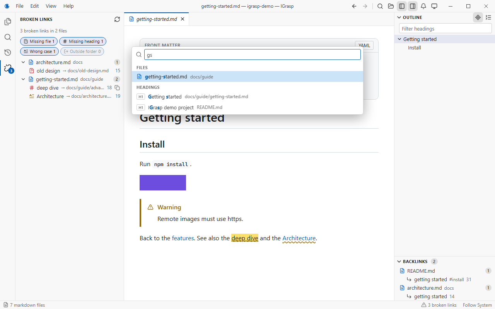 |
| 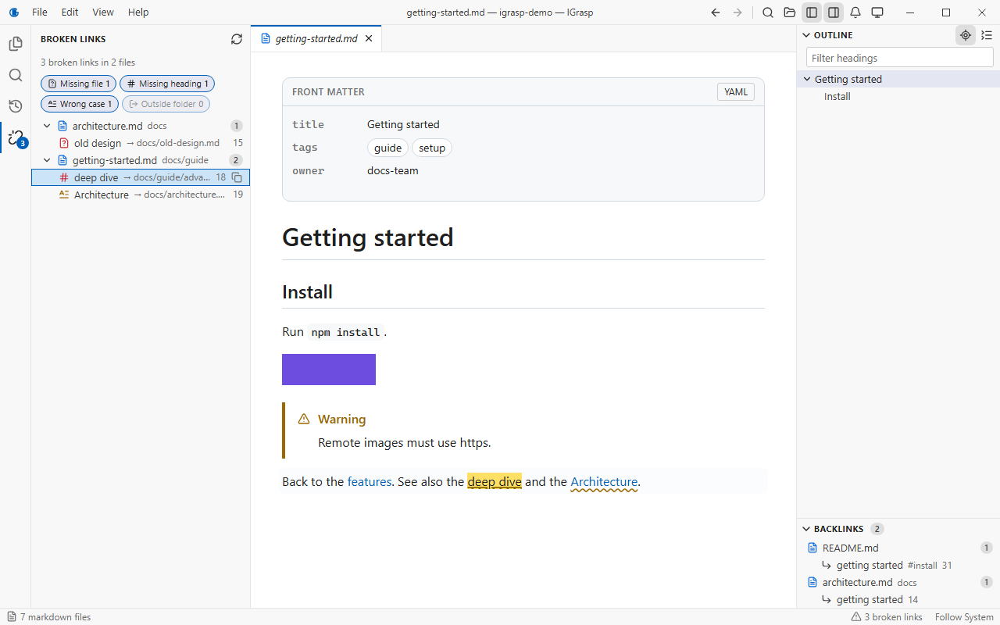 | 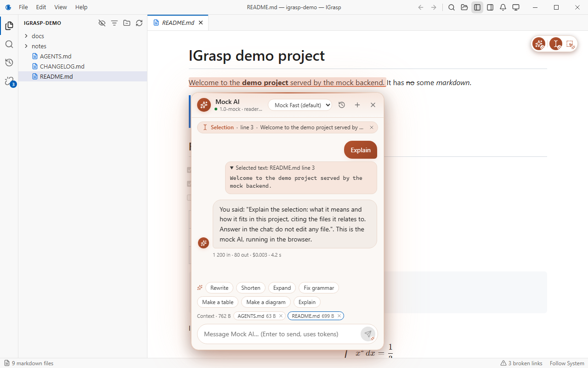 |
| 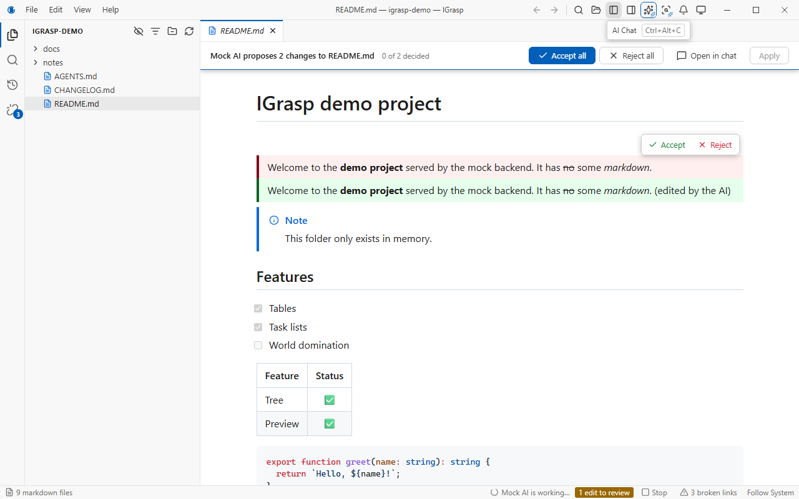 | 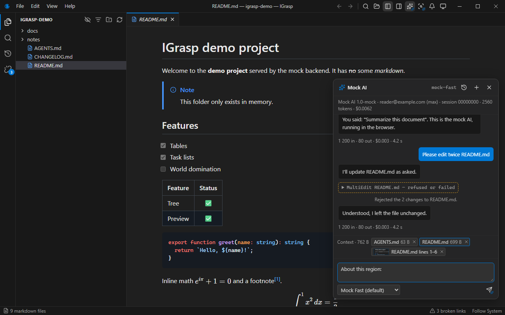 |
| 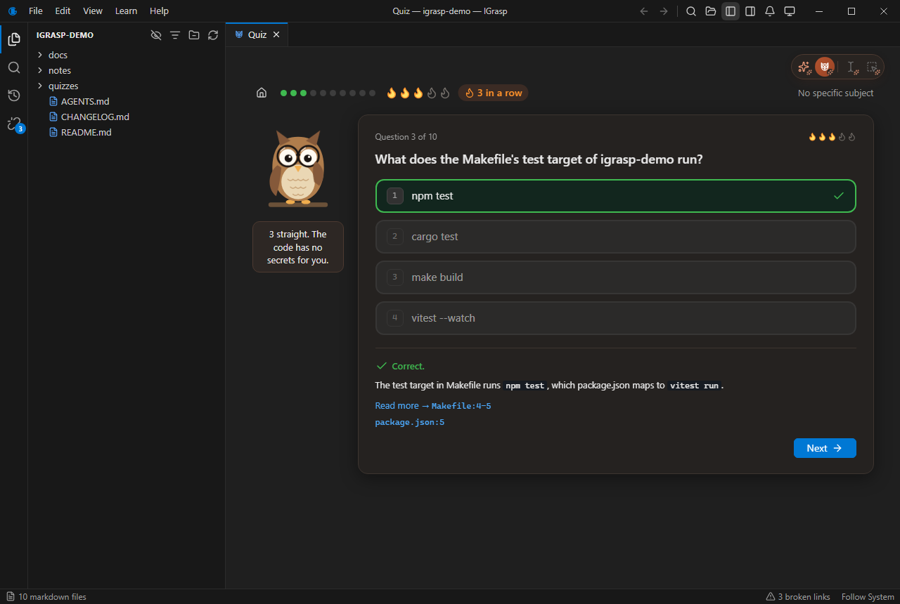 | 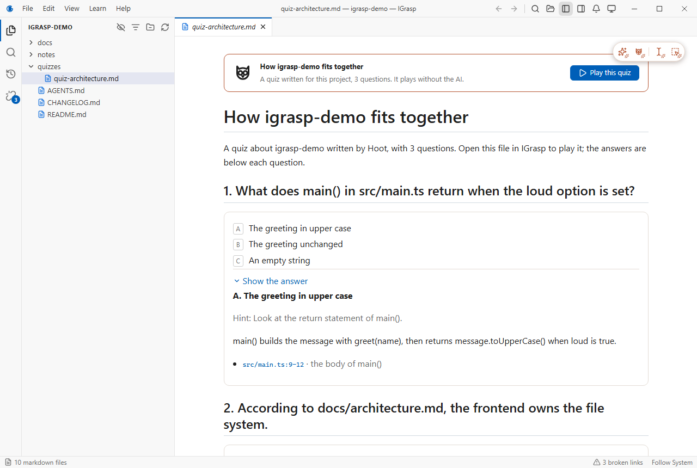 |

## Features

- **Markdown only.** The Explorer shows `.md` and `.markdown` files and the folders that contain
  them, nothing else. `.gitignore` is respected; `.git` and `node_modules` are always skipped.
  Toggles reveal dotfiles and ignored files. Smooth with 10,000+ files.
- **A real reading view.** GitHub Flavored Markdown, GitHub alerts, syntax highlighting, math
  (KaTeX), YAML front matter as a card, images and videos, and **Mermaid diagrams** with zoom,
  pan, fit and full screen.
- **Live.** When an agent (or anything else) changes files, the tree and the open documents update
  on their own, keeping your scroll position. Notifications say what changed; a burst of changes
  becomes one grouped notification. Mute them when you want quiet.
- **VS Code-style workspace.** Preview and pinned tabs, a custom title bar with menus, keyboard
  shortcuts for everything, and per-folder sessions: tabs, scroll positions and expanded folders
  come back when you reopen a folder.
- **Find anything.** `Ctrl+T` fuzzy-searches every file name and heading; `Ctrl+Shift+F`
  searches the content of every document with regex, match case, whole word and include/exclude
  globs, VS Code style. Both stay instant on 10,000 documents.
- **Follow the links.** Links between documents open in the app and scroll to their heading;
  links to source code open a read-only highlighted viewer. **Broken links** (missing file,
  missing heading, wrong case) are flagged in the text and listed in one view, and **backlinks**
  show who links to the document you read.
- **Know where you are.** An outline that follows your scroll, back and forward (`Alt+←` /
  `Alt+→`) through what you read, and a **Recent changes** view that marks what an agent just
  touched.
- **AI chat.** A floating panel (`Ctrl+Alt+C`) that talks to Claude through your own Claude Code
  CLI in the open folder: chat-style answers, a **context bar** that shows which instruction files
  (`CLAUDE.md`) and which document go with your message, a model picker listing the models your
  CLI offers, usage per answer, and
  a confirmation before a large message.
- **Review an edit where you read it.** When the AI proposes a change to a markdown file, the
  document opens in **review mode**: removed and added blocks in the rendered text, **Accept**
  or **Reject** each change, and only what you accepted is written.
- **Ask about a selection.** The AI tools over the document: highlight text with the cursor tool
  (`Ctrl+Alt+S`) or drag a region (`Ctrl+Alt+R`), and the chat opens next to it with its source
  lines, the selection stays highlighted, and quick actions (Rewrite, Shorten, Expand, Fix
  grammar, Make a table, Make a diagram, Explain) work on it.
- **Permissions you control.** Ask, Allow or Deny per kind of action (markdown edits, other file
  edits, commands, web, anything else); every automatic answer is shown in the conversation.
- **History.** Conversations are kept per folder (in the app's data folder, never in your
  project) and can be reopened and continued, or forgotten.
- **Quiz Me.** `Ctrl+Alt+Q`: Hoot the owl asks you questions about how **this** project is
  made, written by the AI from its code, configuration, build, tests and docs, each citing the
  lines that prove the answer (**Read more →** opens them). Every question is checked before you
  see it: real files, real lines, nothing generic. Fixed or adaptive to your level, whole
  project or docs only, hints, streaks, confetti, and a detected **project profile** (engine,
  frameworks, languages, modules) you can correct. Works on games (Godot, Unity, Unreal), web
  apps, tools and libraries alike.
- **Share a quiz.** Save results as a readable report, or save the quiz itself as a markdown file
  your teammates replay **without the AI**; it tells them when the cited code has changed.
- **Themes.** Light, Dark, High Contrast and Follow System.
- **Safe by design.** IGrasp never writes inside the folder you open on its own (an edit you
  accept is written by the AI provider; results and quizzes only where you save them). HTML in
  markdown is sanitized, links never navigate the app or launch programs, and the app reads only
  the folder you chose. AI features only ever spend tokens when you ask for it.

Coming next: generated tutorials about your project (its code, not only its docs), editing, and
a beginner-friendly git view with "what changed since I last looked". See the
[roadmap](#roadmap).

## Download and installation

Installers are published on the [Releases](https://github.com/jean3978/IGrasp/releases) page:

| Platform | Files |
|---|---|
| Windows 10/11 (x64) | `IGrasp_x.y.z_x64-setup.exe` (NSIS) or `IGrasp_x.y.z_x64_en-US.msi` |
| Linux (x64) | `IGrasp_x.y.z_amd64.AppImage` or `IGrasp_x.y.z_amd64.deb` |

The installers are not code-signed yet: Windows SmartScreen will warn about an unknown publisher
("More info" › "Run anyway"). On Linux, make the AppImage executable (`chmod +x`) before running
it.

## Requirements

- **Windows**: the Microsoft Edge WebView2 runtime (preinstalled on Windows 11 and recent
  Windows 10).
- **Linux**: WebKitGTK 4.1, version **2.44 or newer** (Ubuntu 22.04 and later with updates,
  Debian 12, Fedora 39+). Mermaid diagrams need it.
- **AI features** use your installed
  [Claude Code CLI](https://docs.anthropic.com/en/docs/claude-code) and your own login; it is not
  bundled and IGrasp stores no API key. Claude is the only supported provider for now; the AI
  layer is provider-neutral so others can be added later. IGrasp never spends tokens in the
  background: only when you click a control marked as using AI. The Claude integration is
  verified on Windows; the Linux run is still pending.

### Video on Linux

Videos play through GStreamer. If a video shows an "Open externally" card instead of playing,
install the codecs:

```sh
# Debian, Ubuntu
sudo apt install gstreamer1.0-plugins-good gstreamer1.0-plugins-bad gstreamer1.0-libav gstreamer1.0-gl
# Fedora (with RPM Fusion for the ffmpeg codecs)
sudo dnf install gstreamer1-plugins-good gstreamer1-plugins-bad-free gstreamer1-libav
```

The AppImage does not bundle GStreamer.

### Live updates on Linux

IGrasp watches the opened folder with inotify. On very large folders the system limit can be
reached; IGrasp then polls every 2 seconds and the status bar shows "Polling for changes". To get
instant updates again, raise the limit:

```sh
echo fs.inotify.max_user_watches=524288 | sudo tee /etc/sysctl.d/60-igrasp.conf && sudo sysctl --system
```

## Build from source

You need Node.js ≥ 24.15, npm ≥ 11 and Rust (stable) with the
[Tauri prerequisites](https://tauri.app/start/prerequisites/) for your platform.

```sh
git clone https://github.com/jean3978/IGrasp.git
cd IGrasp
npm install
npm run tauri dev      # run the app
npm run tauri build    # build installers into src-tauri/target/release/bundle
npm run check          # type checks, lint, formatting and all unit tests
```

See [CONTRIBUTING.md](CONTRIBUTING.md) for the details, and
[docs/architecture.md](docs/architecture.md) for how it works.

## Keyboard shortcuts

| Keys | Action |
|---|---|
| `Ctrl+O` | Open a folder |
| `Ctrl+,` | Settings |
| `F1` | All keyboard shortcuts |
| `Ctrl+T` | Search everything: files and headings |
| `Ctrl+Shift+F` | Search in files |
| `F4` / `Shift+F4` | Next / previous search result |
| `Alt+←` / `Alt+→` | Back / forward |
| `Ctrl+B` / `Ctrl+Alt+B` | Show or hide the sidebar / the right panel (outline, backlinks) |
| `Ctrl+Shift+E` / `R` / `L` | Explorer / Recent changes / Broken links |
| `Ctrl+Shift+O` | Focus the outline |
| `Ctrl+Alt+C` | Show or hide the AI chat |
| `Ctrl+Alt+S` | Ask about selected text (text mode) |
| `Ctrl+Alt+R` | Ask about a region |
| `Ctrl+Alt+N` / `Ctrl+Alt+H` | New AI conversation / history |
| `Alt+Shift+A` / `Alt+Shift+R` | Accept all / reject all changes of an AI edit under review |
| `Ctrl+Alt+Q` | Quiz Me (then `1`–`4`, `T` / `F`, `H` for a hint, `L` to look it up, `Enter`) |
| `Ctrl+W` | Close the tab |
| `Ctrl+Tab` / `Ctrl+Shift+Tab` | Next / previous tab |
| `Alt+1` … `Alt+9` | Go to a tab |
| `Ctrl+=` / `Ctrl+-` / `Ctrl+0` | Larger / smaller / default text |
| `Alt+F`, `Alt+E`, `Alt+V`, `Alt+L`, `Alt+H` | Open a menu |

In the Explorer: arrows, Home/End, Enter (open), Space (preview), `*` (expand siblings) and
type-ahead. More in [docs/features/keyboard.md](docs/features/keyboard.md).

### Known limitations

- The custom title bar has no Windows 11 snap-layout flyout on the maximize button and no
  `Alt+Space` system menu. Settings › Appearance › Window frame › Native switches to the system
  title bar.

## Roadmap

- [x] **Phase 1 — MVP** (0.1.0): open folder and recent folders, markdown-only file tree, rich
      preview (GFM, code highlighting, math, front matter, images, videos, Mermaid), tabs, live
      reload, change notifications, themes, settings, session restore, keyboard accessibility.
- [x] **Phase 2 — Navigation** (0.2.0): search everything (Ctrl+T), search in files
      (Ctrl+Shift+F), recent changes, back/forward history, outline, internal links, code viewer,
      broken links, backlinks.
- [x] **Phase 3 — Claude** (0.3.0): a provider-neutral AI layer (Claude first) that spends tokens
      only on a user action, chat through the Claude CLI with context, the CLI's own models,
      permissions and per-folder history, inline diff review, and AI tools over the document:
      highlight text or drag a region, the chat opens beside it, with quick actions (Rewrite,
      Shorten, Expand, Fix grammar, Make a table, Make a diagram, Explain).
- [x] **Phase 4 — Quiz** (0.4.0): a fun quiz about the project with Hoot the owl, grounded in
      the whole project (code, config, docs) with checked citations, a local project profile,
      fixed and adaptive modes, effects, saved results, and shareable quiz files replayed
      without the AI.
- [ ] **Phase 5 — Tutorials**: Hoot's Academy, interactive tutorials generated about the project
      (architecture, features, dependencies, how things are built, any engine or stack), saved
      privately with your progress, shareable with the team, and checked for freshness only when
      you ask.
- [ ] **Phase 6 — Editing**: WYSIWYG editing with lossless round-trip, file management, edit
      conflicts.
- [ ] **Phase 7 — Git**: branch graph, commit details, status panel, stash, beginner-friendly
      operations, and "what changed since I last looked".
- [ ] **Phase 8 — Mermaid visual editor**: flowcharts first.

## License

[MIT](LICENSE) © 2026 Jean-Rene Choiniere

All dependencies are MIT-compatible. One is not MIT/Apache: `nucleo-matcher` (fuzzy matching for
Ctrl+T) is MPL-2.0 and used unmodified; see
[ADR 0011](docs/decisions/0011-fuzzy-matching-with-nucleo.md).
