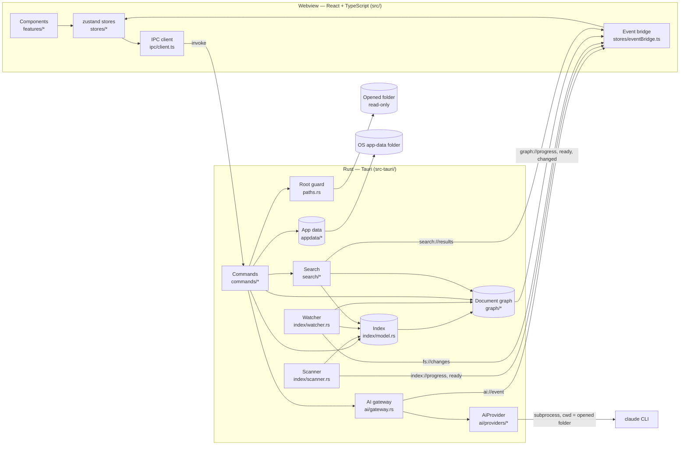
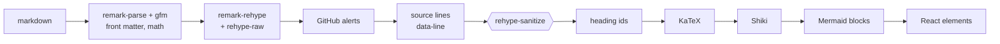
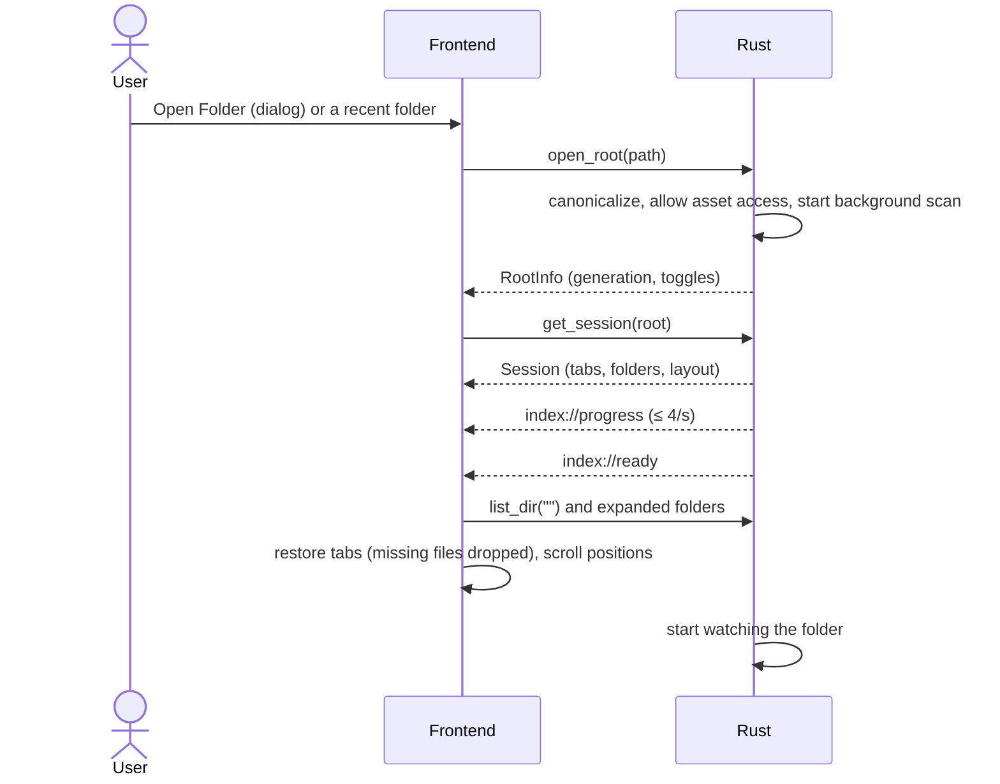
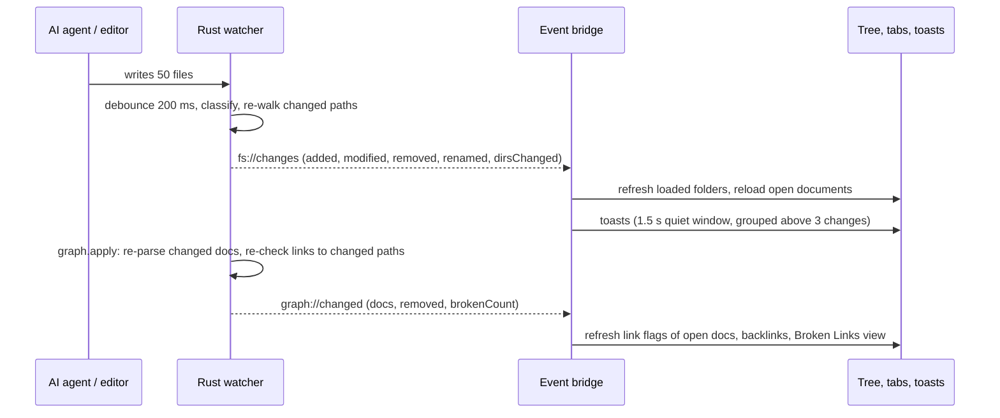
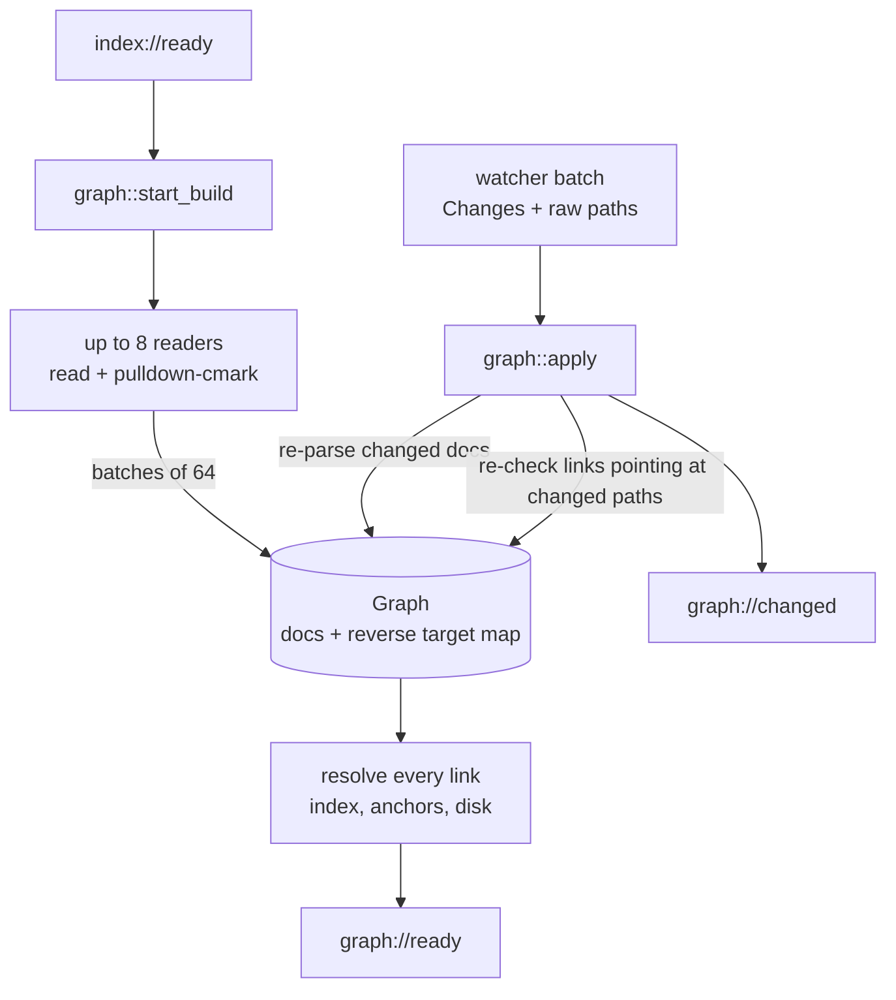
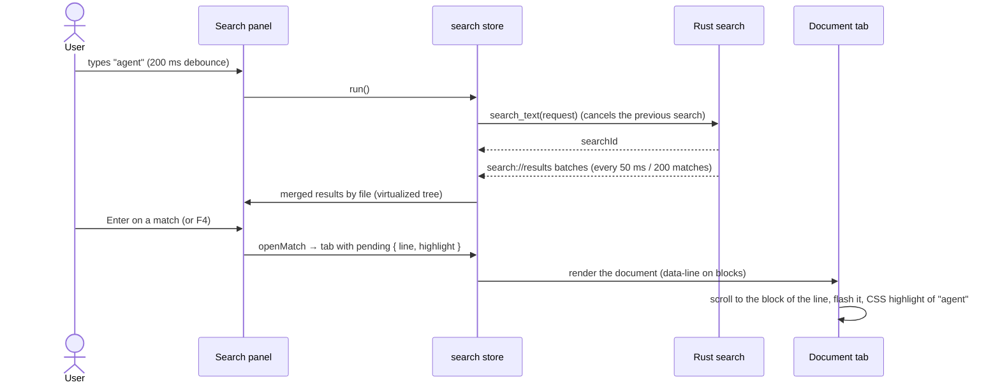

# Architecture

IGrasp is a [Tauri v2](https://tauri.app) application. A Rust process owns the window, the file
system and all background work; a React + TypeScript frontend running in the system webview
(WebView2 on Windows, WebKitGTK on Linux) renders the interface. They talk through typed IPC
commands and events.

## Rust backend (`src-tauri/src`)

| Module | Role |
|---|---|
| `lib.rs` | Builder: plugins (log, dialog, opener, window-state), state, commands, window fallback. |
| `state.rs` | `AppState`: app data plus the open `Workspace` (root guard, scan generation, options, shared index, cancel flag, watcher handle, document graph, symbol-search cache, running text search). Replacing or dropping the workspace cancels its background work. `ScanContext` is what the scan, the watcher and the graph builder share. |
| `paths.rs` | `RootGuard`: root-relative `/` paths in, canonical absolute paths out; rejects traversal, absolute, drive and UNC paths, and symlinks or junctions escaping the root. |
| `index/model.rs` | In-memory index of markdown files; folders exist only while they contain markdown; diffing for the watcher. |
| `index/scanner.rs` | Parallel, ignore-aware walk (`ignore` crate); scoped walks for the watcher. |
| `index/watcher.rs` | Debounced `notify` events → classification → targeted re-walk → `fs://changes`; then the same batch (with the raw event paths) goes to the graph; poll fallback. |
| `graph/` | The document graph ([ADR 0009](decisions/0009-document-graph-in-rust.md)): `parse.rs` (pulldown-cmark → headings, anchors, links with lines), `slug.rs` (github-slugger port), `links.rs` (target and status of a link), `mod.rs` (graph with a reverse target map, parallel build, incremental `apply`, events). |
| `search/` | `symbols.rs` (Ctrl+T, nucleo-matcher, cached candidates), `text.rs` (Ctrl+Shift+F, grep crates, streamed batches), `globs.rs` (VS Code-style include/exclude), `SearchRegistry` (one running search, cancellation). |
| `commands/` | `workspace.rs` (open/close/rescan/list, recent files), `files.rs` (read markdown and text files, open media externally, open with the default app, reveal in the file manager), `graph.rs` (link status, backlinks, broken links, status), `search.rs` (symbols, text, cancel), `appdata.rs` (settings, recents, sessions, app info), `ai.rs` (provider status, capabilities and choice, context and size estimate, start an operation for a user action, answer a permission, cancel, conversations per folder). |
| `appdata/` | Versioned JSON files in the OS app-data folder, written atomically, recovered when corrupt; `conversations.rs` keeps the AI conversations per folder. |
| `ai/` | AI providers behind one trait ([ADR 0015](decisions/0015-ai-provider-abstraction-and-gateway.md)): `types.rs` (neutral request, events, capabilities, status), `gateway.rs` (the only door: provider chosen in the settings, a user action per operation, one at a time, the permission policy, cancelled when the folder, window or app closes), `policy.rs` (permission kind → Ask / Allow / Deny), `context.rs` (instruction files and current file, bounded), `estimate.rs` (size buckets), `process.rs` (children die with the app), `providers/claude_cli/` ([ADR 0014](decisions/0014-claude-cli-integration.md): `cli.rs` probes, `turn.rs` one process per operation, `protocol.rs` wire format → events), `providers/mock.rs` (tests). |
| `error.rs` | `AppError`, serialized as `{ code, message }`. |

The frontend never reads files directly: there is no fs plugin and no shell plugin
([ADR 0002](decisions/0002-file-access-through-rust-commands.md)).

### IPC commands and events

| Command | Returns |
|---|---|
| `open_root`, `close_root`, `rescan`, `list_dir` | Folder info, generation, folder listings. |
| `list_recent_files(offset, limit)` | Markdown files newest first (Recent changes). |
| `read_markdown`, `read_text_file` | File contents (`read_text_file`: any text file, `NotText` / `TooLarge`, first 1 MB). |
| `open_external`, `open_with_default_app`, `reveal_in_file_manager` | Media only / text files that are not programs ([ADR 0013](decisions/0013-opening-files-with-the-default-app.md)) / any file or folder. |
| `get_graph_status`, `get_doc_links`, `get_backlinks`, `list_broken_links` | Graph progress and broken count, a document's links with status, documents linking to one, every broken link. |
| `search_symbols` | Ctrl+T hits (files and headings) for a query, with a request id. |
| `search_text`, `cancel_search` | Starts a full-text search (returns its id) / stops it. |
| `ai_status`, `ai_capabilities`, `ai_providers`, `ai_set_provider`, `ai_context`, `ai_estimate`, `ai_start`, `ai_respond_permission`, `ai_cancel` | Provider installed and logged in (cached 60 s) / what it supports / the providers / switch provider / what a message carries / its size / starts an operation for a user action in the open folder (returns its id) / answers a permission request / stops the operation. |
| `list_conversations`, `get_conversation`, `save_conversation`, `delete_conversation`, `forget_conversations` | The AI conversations of the open folder (app data only). |
| `get_settings`, `update_settings`, `get_recent_folders`, …, `get_session`, `save_session` | App data. |

| Event | When |
|---|---|
| `index://progress`, `index://ready`, `index://error` | Scan of a generation. |
| `fs://changes`, `fs://watch-status` | A batch of changes on disk; how the folder is watched. |
| `graph://progress`, `graph://ready`, `graph://changed` | Graph build (≤ 4/s), done, and documents whose links changed with the broken count. |
| `search://results` | A batch of full-text results (`done` on the last one). |
| `ai://event` | One provider-neutral event of an operation (`session`, `textDelta`, `text`, `toolUse`, `toolResult`, `permissionRequest`, `usage`, `error`, `done`). |
| `appdata://recovered` | A corrupt app-data file was reset. |

## Frontend (`src`)

| Folder | Role |
|---|---|
| `ipc/` | The `Backend` interface, its Tauri implementation (the only code calling `invoke`/`listen`) and the in-memory mock used in the browser and in tests. `generated/` holds the TypeScript types exported from Rust by ts-rs. |
| `stores/` | zustand stores: `workspace` (layout: sidebar view, right panel), `tree`, `tabs` (document and code tabs, pending scroll targets), `documents`, `textFiles`, `history`, `recentFiles`, `graph`, `outline`, `quickOpen`, `search`, `settings`, `toasts`, `recent`, `ui`, `ai` (provider status and capabilities, conversation, pending permissions, usage); `session.ts` (save/restore), `diskChanges.ts`, `eventBridge.ts` (backend events → stores). |
| `features/` | UI by feature: `titlebar` (menu bar, toolbar, window controls, `menuActions.ts`), `shell` (layout, activity bar, sidebar host, status bar), `explorer`, `search`, `recent`, `links` (broken links, backlinks), `outline`, `rightpanel`, `quickopen`, `code` (code viewer), `tabs`, `preview` (markdown pipeline, link resolver, reveal helpers), `mermaid`, `toasts`, `settings`, `shortcuts`, `welcome`, `splash`, `about`, `ai` (chat panel, event reducer, line diff). |
| `components/` | Shared UI: buttons and `VirtualRows` (the virtualized, keyboard-navigable list behind every new view). |
| `styles/` | Design tokens and the three themes. |
| `lib/` | Pure helpers (paths, link classification, platform). |

Every user action is defined once in `features/titlebar/menuActions.ts`; menus, toolbar buttons
and keyboard shortcuts all dispatch through it.

### Markdown pipeline

Untrusted HTML is sanitized **before** the trusted generators (KaTeX, Shiki) run
([ADR 0003](decisions/0003-markdown-pipeline-sanitize-before-generators.md)). The pipeline, KaTeX,
Shiki languages and Mermaid are loaded on first use.

## Data flows

### Opening a folder

Every scan has a **generation**; results and events of an older generation are ignored, so
opening another folder or toggling dotfiles while a scan runs is safe.

### A file changes on disk

### The document graph

Headings and anchors use the same slugs as the preview (two shared fixtures are asserted by both
test suites), and a link to a heading stays `NotChecked` until its target is parsed, so the UI
never flags a link it is not sure about.

### From a keystroke to a highlighted line

## State on disk

All state lives in the OS app-data folder (`%APPDATA%\io.github.jean3978.igrasp` on Windows,
`~/.local/share/io.github.jean3978.igrasp` on Linux), never in the opened folder:
`settings.json`, `recent-folders.json`, `sessions.json`, `conversations/` (`index.json` maps each
folder to a `c0001.json` of its AI conversations), and `logs/` (in the OS log folder).

## Decisions

See [docs/decisions](decisions/README.md) for the reasoning behind each major choice.
