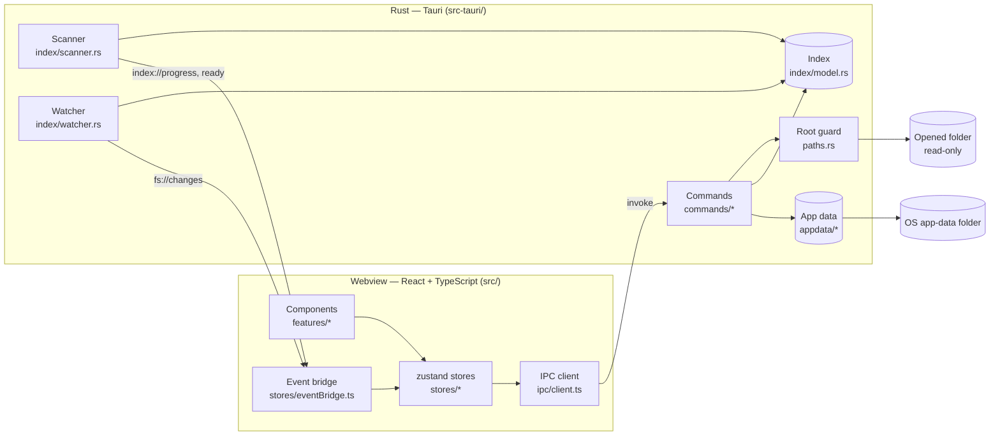
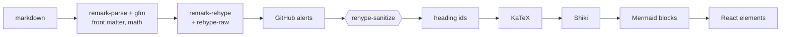
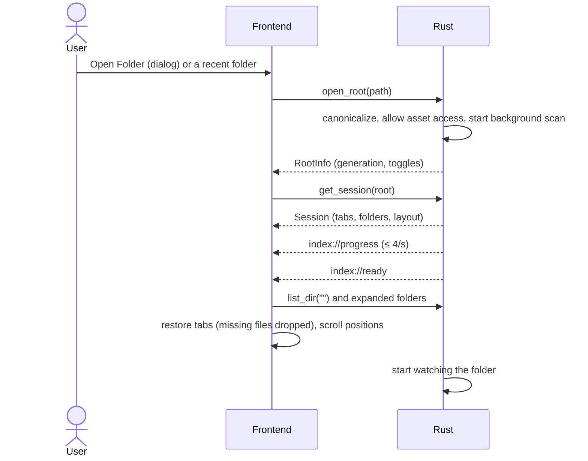
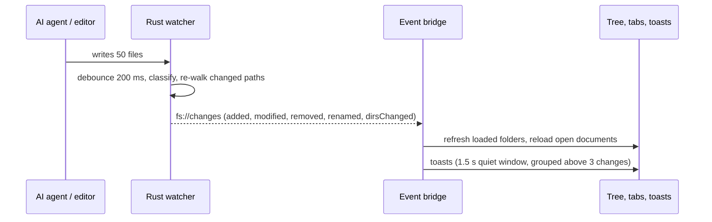

# Architecture

IGrasp is a [Tauri v2](https://tauri.app) application. A Rust process owns the window, the file
system and all background work; a React + TypeScript frontend running in the system webview
(WebView2 on Windows, WebKitGTK on Linux) renders the interface. They talk through typed IPC
commands and events.

## Rust backend (`src-tauri/src`)

| Module | Role |
|---|---|
| `lib.rs` | Builder: plugins (log, dialog, opener, window-state), state, commands, window fallback. |
| `state.rs` | `AppState`: app data plus the open `Workspace` (root guard, scan generation, options, shared index, cancel flag, watcher handle). Replacing or dropping the workspace cancels its background work. |
| `paths.rs` | `RootGuard`: root-relative `/` paths in, canonical absolute paths out; rejects traversal, absolute, drive and UNC paths, and symlinks or junctions escaping the root. |
| `index/model.rs` | In-memory index of markdown files; folders exist only while they contain markdown; diffing for the watcher. |
| `index/scanner.rs` | Parallel, ignore-aware walk (`ignore` crate); scoped walks for the watcher. |
| `index/watcher.rs` | Debounced `notify` events → classification → targeted re-walk → `fs://changes`; poll fallback. |
| `commands/` | `workspace.rs` (open/close/rescan/list), `files.rs` (read markdown, open media externally), `appdata.rs` (settings, recents, sessions, app info). |
| `appdata/` | Versioned JSON files in the OS app-data folder, written atomically, recovered when corrupt. |
| `error.rs` | `AppError`, serialized as `{ code, message }`. |

The frontend never reads files directly: there is no fs plugin and no shell plugin
([ADR 0002](decisions/0002-file-access-through-rust-commands.md)).

## Frontend (`src`)

| Folder | Role |
|---|---|
| `ipc/` | The `Backend` interface, its Tauri implementation (the only code calling `invoke`/`listen`) and the in-memory mock used in the browser and in tests. `generated/` holds the TypeScript types exported from Rust by ts-rs. |
| `stores/` | zustand stores: `workspace`, `tree`, `tabs`, `documents`, `settings`, `toasts`, `recent`, `ui`; `session.ts` (save/restore), `diskChanges.ts`, `eventBridge.ts` (backend events → stores). |
| `features/` | UI by feature: `titlebar` (menu bar, toolbar, window controls, `menuActions.ts`), `explorer`, `tabs`, `preview` (markdown pipeline and components), `mermaid`, `toasts`, `settings`, `shortcuts`, `welcome`, `splash`, `about`, `shell`. |
| `styles/` | Design tokens and the three themes. |
| `lib/` | Pure helpers (paths, platform). |

Every user action is defined once in `features/titlebar/menuActions.ts`; menus, toolbar buttons
and keyboard shortcuts all dispatch through it.

### Markdown pipeline

Untrusted HTML is sanitized **before** the trusted generators (KaTeX, Shiki) run
([ADR 0003](decisions/0003-markdown-pipeline-sanitize-before-generators.md)). The pipeline, KaTeX,
Shiki languages and Mermaid are loaded on first use.

## Data flows

### Opening a folder

Every scan has a **generation**; results and events of an older generation are ignored, so
opening another folder or toggling dotfiles while a scan runs is safe.

### A file changes on disk

## State on disk

All state lives in the OS app-data folder (`%APPDATA%\io.github.jean3978.igrasp` on Windows,
`~/.local/share/io.github.jean3978.igrasp` on Linux), never in the opened folder:
`settings.json`, `recent-folders.json`, `sessions.json`, and `logs/` (in the OS log folder).

## Decisions

See [docs/decisions](decisions/README.md) for the reasoning behind each major choice.
