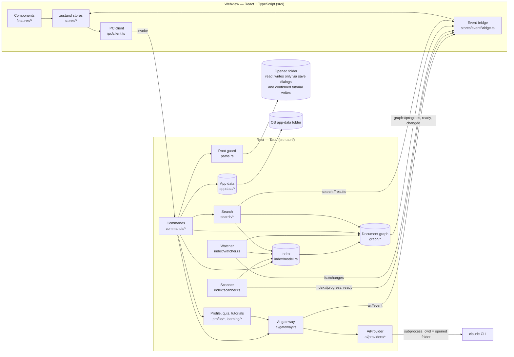
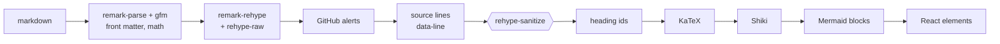
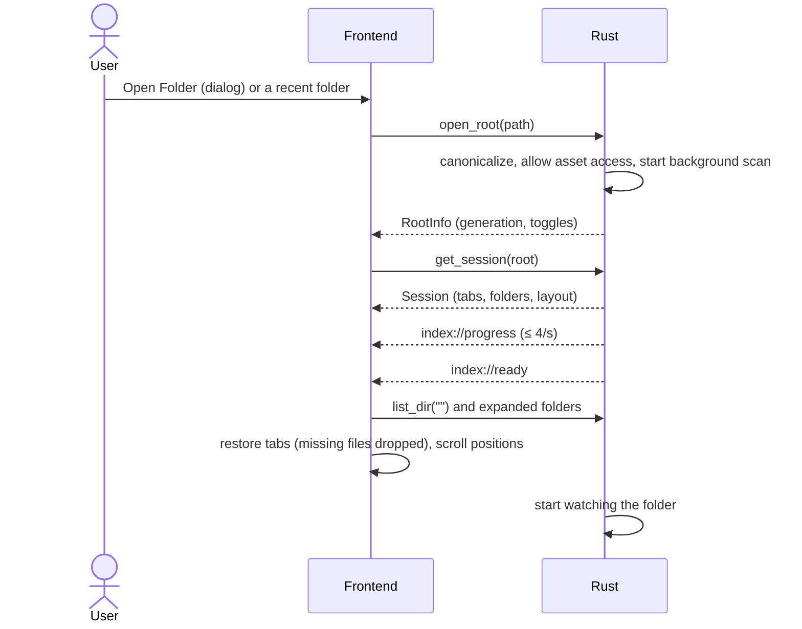
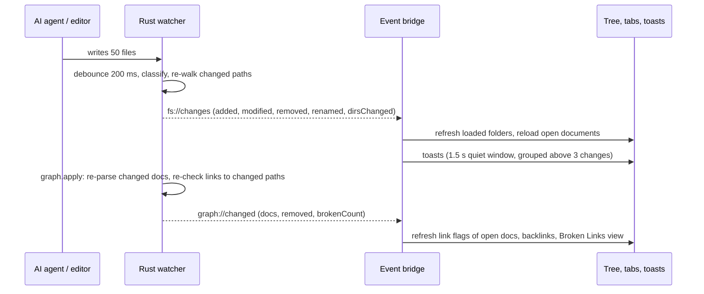
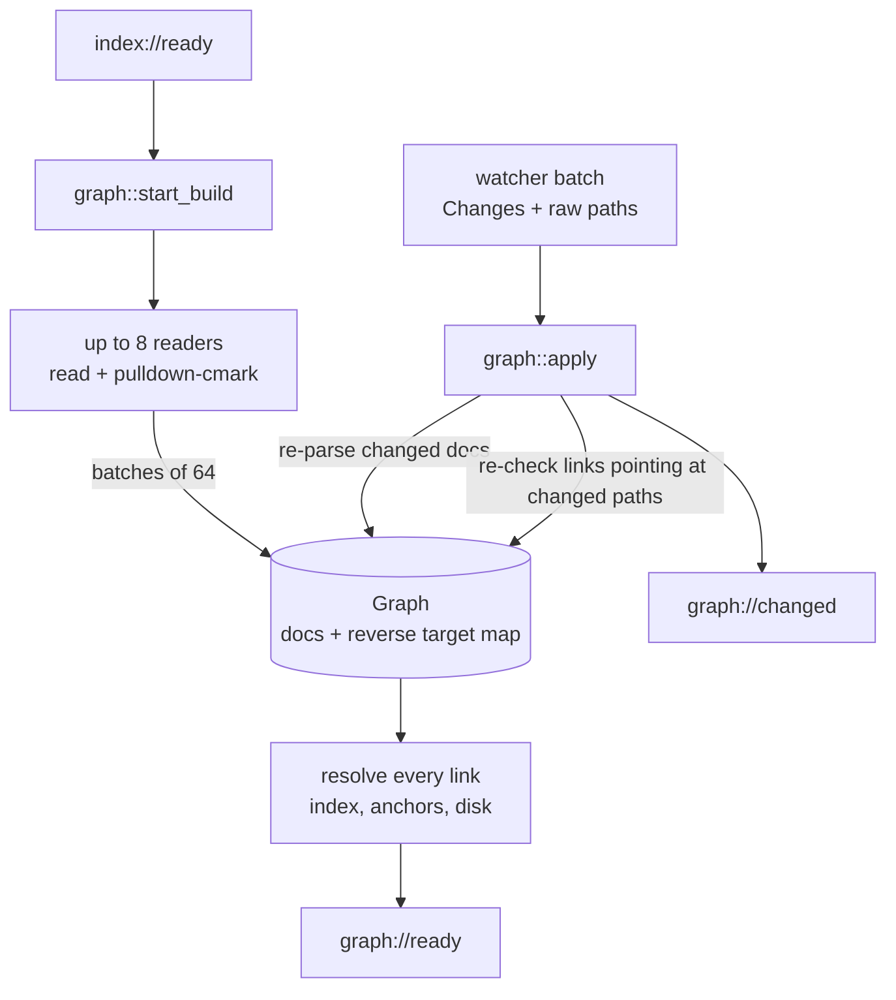
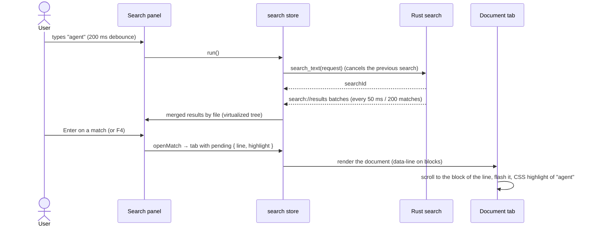
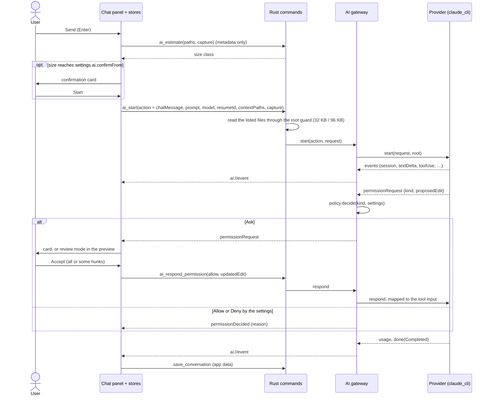
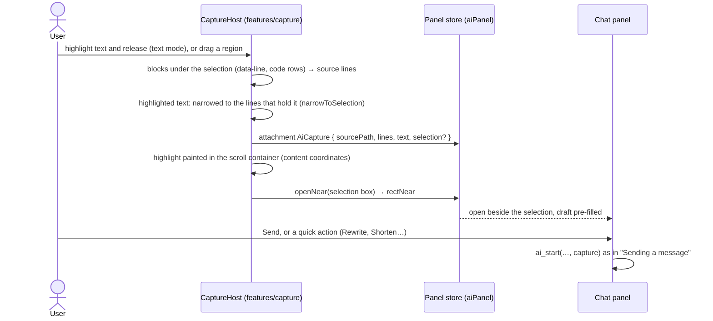
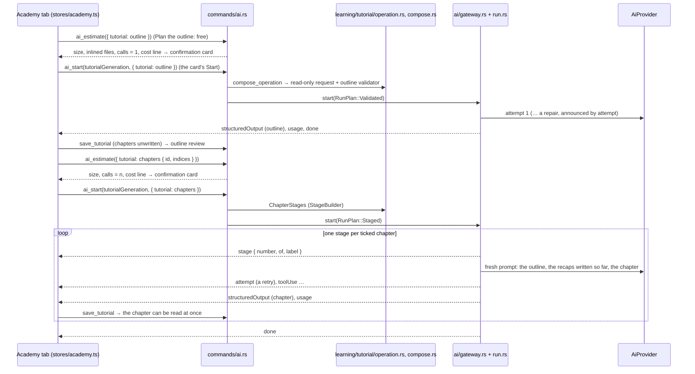

# Architecture

IGrasp is a [Tauri v2](https://tauri.app) application. A Rust process owns the window, the file
system and all background work; a React + TypeScript frontend running in the system webview
(WebView2 on Windows, WebKitGTK on Linux) renders the interface. They talk through typed IPC
commands and events.



## Rust backend (`src-tauri/src`)

| Module | Role |
|---|---|
| `lib.rs` | Builder: plugins (log, dialog, opener, window-state), state, commands, window fallback. |
| `state.rs` | `AppState`: app data plus the open `Workspace` (root guard, scan generation, options, shared index, cancel flag, watcher handle, document graph, symbol-search cache, running text search). Replacing or dropping the workspace cancels its background work. `ScanContext` is what the scan, the watcher and the graph builder share. |
| `paths.rs` | `RootGuard`: root-relative `/` paths in, canonical absolute paths out; rejects traversal, absolute, drive and UNC paths, and symlinks or junctions escaping the root. |
| `index/model.rs` | In-memory index of markdown files; folders exist only while they contain markdown; diffing for the watcher. |
| `index/scanner.rs` | Parallel, ignore-aware walk (`ignore` crate); scoped walks for the watcher. |
| `index/watcher.rs` | Debounced `notify` events → classification → targeted re-walk → `fs://changes`; then the same batch (with the raw event paths) goes to the graph; poll fallback. |
| `graph/` | The document graph ([ADR 0009](decisions/0009-document-graph-in-rust.md)): `parse.rs` (pulldown-cmark → headings, anchors, links with lines; quiz and tutorial files flagged from their front matter), `slug.rs` (github-slugger port), `links.rs` (target and status of a link; a GitHub line fragment such as `#L3-L8` into a markdown file is not reported as a missing anchor, `is_line_fragment`), `mod.rs` (graph with a reverse target map, parallel build, incremental `apply`, events). |
| `search/` | `symbols.rs` (Ctrl+T, nucleo-matcher, cached candidates), `text.rs` (Ctrl+Shift+F, grep crates, streamed batches), `globs.rs` (VS Code-style include/exclude), `SearchRegistry` (one running search, cancellation). |
| `commands/` | `workspace.rs` (open/close/rescan/list, recent files), `files.rs` (read markdown and text files, open media externally, open with the default app, reveal in the file manager), `graph.rs` (link status, backlinks, broken links, status), `search.rs` (symbols, text, cancel), `appdata.rs` (settings, recents, sessions, app info), `ai.rs` (provider status, capabilities and choice, context and size estimate, start an operation for a user action, answer a permission, cancel, conversations per folder), `learning.rs` (profile, subjects, quizzes), `tutorials.rs` (the Academy's local commands: subject cards, private and shared tutorials, progress, freshness, write plans and writes, verification). |
| `appdata/` | Versioned JSON files in the OS app-data folder, written atomically, recovered when corrupt; `settings.rs` (including `ai` and `learning`), `session.rs` (including the AI panel), `conversations.rs` keeps the AI conversations per folder (the app's own readable copy, trimmed), `learning.rs` (per folder: profile corrections, quizzes, tutorial progress, suggested subjects, tutorial usage), `tutorials.rs` (one JSON file per private tutorial, [ADR 0027](decisions/0027-tutorial-storage-sharing-and-verification.md)). |
| `ai/` | AI providers behind one trait ([ADR 0015](decisions/0015-ai-provider-abstraction-and-gateway.md)): `types.rs` (neutral request, events, capabilities, status), `gateway.rs` (the only door: provider chosen in the settings, a user action per operation, one at a time, the permission policy, cancelled when the folder, window or app closes), `policy.rs` (permission kind → Ask / Allow / Deny from `settings.ai.permissions`; a read-only operation denies everything), `context.rs` (the provider's instruction files from the root down and the current file, read through the root guard with caps of 32 KB / 96 KB), `estimate.rs` (size from metadata: small / medium / large), `process.rs` (children die with the app), `no_start.rs` (tests: nothing but `ai_start` can start an operation), `providers/claude_cli/` ([ADR 0014](decisions/0014-claude-cli-integration.md): `cli.rs` probes, `turn.rs` one process per operation, `protocol.rs` wire format → events, permission kinds and the neutral edit → tool input), `providers/mock.rs` (scripted provider, tests only). The provider is built from a small registry (`build_provider` in `mod.rs`) by `settings.ai.provider`; the policy is [ADR 0019](decisions/0019-permission-policy-history-and-floating-chat.md). |
| `profile/` | The project profile ([ADR 0021](decisions/0021-project-profile-from-a-marker-table.md)), local and without AI: `walk.rs` (one bounded, ignore-aware walk), `markers.rs` (the marker table: files, extensions and manifest keys → kinds, engines, frameworks, build, tests, CI), `manifests.rs` (TOML / JSON parsing), `languages.rs`, `modules.rs`, `summary.rs`, `tests.rs` (one fixture per kind, the dogfooding test, the ignored perf test). |
| `learning/` | The quiz and the tutorials: `mod.rs` (the profile with corrections, cached per disk revision; the Academy's subject cards), `corpus.rs` (files a generation may read and cite, scopes: whole project, documentation only, or the paths of a code check; secrets out; `read_text` reads only inside the root), `agent_files.rs` (instruction files: context only, never cited), `subjects.rs` (global concepts and features proposed from the profile and corpus), `role.rs` (the player's role read as a family of crafts: the prompt's audience and focus; mirrored by `quizRoles.ts` on a shared fixture), `hoot.rs` (the tone of every learning prompt), `save.rs` (`save_quiz_markdown` and Save as…'s folder dialog behind a `SaveDialog` trait), `quiz/` ([ADR 0022](decisions/0022-grounded-generation-pipeline.md): `schema.rs`, `difficulty.rs`, `prompt.rs` with a snapshot, `validate.rs` with shared fixtures, `compose.rs` (the request built in `ai_start`, the `QuizValidator`, the ignored `real_quiz` test), `file.rs` (recognising quiz files, [ADR 0024](decisions/0024-shareable-learning-files-as-markdown.md))), `tutorial/` (Hoot's Academy: `mod.rs` (`TutorialInput`, `TutorialRef`, `TutorialRequest`, the id scheme), `schema.rs` (outline, chapter, the ten step types, `Tutorial`), `prompt.rs`, `validate.rs` with shared fixtures, `compose.rs` (the outline request and `ChapterStages`, the staged run's builder; the proof of concept's ignored `real_tutorial` and `real_freshness` tests), `operation.rs` (`compose_operation`: a `TutorialRequest` → a read-only validated or staged run, shared by `ai_estimate` and `ai_start`), `cost.rs` (the card's cost line), `families.rs` (subject cards, [ADR 0028](decisions/0028-subject-families-built-locally.md)), `suggest.rs` (Suggest more subjects), `review.rs` (Check with the AI: schema, prompt, validator), `markdown.rs` (the shared format, owned by Rust: [ADR 0025](decisions/0025-tutorial-format-json-schema-and-shared-markdown.md)), `share.rs` (reading a shared tutorial; write plans and atomic writes: share, update, Save as…), `freshness.rs` (hashes, check, relocation), `progress.rs` (`TutorialProgress`, `step_hash`, usage), `question.rs` (questions readers save on a step, anonymous; the step context added to a chat message about a step), `repo.rs` (HEAD commit and user name from the `.git` files), `real.rs` (the ignored `real_academy` test); [the proof of concept report](plan/poc-tutorials.md)). |
| `error.rs` | `AppError`, serialized as `{ code, message }`. |

`ai/run.rs` runs a **validated run**: one gateway operation whose structured answer is checked by
an `OutputValidator`, with at most two retries announced by `AiEvent::Attempt` and resumed in the
attempt's conversation; only `AiGateway::start` starts one. A **staged run**
([ADR 0026](decisions/0026-staged-runs.md)) is several validated runs under one operation id, one
after the other, built by a `StageBuilder` that sees the accepted outputs so far (a tutorial's
chapters): at most `MAX_STAGES` = 8, each stage announced by `AiEvent::Stage`, a failed stage
ends the run, exactly one `done`. The gateway's `start` takes a `RunPlan`
(`Validated` or `Staged`). `appdata/learning.rs` keeps, per folder, the profile corrections,
the quiz in progress, the last 20 finished quizzes, the tutorial progress, the suggested
subjects and the usage of the last 20 tutorial operations.

The frontend never reads files directly: there is no fs plugin and no shell plugin
([ADR 0002](decisions/0002-file-access-through-rust-commands.md)).

### IPC commands and events

| Command | Returns |
|---|---|
| `open_root`, `close_root`, `rescan`, `list_dir` | Folder info, generation, folder listings. |
| `list_recent_files(offset, limit)` | Markdown files newest first (Recent changes). |
| `read_markdown`, `read_text_file` | File contents (`read_text_file`: any text file, `NotText` / `TooLarge`, first 1 MB). |
| `open_external`, `open_with_default_app`, `reveal_in_file_manager` | Media only / text files that are not programs ([ADR 0013](decisions/0013-opening-files-with-the-default-app.md)) / any file or folder. |
| `get_graph_status`, `get_doc_links`, `get_backlinks`, `list_broken_links` | Graph progress and broken count, a document's links with status, documents linking to one, every broken link. |
| `search_symbols` | Ctrl+T hits (files and headings) for a query, with a request id. |
| `search_text`, `cancel_search` | Starts a full-text search (returns its id) / stops it. |
| `ai_status`, `ai_capabilities`, `ai_providers`, `ai_set_provider`, `ai_context`, `ai_estimate`, `ai_start`, `ai_respond_permission`, `ai_cancel` | Provider installed and logged in (cached 60 s; the Claude provider also lists the CLI's models, once per CLI version and account, through its `initialize` control request: no message, no token) / what it supports, with exactly those models / the providers / switch provider / what a message carries / its size / starts an operation for a user action in the open folder (returns its id) / answers a permission request / stops the operation. |
| `list_conversations`, `get_conversation`, `save_conversation`, `delete_conversation`, `forget_conversations` | The AI conversations of the open folder (app data only). |
| `get_project_profile(force?)`, `set_profile_corrections`, `list_subjects` | The project profile with the user's corrections (local walk, cached), saving corrections, subject proposals. No token. |
| `ai_estimate({ quiz })`, `ai_start(quizGeneration, { quiz })` | The size of a quiz request with its inlined files / the one call that spends tokens for a quiz (a fixed quiz, Keep going, or one adaptive round): composed in Rust, read-only, with the validator. |
| `get_current_quiz`, `save_current_quiz`, `clear_current_quiz`, `list_quiz_history`, `get_quiz_record`, `forget_quizzes` | The quiz in progress and the finished quizzes of the open folder (app data). |
| `save_quiz_markdown(kind, markdown, suggestedName)` | Save results… / Save quiz…: the save dialog on the folder of the kind, then the file written where the user chose (`SaveCancelled` when dismissed). The only learning write in the folder. |
| `list_quiz_files`, `read_quiz_file(relPath?)` | The folder's quiz files from the graph / a quiz file to replay, in the folder or picked in the open dialog (`NotAQuizFile` otherwise). |
| `list_tutorial_subjects` | The Academy's subject cards, the "I'm new to…" domains and `tooThin` (local), then the AI's kept suggestions. No token. |
| `list_tutorials`, `get_tutorial(ref)` | The library: private tutorials (app data) and shared ones (the graph's READMEs, read again), with progress, the updated-step count and the freshness badge / one tutorial, a shared one read from its files through the root guard. |
| `save_tutorial`, `delete_tutorial(id)`, `forget_tutorials` | A private tutorial saved (normalized, its new citations hashed, an id and generation commit when new) / deleted with its progress / every private tutorial, progress and suggestion of the folder. |
| `get_tutorial_progress(id)`, `save_tutorial_progress`, `save_suggested_subjects` | The reader's progress (saved after every step) / the AI's suggestions kept as cards. |
| `check_tutorial_freshness(ref)` | The local check: badge, checks per cited range, affected steps; moved citations relocated and saved for a private tutorial, returned as `relocated` for a shared one. No token. |
| `plan_tutorial_write(target, tutorial?)`, `write_tutorial(target, tutorial?)` | What a write would do (files new, changed, unchanged; chapter files removed), writing nothing / the write after the user's confirmation: `share`, `shared` (an update in place) or `export` (Save as…, whose folder dialog runs in the command). The Academy's only writes in the folder. |
| `mark_tutorial_verified(ref)` | The user's verification: date, HEAD commit, git user name, cited ranges hashed again; a private tutorial saved, a shared one returned to be written after the confirmation. |
| `ai_estimate({ tutorial })`, `ai_start(tutorialGeneration / tutorialReview / subjectSuggestion, { tutorial })` | A `TutorialRequest` (outline, chapters, chapter, review, suggest): its size, number of calls and cost line / the operation, composed in Rust (`compose_operation`), read-only, a validated run or, for chapters, a staged run. |
| `ai_estimate({ quiz: { tutorial } })`, `ai_start(quizGeneration, { quiz: { tutorial } })` | Quiz me on this tutorial: a quiz limited to the tutorial's cited files (`QuizCategory::Tutorial`). |
| `get_settings`, `update_settings`, `get_recent_folders`, …, `get_session`, `save_session` | App data. |

| Event | When |
|---|---|
| `index://progress`, `index://ready`, `index://error` | Scan of a generation. |
| `fs://changes`, `fs://watch-status` | A batch of changes on disk; how the folder is watched. |
| `graph://progress`, `graph://ready`, `graph://changed` | Graph build (≤ 4/s), done, and documents whose links changed with the broken count. |
| `search://results` | A batch of full-text results (`done` on the last one). |
| `ai://event` | One provider-neutral event of an operation (`session`, `textDelta`, `text`, `toolUse`, `toolResult`, `permissionRequest`, `permissionDecided` for an answer given by the settings, `usage`, `error`, `done`, for a validated run `structuredOutput` and `attempt`, and for a staged run `stage { number, of, label }` before each stage, one `structuredOutput` per stage and a single `done`). |
| `appdata://recovered` | A corrupt app-data file was reset. |

## Frontend (`src`)

| Folder | Role |
|---|---|
| `ipc/` | The `Backend` interface, its Tauri implementation (the only code calling `invoke`/`listen`) and the in-memory mock used in the browser and in tests. `generated/` holds the TypeScript types exported from Rust by ts-rs. |
| `stores/` | zustand stores: `workspace` (layout: sidebar view, right panel), `tree`, `tabs` (document and code tabs, pending scroll targets), `documents`, `textFiles`, `history`, `recentFiles`, `graph`, `outline`, `quickOpen`, `search`, `settings`, `toasts`, `recent`, `ui`, `capture` (the region overlay, the text mode and the selection highlight), and three for the AI: `aiProvider` (status, capabilities, model), `aiConversation` (items, operation, permissions, usage, history), `aiPanel` (the floating panel, draft, context, attachment), and two for learning: `projectProfile` (the profile, its corrections, the subjects) and `quiz` (the screens, the setup, the one generation call in `start`, playing, history, saving, quiz files; `prepareForTutorial` for a quiz on a tutorial), and three for the Academy: `academy` (home, cards, library, options, the confirmation, the generations: its `start` is the only tutorial call to `aiStart`, always from a card's Start; the review), `tutorialPlayer` (the open tutorial, its progress, completing steps through `academyEngine.ts`, saved after every step) and `tutorialWrite` (a write plan, its confirmation, the write), `stepQuestions` (saving and removing a question on a step); `session.ts` (save/restore), `diskChanges.ts`, `eventBridge.ts` (backend events → stores). |
| `features/` | UI by feature: `titlebar` (menu bar, toolbar, window controls, `menuActions.ts`), `shell` (layout, activity bar, sidebar host, status bar), `explorer`, `search`, `recent`, `links` (broken links, backlinks), `outline`, `rightpanel`, `quickopen`, `code` (code viewer), `tabs`, `preview` (markdown pipeline, link resolver, reveal helpers, `keepScroll` for asynchronous renders), `mermaid`, `toasts`, `settings`, `shortcuts`, `welcome`, `splash`, `about`, `ai` (chat panel, selection line, quick actions, context bar, history, permission and edit cards, inline review, event reducer, line diff, the AI tools toolbar over the document), `diff` (the rendered block diff shared by AI review, the tutorial review and, later, Git), `capture` (region overlay, text mode, source-line mapping, selection highlight; on a step card of the Academy it attaches the step), `quiz` (the Quiz tab: home with the new-quiz wizard (`QuizWizard.tsx`: role, kind of quiz, subject, options, each step adapted to the ones before by `quizRoles.ts`; `SubjectPicker.tsx`), confirmation, generation, question card, Look it up (`LookUpDialog.tsx`), results, `quizEngine.ts`, `quizMarkdown.ts` for results, `quizFile.ts` for shareable quiz files, `effects/` the particle system), `hoot` (the owl, its states and lines), `profile` (the profile card and its edit dialog), `academy` (the Academy tab: `AcademyTab`, `AcademyWelcome` (Hoot's welcome when the tab opens), `AcademyHome` the hub (a classroom: the tutorials on the blackboard of `TutorialBoard`, details behind a button, "New tutorial"), the new-tutorial wizard (`AcademyRole` the role first, `AcademyCreate` the subject and its cards ranked for the role by `tutorialRoles.ts`, `TutorialOptions`, `AcademyConfirm`, with `WizardSteps`; `hub.css`), `AcademyGeneration`, `OutlineReview`, `TutorialView`, `CourseMap`, `ChapterPlayer` and `steps/` (the ten step types), `FreshnessPanel`, `ReviewScreen`, `WriteConfirmDialog`, `GraduationScreen`; `academyEngine.ts` the XP and progress rules; `tutorialBlocks.ts` the preview's block parser). The preview shows tutorial files with `TutorialFileBanner` and `TutorialBlock`. |
| `components/` | Shared UI: buttons, `VirtualRows` (the virtualized, keyboard-navigable list behind every new view) and `CodeView` (a read-only highlighted file with a highlighted range, clickable lines and a scroll target: Look it up, code tours, Spot it). |
| `styles/` | Design tokens and the three themes. |
| `lib/` | Pure helpers (paths, link classification, platform). |

Every user action is defined once in `features/titlebar/menuActions.ts`; menus, toolbar buttons
and keyboard shortcuts all dispatch through it.

### Markdown pipeline



Untrusted HTML is sanitized **before** the trusted generators (KaTeX, Shiki) run
([ADR 0003](decisions/0003-markdown-pipeline-sanitize-before-generators.md)). The pipeline, KaTeX,
Shiki languages and Mermaid are loaded on first use.

## Data flows

### Opening a folder



Every scan has a **generation**; results and events of an older generation are ignored, so
opening another folder or toggling dotfiles while a scan runs is safe.

### A file changes on disk



A file removed and created again in one batch is reported as **modified**: it was replaced in
place (a temporary file renamed over it, as editors and the AI CLI save), so an open tab reloads
instead of showing "deleted". A markdown file renamed over another stays a rename. While a new
version renders, the previous render stays on screen, so a reload never blanks the document or
loses its scroll position.

### The document graph



Headings and anchors use the same slugs as the preview (two shared fixtures are asserted by both
test suites), and a link to a heading stays `NotChecked` until its target is parsed, so the UI
never flags a link it is not sure about.

### From a keystroke to a highlighted line



### Sending a message



Nothing before `ai_start` reaches a provider; opening the panel, the context bar and the estimate
only read metadata. The provider writes an accepted edit; the watcher then reloads the file. The
chat shows an answer in one piece when it is complete (rendered with the preview's sanitized
pipeline, in its own render cache); streamed text is shown only while a card waits on the user.

### Asking about a selection

The **AI tools** toolbar over the view (`features/ai/ViewportToolbar.tsx`) starts the text mode
or the region overlay; both only attach a selection, never call a provider
([ADR 0020](decisions/0020-viewport-ai-tools-and-text-selections.md)).



The region's or selection's text goes as text (no screenshot); the provider quotes the
highlighted text exactly and gives its source lines as context.

### Generating a quiz

```mermaid
sequenceDiagram
  participant Q as Quiz tab (stores/quiz.ts)
  participant C as commands/ai.rs
  participant L as learning/quiz/compose.rs
  participant G as ai/gateway.rs + run.rs
  participant P as AiProvider
  Q->>C: ai_estimate({ quiz }) (the wizard's Start: free)
  C->>L: corpus, anchors, agent files (context only)
  C-->>Q: size, inlined files → confirmation card
  Q->>C: ai_start(quizGeneration, { quiz }) (the card's Start)
  C->>L: prompt + schema + QuizValidator (from the profile, role, kind, subject, scope, plan)
  C->>G: start(read-only request, validator)
  G->>P: attempt 1
  P-->>G: structuredOutput
  G->>L: check: choices, citations, ranges, scope, generic, duplicates
  alt too few questions pass
    G-->>Q: ai://event attempt (reason)
    G->>P: attempt 2, resuming with the repair prompt
  end
  G-->>Q: ai://event structuredOutput (accepted questions), usage, done
  Q->>Q: choices shuffled; quizEngine orders by level; save_current_quiz after each answer
```

The frontend sends only a `QuizGenerationInput` (the wizard's role, kind of quiz, a proposed or
typed subject or the paths of a code check, mode, count, sources); Rust ignores any prompt or
schema it might send for a quiz. The accepted result carries the questions and, when the
generator reports them, `materialNote` (too little material) and `docsNote` (what the
documentation lacks); the store shuffles each multiple choice question's choices once, and the
record keeps that order. An adaptive quiz repeats `ai_start` once per round, each from the player's
**Next round** click, with the previous round's resume id. Play again and quiz files replay
from app data or the file without any AI call.

### Generating a tutorial



The frontend sends only a `TutorialRequest` (outline, chapters, chapter, review, suggest); Rust
composes the prompt, the schema and the validators and ignores any prompt, policy or schema the
frontend might send. Taking a tutorial is local: `get_tutorial`, `get_tutorial_progress`,
`check_tutorial_freshness`, then `save_tutorial_progress` after every step. Sharing, an update of
a shared tutorial and Save as… are `plan_tutorial_write` (nothing written), the confirmation
dialog listing the files, then `write_tutorial`; the watcher reports the files and the graph
flags the README, so the library lists the shared copy. The review is one `ai_start`
(`tutorialReview`); the accepted proposals are applied by the frontend, then saved (private) or
written after the confirmation (shared).

## State on disk

All state lives in the OS app-data folder (`%APPDATA%\io.github.jean3978.igrasp` on Windows,
`~/.local/share/io.github.jean3978.igrasp` on Linux), never in the opened folder:
`settings.json` (appearance, notifications, ignore patterns and the `ai` section: provider, model,
permission rules, confirmation threshold, history limit), `recent-folders.json`, `sessions.json`
(per folder: tabs, layout and the AI panel's open state and rectangle), `conversations/`
(`index.json` maps each folder to a `c0001.json` of its AI conversations: transcript items,
resume id, model, usage), `learning/` (`index.json` maps each folder to a file of its profile
corrections, quiz in progress, last 20 finished quizzes, tutorial progress keyed by tutorial id,
suggested subjects and the usage of the last 20 tutorial operations; `tutorials/<folder>/<id>.json`
holds each private tutorial; the `learning` settings hold the quiz and tutorial defaults and
folders), and `logs/` (in the OS log folder). The AI never writes anything of its own in the
opened folder; only the provider, on an edit the user accepted. The app writes there only what
the user saves through a save dialog (quiz results and quiz files) and the tutorial writes the
user confirmed after seeing the list of files (Share with the project, Save as… into the folder,
updates of a shared tutorial).

## Decisions

See [docs/decisions](decisions/README.md) for the reasoning behind each major choice.
