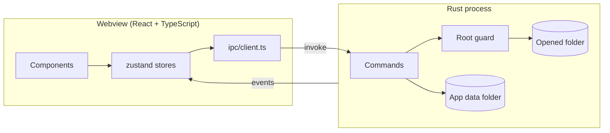

# Architecture

IGrasp is a [Tauri v2](https://tauri.app) application: a Rust process owns the window, the file
system and all background work; a React frontend running in the system webview (WebView2 on
Windows, WebKitGTK on Linux) renders the user interface.

_This page is completed as the phase 1 components land._
