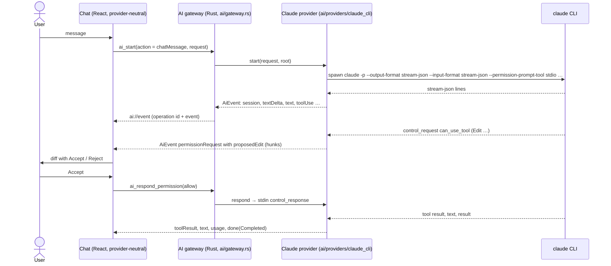

# AI chat (proof of concept)

> Built on the `poc-claude-cli` branch before Phase 3 to validate [ADR 0014](../decisions/0014-claude-cli-integration.md)
> (Claude through its CLI) and [ADR 0015](../decisions/0015-ai-provider-abstraction-and-gateway.md)
> (provider abstraction and the "no token without a user action" gateway). The full feature
> (chat history, model persistence, CLAUDE.md context, region capture, inline diff in the
> preview, the "AI provider" setting) is Phase 3 work.

IGrasp talks to an **AI provider** behind one abstraction. The only provider today is **Claude,
through the Claude Code CLI installed by the user**, spawned in the open folder with the user's
own login. Nothing is bundled and no API key is stored by the app. The chat never names the
provider in its code: the name, version, account, model list and capabilities all come from the
provider's status.

## Using it

- **Open**: the sparkles button in the toolbar, **View → AI Chat**, or `Ctrl+Alt+C` (a folder must
  be open). The chat is a floating panel over the bottom-right corner; the document behind it
  stays readable and clickable.
- **Status line**: the provider's name, version and account, or what is missing (not installed,
  not logged in) with the provider's own instructions and a **Check again** button.
- **Model**: the provider's suggested models (`sonnet`, `opus`, `haiku` for Claude) or a custom
  id. Not remembered yet.
- **Send** with Enter (Shift+Enter for a new line). Every message is one user action that spends
  tokens, and the Send button says so. **Stop** kills the running operation.
- **Permissions**: when the AI wants to edit a markdown file, the proposed change is shown as a
  line diff with **Accept** / **Reject**. Any other tool (running a command, writing another
  file, …) shows the tool name and its input with **Allow** / **Deny**. Reading files inside the
  folder needs no approval. A rejection tells the model why, so it does not retry.
- **New conversation** (+) forgets the session; otherwise every message continues the same
  conversation (the provider's resume id), even after a stop or a crash.
- Accepted edits land on disk through the provider, so the file tree, the open tab and the toasts
  update through the normal live reload.
- Usage (tokens, and cost when the provider reports it) accumulates in the status line.

## How it works

| Piece | Where |
|---|---|
| Neutral contracts (`AiRequest`, `AiEvent`, `AiCapabilities`, `AiProviderStatus`, …) | `src-tauri/src/ai/types.rs` → `src/ipc/generated/` |
| `AiProvider` / `AiOperation` traits | `src-tauri/src/ai/mod.rs` |
| Gateway: user action required, one operation at a time, cancel on close | `src-tauri/src/ai/gateway.rs` |
| Permission policy: each request's kind (markdown edit, file edit, command, web, other) → Ask / Allow / Deny from `settings.ai.permissions` (snapshot at start); read-only operations refuse every prompt; automatic answers emit `permissionDecided` | `src-tauri/src/ai/policy.rs`, `gateway.rs` |
| Context of a message: instruction files from the root down, then the current file, read through the root guard (32 KB / 96 KB caps); size estimate (bytes / 4, 1 500 tokens per image, small < 20k ≤ medium < 80k ≤ large) | `src-tauri/src/ai/context.rs`, `estimate.rs` |
| Child processes die with the app (job object on Windows) | `src-tauri/src/ai/process.rs` |
| Claude provider: CLI discovery and probes, one process per operation, wire-format mapping | `src-tauri/src/ai/providers/claude_cli/{cli,turn,protocol}.rs` |
| Rust mock provider (gateway tests) | `src-tauri/src/ai/providers/mock.rs` |
| Commands `ai_status` (60 s cache, `force`), `ai_capabilities`, `ai_providers`, `ai_set_provider`, `ai_context`, `ai_estimate`, `ai_start`, `ai_respond_permission`, `ai_cancel` | `src-tauri/src/commands/ai.rs` |
| Event reducer (events → chat items) and line diff | `src/features/ai/timeline.ts`, `diff.ts` |
| Store (status, capabilities, items, pending permissions, operation, usage) | `src/stores/ai.ts` |
| Floating chat panel | `src/features/ai/AiChatDialog.tsx` |
| Mock provider for the browser and the tests | `src/ipc/mock/mockAi.ts` |

In the browser dev mode (`npm run dev`), the mock provider ("Mock AI") answers: mentioning a
fixture file such as `README.md` proposes an edit to it; mentioning "command" asks to run one.
The full list of its scripts is at the top of `src/ipc/mock/mockAi.ts`; it applies the same
permission policy as the Rust gateway.

## Failure handling

| Situation | What happens |
|---|---|
| Provider not installed | Status line shows the provider's install instructions; the composer is disabled. |
| Not logged in | Status line shows the login command; if the login expires later, the provider's own error is shown in the conversation. |
| Process exits without finishing | "Claude stopped unexpectedly (exit code …)" with the last lines of stderr. |
| Stop | The process tree is killed; "Stopped." appears; the next message resumes the conversation. |
| Folder, window or app closed while an operation runs | The operation is cancelled; on Windows the OS also kills the child if the app dies hard. |
| Unknown control request from a newer CLI | Refused with an error response so the CLI never hangs. |

## Testing

- `npm test`: event reducer, diff, the chat against the mock provider (accept, reject, command
  prompt, stop, not installed, not logged in, late login error, new conversation), the
  "no token without a user action" test, and the provider-neutrality scan of the frontend.
- `cargo test`: gateway with the mock provider, protocol mapping on recorded samples, argument
  building, stdin line shapes, CLI probes parsing.
- Against the real CLI (needs a login, costs a few tokens):
  `cargo test --manifest-path src-tauri/Cargo.toml -- --ignored claude_cli::`.
