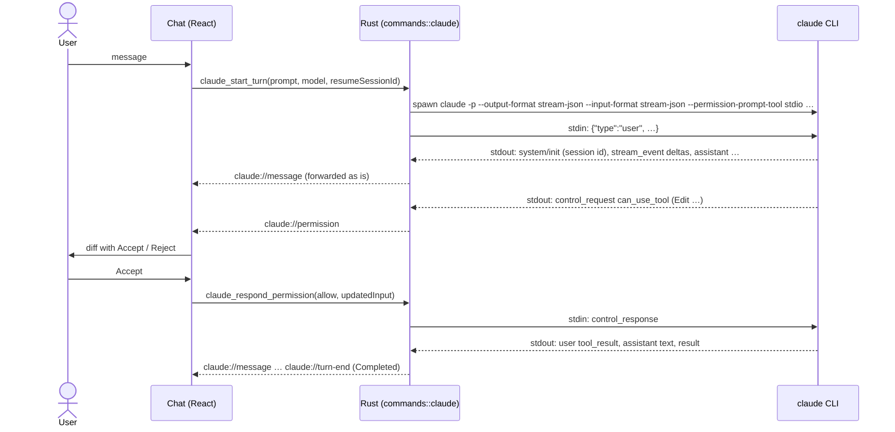

# Claude chat (proof of concept)

> Built on the `poc-claude-cli` branch before Phase 3 to validate the integration described in
> [ADR 0014](../decisions/0014-claude-cli-integration.md). The full feature (chat history, model
> persistence, CLAUDE.md context, region capture, inline diff in the preview) is Phase 3 work.

IGrasp talks to Claude through the **Claude Code CLI installed by the user**, spawned in the open
folder with the user's own login. Nothing is bundled and no API key is stored by the app.

## Using it

- **Open**: the sparkles button in the toolbar, **View → Claude Chat**, or `Ctrl+Alt+C` (a folder
  must be open). The chat is a floating panel over the bottom-right corner; the document behind
  it stays readable and clickable.
- **Status line**: the CLI version and the logged-in account, or what is missing (CLI not
  installed, not logged in) with the command to run and a **Check again** button.
- **Model**: `sonnet` (default), `opus`, `haiku`, or a custom model id. Not remembered yet.
- **Send** with Enter (Shift+Enter for a new line); **Stop** kills the running turn.
- **Permissions**: when Claude wants to edit a markdown file, the proposed change is shown as a
  line diff with **Accept** / **Reject**. Any other tool (running a command, writing another
  file, …) shows the tool name and its input with **Allow** / **Deny**. Reading files inside the
  folder needs no approval, like the CLI's default. A rejection tells the model why, so it does
  not retry.
- **New conversation** (+) forgets the session; otherwise every message continues the same CLI
  session (`--resume`), even after a cancel or a crash.
- Accepted edits land on disk through the CLI, so the file tree, the open tab and the toasts
  update through the normal live reload.

## How it works

| Piece | Where |
|---|---|
| CLI discovery and status (`--version`, `auth status`) | `src-tauri/src/claude/cli.rs` |
| One turn = one process; stdout reader, stdin answers, kill tree | `src-tauri/src/claude/turn.rs` |
| Commands `claude_status`, `claude_start_turn`, `claude_respond_permission`, `claude_cancel` | `src-tauri/src/commands/claude.rs` |
| Protocol reducer (stream → chat items) | `src/features/claude/stream.ts` |
| Line diff and proposed-edit extraction | `src/features/claude/diff.ts`, `edits.ts` |
| Store (status, items, pending permissions, turn) | `src/stores/claude.ts` |
| Floating chat panel | `src/features/claude/ClaudeDialog.tsx` |
| Scripted CLI for the browser and tests | `src/ipc/mock/mockClaude.ts` |

In the browser dev mode (`npm run dev`), mentioning a fixture file such as `README.md` makes the
mock propose an edit to it; mentioning "command" asks to run one.

## Failure handling

| Situation | What happens |
|---|---|
| `claude` not found | Status line explains how to install it; the composer is disabled. |
| Not logged in | Status line shows the command to run; if the login expires later, the CLI's own "Not logged in" result is shown as an error. |
| Process exits without a result | "The Claude CLI stopped unexpectedly (exit code …)" with the last lines of stderr. |
| Stop | The process tree is killed; "Stopped." appears; the session can be resumed by the next message. |
| Folder closed while a turn runs | The turn is cancelled. |
| Unknown control request from a newer CLI | Refused with an error response so the CLI never hangs. |

## Testing

- `npm test`: protocol reducer, diff, and the chat against the scripted CLI (accept, reject,
  command prompt, stop, not installed, not logged in, late login error, new conversation).
- `cargo test`: argument building, protocol parsing, stdin line shapes.
- Against the real CLI (needs a login, costs a few tokens):
  `cargo test --manifest-path src-tauri/Cargo.toml -- --ignored claude::`.
