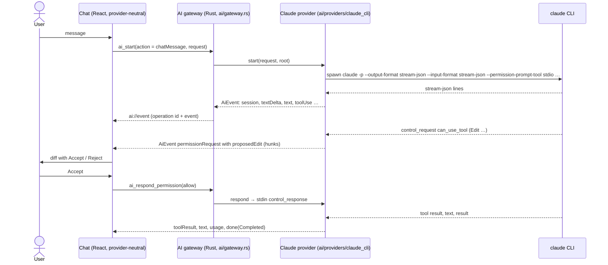

# AI chat (proof of concept)

> Built on the `poc-claude-cli` branch before Phase 3 to validate [ADR 0014](../decisions/0014-claude-cli-integration.md)
> (Claude through its CLI) and [ADR 0015](../decisions/0015-ai-provider-abstraction-and-gateway.md)
> (provider abstraction and the "no token without a user action" gateway). The full feature
> (chat history, model persistence, CLAUDE.md context, region capture, inline diff in the
> preview, the "AI provider" setting) is Phase 3 work.

IGrasp talks to an **AI provider** behind one abstraction. The only provider today is **Claude,
through the Claude Code CLI installed by the user**, spawned in the open folder with the user's
own login. Nothing is bundled and no API key is stored by the app. The chat never names the
provider in its code: the name, version, account, model list and capabilities all come from the
provider's status.

## Using it

- **Open**: the sparkles button in the toolbar, **View → AI Chat**, or `Ctrl+Alt+C` (a folder must
  be open). The chat is a floating panel (default: bottom-right corner, 420 × 560); the document
  behind it stays readable and clickable (`role="dialog"`, `aria-modal="false"`).
- **Move and resize**: drag the header, or focus the title and press `Alt+arrows`; resize from
  any edge or corner (minimum 360 × 320, at most the window), or `Alt+Shift+arrows`. The panel
  stays inside the window when it shrinks. Its place, size and open state are saved per folder in
  the session (app data).
- **Escape** stops a running answer; pressed again (or with nothing running) it closes the panel
  and the focus returns to the AI Chat button. Closing the panel never stops an answer: the status
  bar shows it with **Stop**.
- **Context bar** (above the message box): what the next message carries, from `ai_context`
  (paths and sizes only, no content reaches the frontend): the provider's instruction files
  (`CLAUDE.md`, `CLAUDE.local.md` for Claude; `AGENTS.md` for the mock) from the root down to the
  current file's folder, then the current file (document or code tab; a settings tab adds none),
  with the total size. Hover shows the path, a click opens the file, ✕ leaves a document out of
  the messages sent from this file (+ adds it back; another active tab brings it back). The list
  is computed when the panel opens and when the active tab changes, never on a disk change or a
  timer. On Send, `ai_start` receives the paths still listed and Rust reads their contents
  through the root guard (32 KB per instruction file, 96 KB for the current file; larger ones go
  by path). A region capture (later step) shows as one more chip.
- **Status line**: the provider's name, version and account, or what is missing (not installed,
  not logged in) with the provider's own instructions and a **Check again** button.
- **Model**: the provider's suggested models (`sonnet`, `opus`, `haiku` for Claude) or a custom
  id. The choice is remembered (`settings.ai.model`) and is the default of new conversations; a
  conversation reopened from the history continues with the model it ran with (shown in the
  header).
- **Send** with Enter (Shift+Enter for a new line). Every message is one user action that spends
  tokens, and the Send button says so. **Stop** kills the running operation.
- **Permissions**: when the AI wants to edit a markdown file, the proposed change is shown as a
  line diff with **Accept** / **Reject**. Any other tool (running a command, writing another
  file, …) shows the tool name, a one-line summary and its input (under **Details**) with
  **Allow**, **Deny** and **Allow for this conversation**: the last one also allows the same tool
  for the same kind of permission without asking until New conversation; the header's shield
  button lists these rules, each with a ✕. Reading files inside the folder needs no approval. A
  rejection tells the model "The user rejected this in IGrasp." so it does not retry; a denial by
  the settings says "Denied by the user's IGrasp settings.". Every automatic answer (settings,
  conversation rule, read-only policy) is a line in the transcript: "Allowed by your settings:
  Bash npm test", "Allowed for this conversation: Bash ls".
- **Settings → AI**: the provider's status with **Check again**, the provider (one entry, so
  disabled), the default model, one row per permission category (markdown edits, other file
  edits, commands, web access, anything else) with Ask / Allow / Deny, a sentence each and a
  warning when Allow is chosen for a risky one, **Reset to defaults**, the confirmation threshold
  (from medium, from large, never), the conversations kept per folder (25, 100, 500) and **Forget
  this folder's conversations**. A change applies from the next message.
- **New conversation** (+, `Ctrl+Alt+N` with the panel open) saves the conversation in the
  history and starts an empty one; otherwise every message continues the same conversation (the
  provider's resume id), even after a stop or a crash.
- **History** (clock button, `Ctrl+Alt+H`): this folder's conversations, newest first, with their
  date, model and tokens, a filter box, and **Delete** (with a confirmation). Opening one shows
  its transcript; the next message continues it with its resume id. The app keeps its own copy
  (app data, `conversations/`, written when an operation ends and on New conversation, trimmed to
  `settings.ai.historyLimit` conversations and 400 items, tool calls kept as summaries with the
  first 2 KB of their result), so a conversation stays readable even when the provider has
  forgotten it. Sending into a conversation the provider lost shows its error and **Start a new
  conversation from here** (it spends tokens: it re-sends the message without a resume id, same
  history entry). Settings → AI → **Forget this folder's conversations** deletes them all.
  Listing, opening, deleting and forgetting never start the AI.
- Accepted edits land on disk through the provider, so the file tree, the open tab and the toasts
  update through the normal live reload.
- Usage (tokens, and cost when the provider reports it) accumulates in the status line.

## Region capture

- **Start**: the region button in the toolbar, **View → Ask About a Region**, or `Ctrl+Alt+R`.
  It needs a markdown or code tab and is disabled otherwise. The action only shows the overlay;
  it never calls the provider.
- **Select**: a crosshair covers the tab's scroll area. Drag a rectangle (at least 24 × 24 px),
  or use the keyboard: arrows move a rectangle from the centre, `Shift+arrows` resize it, `Enter`
  captures, `Escape` cancels.
- **Lines**: in a markdown tab every block with a `data-line` marker that the rectangle touches
  gives the range, from the first block's start line to the line before the next block (blank
  separator lines trimmed); in a code tab, the rendered rows. A selection over an image only
  keeps the nearest block's line with an empty text.
- **Screenshot**: after the overlay is removed, the visible part of the tab is rendered with
  `modern-screenshot`, cut to the rectangle plus a 12 px margin, the selection outlined in the
  accent colour, at most 1568 px on the long edge (PNG, JPEG above 1.5 MB). The chip and the
  transcript item show a thumbnail. If it cannot be taken (an image the webview refuses to
  draw, a render error) the text alone is attached with the notice "The screenshot could not be
  taken; the text was attached." A model that cannot read images (`imageInput: false`) gets no
  screenshot, with a notice saying so; switching to such a model before Send drops it too.
- **Result**: the chat opens with a chip ("docs/a.md lines 40–58", ✕ to drop it), the draft
  "About this region:" (an existing draft is kept) and the focus in the message box. Nothing is
  sent until Send, which passes the region with the message; the transcript then shows a
  "Selected region" item right after it, and the history keeps its text and range.

## How it works

| Piece | Where |
|---|---|
| Neutral contracts (`AiRequest`, `AiEvent`, `AiCapabilities`, `AiProviderStatus`, …) | `src-tauri/src/ai/types.rs` → `src/ipc/generated/` |
| `AiProvider` / `AiOperation` traits | `src-tauri/src/ai/mod.rs` |
| Gateway: user action required, one operation at a time, cancel on close | `src-tauri/src/ai/gateway.rs` |
| Permission policy: each request's kind (markdown edit, file edit, command, web, other) → Ask / Allow / Deny from `settings.ai.permissions` (snapshot at start); read-only operations refuse every prompt; automatic answers emit `permissionDecided` | `src-tauri/src/ai/policy.rs`, `gateway.rs` |
| Context of a message: instruction files from the root down, then the current file, read through the root guard (32 KB / 96 KB caps); size estimate (bytes / 4, 1 500 tokens per image, small < 20k ≤ medium < 80k ≤ large) | `src-tauri/src/ai/context.rs`, `estimate.rs` |
| Child processes die with the app (job object on Windows) | `src-tauri/src/ai/process.rs` |
| Claude provider: CLI discovery and probes, one process per operation, wire-format mapping | `src-tauri/src/ai/providers/claude_cli/{cli,turn,protocol}.rs` |
| Rust mock provider (gateway tests) | `src-tauri/src/ai/providers/mock.rs` |
| Commands `ai_status` (60 s cache, `force`), `ai_capabilities`, `ai_providers`, `ai_set_provider`, `ai_context`, `ai_estimate`, `ai_start`, `ai_respond_permission`, `ai_cancel` | `src-tauri/src/commands/ai.rs` |
| Event reducer (events → chat items) and line diff | `src/features/ai/timeline.ts`, `diff.ts` |
| Stores: provider (status, capabilities, model), conversation (items, operation, permissions, usage, history save/load), panel | `src/stores/aiProvider.ts`, `aiConversation.ts`, `aiPanel.ts` |
| History list, saved-item format (`toStoredItems` / `fromStoredItems`) | `src/features/ai/HistoryList.tsx`, `timeline.ts` |
| Floating chat panel: `AiPanel` (geometry, Escape), `StatusLine`, `Transcript`, `PermissionCard`, `Composer`, `ModelPicker` | `src/features/ai/` |
| Panel store (open, rectangle, clamping, draft) | `src/stores/aiPanel.ts` |
| Context bar (`ai_context` on panel open and tab change, ✕ per document, capture chip) | `src/features/ai/ContextBar.tsx`, `src/stores/aiPanel.ts` (`context`, `attachment`) |
| Mock provider for the browser and the tests | `src/ipc/mock/mockAi.ts` |

In the browser dev mode (`npm run dev`), the mock provider ("Mock AI") answers: mentioning a
fixture file such as `README.md` proposes an edit to it; mentioning "command" asks to run one.
The fixture has `AGENTS.md` at its root and in `docs/` (the mock provider's instruction-file name), so
opening `docs/guide/getting-started.md` lists both in the context bar. The full list of its scripts is at the top of `src/ipc/mock/mockAi.ts`; it applies the same
permission policy as the Rust gateway.

## Failure handling

| Situation | What happens |
|---|---|
| Provider not installed | Status line shows the provider's install instructions; the composer is disabled. |
| Not logged in | Status line shows the login command; if the login expires later, the provider's own error is shown in the conversation. |
| Process exits without finishing | "Claude stopped unexpectedly (exit code …)" with the last lines of stderr. |
| Stop | The process tree is killed; "Stopped." appears; the next message resumes the conversation. |
| Folder, window or app closed while an operation runs | The operation is cancelled; on Windows the OS also kills the child if the app dies hard. |
| Unknown control request from a newer CLI | Refused with an error response so the CLI never hangs. |

## Testing

- `npm test`: event reducer, diff, the chat against the mock provider (accept, reject, command
  prompt, stop, not installed, not logged in, late login error, new conversation), the
  "no token without a user action" test, and the provider-neutrality scan of the frontend.
- `cargo test`: gateway with the mock provider, protocol mapping on recorded samples, argument
  building, stdin line shapes, CLI probes parsing.
- Against the real CLI (needs a login, costs a few tokens):
  `cargo test --manifest-path src-tauri/Cargo.toml -- --ignored claude_cli::`.

## Performance

Budgets and what was measured (Chromium against the Vite dev server with the mock backend, Windows
11 dev box, `performance.now()`; the Vitest test `src/features/ai/perf.test.tsx` repeats the
measurements in jsdom with a 3x margin and logs its numbers):

| Budget | Measured | Verdict |
|---|---|---|
| 400-item conversation, one streamed event until the next frame | 16.6 ms median, 18.4 ms worst of 20 (one frame; mounting the 400 items takes 9 ms) | Met; the transcript is not virtualized |
| Block diff of a 5 000-line document, `buildWriteReview` (11 change groups) | 126-162 ms (first call 162 ms, then about 130 ms) | Met (200 ms) |
| Same, `buildEditReview` (one hunk) | 127-135 ms | Met (200 ms) |

The diff time is dominated by parsing the two versions into blocks (`splitBlocks`). Not budgeted,
for information: rendering that 5 000-line diff with `RenderedDiff` shows its first change after
about 0.7 s (the markdown pipeline runs per block); documents over the preview size limit fall
back to the line diff.
