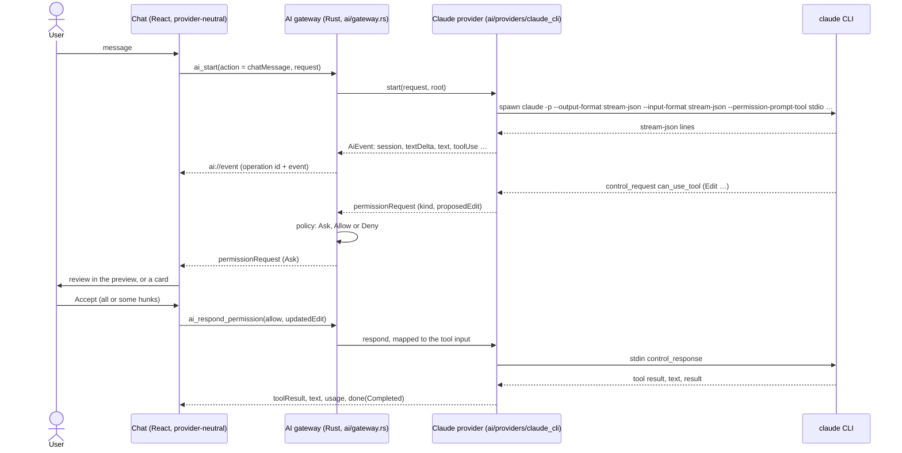

# AI chat

IGrasp talks to an **AI provider** behind one abstraction
([ADR 0015](../decisions/0015-ai-provider-abstraction-and-gateway.md)). The only provider today
is **Claude, through the Claude Code CLI installed by the user**
([ADR 0014](../decisions/0014-claude-cli-integration.md)), spawned in the open folder with the
user's own login. Nothing is bundled and no API key is stored by the app. The chat never names
the provider in its code: the name, version, account, model list and capabilities all come from
the provider's status.

Two rules hold for every AI feature:

1. **No token without a user action.** Every operation starts from an explicit request (Send,
   Start on the confirmation card), never from a watcher, a timer, startup or an event handler.
   Controls that can start one carry a small sparkle with the provider's name in its tooltip.
2. **The provider is replaceable.** Features use the neutral types and the gateway only.

The app never writes inside the opened folder by itself. An accepted edit is written by the
provider, with the input the app sends back.

## Using it

- **Open**: the sparkles button of the **AI tools** toolbar in the top-right corner of the view
  (over every tab, and over the empty area when no tab is open; its selection tools work in
  markdown and code tabs), **View → AI Chat**, or `Ctrl+Alt+C` (a folder must be open). The
  window toolbar has no AI control. The chat is a floating panel (default: bottom-right corner, 420 × 560;
  next to the selection when a selection opens it); the document behind it stays readable and
  clickable (`role="dialog"`, `aria-modal="false"`).
- **Look**: the chat wears the provider's warm accent (`--ai-*` tokens, orange) with a soft
  bloom behind the panel, chat bubbles (yours on the right, the provider's on the left with its
  avatar) and a rounded message box that grows with its text. High Contrast keeps black
  surfaces with orange outlines and no glow.
- **Move and resize**: drag the header, or focus the title and press `Alt+arrows`; resize from
  any edge or corner (minimum 360 × 320, at most the window), or `Alt+Shift+arrows`. The panel
  stays inside the window when it shrinks. Its place, size and open state are saved per folder in
  the session (app data).
- **Header**: the provider's name with one status line under it (version, account, session,
  tokens, and the model the conversation runs with), the model picker, the conversation rules,
  History, New conversation and Close. What is missing (not installed, not logged in) shows
  under the header with the provider's own instructions and a **Check again** button. The
  status is cached for 60 s.
- **Model**: the picker in the header lists exactly the models the provider offers, nothing
  else. For Claude they come from the installed CLI itself, once per CLI version and logged-in
  account (a status check finding a new version or account lists them again): the app starts
  it in stream-json mode from the temporary folder (never the opened folder), sends only the
  `initialize` control request and reads the `models` of its answer (`default`, `opus`,
  `sonnet`, `haiku` and the full ids the account can use, with their names and descriptions as
  tooltips). No message is sent, so no token is spent. Until the CLI has answered, the picker
  offers its default only. `default` is passed to the CLI as no `--model` flag. The choice is
  remembered (`settings.ai.model`) and is the default of new conversations; a remembered model
  the provider no longer offers falls back to its first one. A conversation reopened from the
  history continues with the model it ran with (shown in the status line).
- **Send** with Enter (Shift+Enter for a new line). Every message is one user action that spends
  tokens, and the Send button says so. A message whose estimated size reaches the confirmation
  threshold (Settings → AI, default "large", about 80k tokens) first shows a **confirmation
  card** (provider, model, documents, size class) and starts only on **Start**.
- **Answers** appear in one piece when they are complete, rendered like a document (the
  preview's sanitized pipeline: tables, code, Mermaid diagrams, links); while the provider
  works, three animated dots stand in for it (still under `prefers-reduced-motion`).
- **Stop** kills the running operation and keeps what was received. **Escape** stops a running
  answer; pressed again (or with nothing running) it closes the panel and the focus returns to
  the AI Chat button over the document. Closing the panel never stops an answer: the status bar
  shows it with **Stop**, and a badge when a permission waits.
- **Screen readers**: events of an operation (a tool call, a permission request, the end of an
  answer, a selection attached) reach assistive technology through one polite live region; the
  typing indicator is an image named "… is writing", and the usage line is not a live region of
  its own. The panel comes right after the toolbar in the Tab order. When a card is answered,
  the focus goes to the message box.
- **New conversation** (+, `Ctrl+Alt+N`) saves the conversation in the history and starts an
  empty one; otherwise every message continues the same conversation (the provider's resume id),
  even after a stop or a crash.
- Accepted edits land on disk through the provider, so the file tree, the open tab and the toasts
  update through the normal live reload. Usage (tokens, and cost when the provider reports it)
  is shown under each answer and accumulates in the status line.

## Context

The **context bar** above the message box shows what the next message carries, from `ai_context`
(paths and sizes only; no content reaches the frontend):

- the provider's **instruction files** (`CLAUDE.md` and `CLAUDE.local.md` for Claude; `AGENTS.md`
  for the mock provider) from the root down to the current file's folder;
- the **current file** (a document or a code tab; a settings tab adds none), with the total size.

The selection the message is about, when there is one, is recalled at the top of the chat
([below](#asking-about-a-selection)).

Hover shows the path, a click opens the file, and ✕ leaves a document out of the messages sent
from this file (+ adds it back; another active tab brings it back). The list is computed when the
panel opens and when the active tab changes, never on a disk change or a timer. On Send,
`ai_start` receives the paths still listed and Rust reads their contents through the root guard:
32 KB per instruction file and 96 KB for the current file; larger ones go by path and the model
reads them itself.

## Permissions and settings

Every permission request carries a **kind** set by the provider (markdown edit, other file edit,
command, web, other) and the app decides by the user's settings
([ADR 0019](../decisions/0019-permission-policy-history-and-floating-chat.md)). Reading files
inside the folder needs no approval.

- **Ask** (the default for the five kinds) shows the request in the chat. A markdown edit inside
  the folder is reviewed as a rendered diff ([below](#inline-edit-review)); other edits are a
  line diff with **Accept** / **Reject**. Any other tool shows its name, a one-line summary and
  its input (under **Details**) with **Allow**, **Deny** and **Allow for this conversation**: the
  last one also allows the same tool for the same kind without asking until New conversation;
  the header's shield button lists these rules, each with a ✕.
- **Allow** and **Deny** answer at once, without showing a card. Every automatic answer (settings,
  conversation rule, read-only operation) is a line in the transcript: "Allowed by your settings:
  Bash npm test", "Allowed for this conversation: Bash ls".
- A rejection tells the model "The user rejected this in IGrasp." so it does not retry; a denial
  by the settings says "Denied by the user's IGrasp settings.".
- **Settings → AI**: the provider's status with **Check again**, the provider (one entry, so
  disabled), the default model, one row per permission category with Ask / Allow / Deny, a
  sentence each and a warning when Allow is chosen for commands or non-markdown edits, **Reset
  to defaults**, the confirmation threshold (from medium, from large, never), the conversations
  kept per folder (25, 100, 500) and **Forget this folder's conversations**. A change applies
  from the next message. See [themes-and-settings.md](themes-and-settings.md).

## Inline edit review

A markdown edit inside the folder opens the file's tab in **review mode**: the rendered
document with the removed and added blocks in place, Accept / Reject per change, and a review
bar (Accept all, Reject all, Open in chat, Apply). Only the accepted changes are written. The
chat shows an Edit card with **Review in preview**; with the chat closed, the status bar item
("1 edit to review") leads to the review; both focus the first undecided change. The details are in
[markdown-preview.md](markdown-preview.md#review-mode-an-ai-edit); the diff itself is
[ADR 0017](../decisions/0017-rendered-markdown-diff-at-block-level.md). Edits of other files, of
files outside the folder, of documents too large to render, or whose text is no longer in the
file keep the line-diff card in the chat.

## Asking about a selection

Two tools of the **AI tools** toolbar (top-right corner of a markdown or code tab) point the chat
at part of the document ([ADR 0020](../decisions/0020-viewport-ai-tools-and-text-selections.md)).
They need a markdown or code tab and are disabled otherwise; they only attach a selection and
never call the provider.

- **Text** (cursor button, **View → Ask About Selected Text**, `Ctrl+Alt+S`): a mode, shown
  pressed, with a text cursor and the chat's colour for the selection. Highlight text as in any
  editor; releasing the mouse attaches it. The mode stays on until the button is pressed again
  `Escape` is pressed outside the chat, or another file is opened.
- **Region** (dashed-square button, **View → Ask About a Region**, `Ctrl+Alt+R`): a crosshair
  covers the tab's scroll area. Drag a rectangle (at least 24 × 24 px), or use the keyboard:
  arrows move a rectangle from the centre, `Shift+arrows` resize it, `Enter` captures, `Escape`
  cancels (the focus returns where it was). The size of the selection is announced as it
  changes. One region per use.
- **Lines**: in a markdown tab every block with a `data-line` marker that the selection touches
  (each line box of highlighted text, or the rectangle) gives the range, from the first block's
  start line to the line before the next block (blank separator lines trimmed); in a code tab,
  the rendered rows. A region over an image only keeps the nearest block's line with an empty
  text. **Highlighted text is narrowed** to the source lines that hold it: the rendered text is
  looked up in the block's source without its markup (list and heading marks, emphasis, link
  targets), so four lines highlighted in a long list or paragraph send those four lines, not
  the whole block. When it cannot be found (an unusual construct), the block's lines are sent.
- **Sent as text**: the message carries the source of those lines and, for highlighted text,
  the text exactly as highlighted; the provider is told both. No screenshot is taken.
- **Result**: the chat opens **next to the selection** (beside it, else above or below, narrower
  if needed down to its minimum size, never covering it when there is room), with the draft
  "About this selection:" or "About this region:" (an existing draft is kept) and the focus in
  the message box. The selection stays **highlighted** over the document (its line boxes, and
  the rectangle of a region) while the chat is open, after Send too; closing the chat, another
  tab or a change of the file removes it.
- **Selection line**: one line under the header recalls it ("Selection · lines 3–7 · Start of
  the text…"; hover shows the file), with ✕ to drop it and its highlight.
- **Quick actions** over the message box, while there is a selection: **Rewrite**, **Shorten**,
  **Expand**, **Fix grammar**, **Make a table**, **Make a diagram** (a Mermaid block added after
  the selection) and **Explain**. Each sends one message with the selection attached (it spends
  tokens; the row carries the AI mark); the transcript shows the action's name. All but Explain
  ask for an edit of the file, which goes through the permission settings and the inline review;
  Explain answers in the chat. The editing actions state their scope strictly: the selection is
  exactly the highlighted text (the source lines are context), one edit replaces exactly that
  passage, and every other character of the file stays as it is; Make a diagram only inserts.
  The model is asked, not forced: the review shows any change outside the selection, to reject.
- Nothing is sent until Send or a quick action, which passes the selection with the message; the
  transcript then shows a "Selected text" or "Selected region" item right after it, and the
  history keeps its text, range and highlighted text.

## History

**History** (clock button, `Ctrl+Alt+H`) lists this folder's conversations, newest first, with
their date, model and tokens, a filter box, and **Delete** (with a confirmation). Opening one
shows its transcript; the next message continues it with its resume id.

The app keeps its own readable copy (app data, `conversations/`, never in the folder): written
when an operation ends and on New conversation, trimmed to `settings.ai.historyLimit`
conversations and 400 items each, tool calls kept as summaries with the first 2 KB of their
result. A conversation therefore stays readable even when the provider has forgotten it; the
provider's own transcript remains what the model resumes from. Sending into a conversation the
provider lost shows its error and **Start a new conversation from here** (it spends tokens: it
re-sends the message without a resume id, same history entry). Settings → AI → **Forget this
folder's conversations** deletes them all. Listing, opening, deleting and forgetting never start
the AI.

## How it works

The full flow of a message, with the estimate and the history save, is in
[architecture.md](../architecture.md#sending-a-message).

| Piece | Where |
|---|---|
| Neutral contracts (`AiRequest`, `AiEvent`, `AiCapabilities`, `AiProviderStatus`, …) | `src-tauri/src/ai/types.rs` → `src/ipc/generated/` |
| `AiProvider` / `AiOperation` traits | `src-tauri/src/ai/mod.rs` |
| Gateway: user action required, one operation at a time, cancel on close | `src-tauri/src/ai/gateway.rs` |
| Permission policy: kind (markdown edit, file edit, command, web, other) → Ask / Allow / Deny from `settings.ai.permissions` (snapshot at start); read-only operations refuse every prompt; automatic answers emit `permissionDecided` | `src-tauri/src/ai/policy.rs`, `gateway.rs` |
| Context of a message: instruction files from the root down, then the current file, read through the root guard (32 KB / 96 KB caps); size estimate (bytes / 4, 1 500 tokens per image, small < 20k ≤ medium < 80k ≤ large) | `src-tauri/src/ai/context.rs`, `estimate.rs` |
| Child processes die with the app (job object on Windows) | `src-tauri/src/ai/process.rs` |
| Claude provider: CLI discovery and probes, one process per operation, wire-format mapping, permission kinds, neutral edit → tool input | `src-tauri/src/ai/providers/claude_cli/{cli,turn,protocol}.rs` |
| Rust mock provider (gateway tests) | `src-tauri/src/ai/providers/mock.rs` |
| Commands `ai_status` (60 s cache, `force`), `ai_capabilities`, `ai_providers`, `ai_set_provider`, `ai_context`, `ai_estimate`, `ai_start`, `ai_respond_permission`, `ai_cancel`; conversations | `src-tauri/src/commands/ai.rs`, `appdata/conversations.rs` |
| Event reducer (events → chat items), saved-item format, line diff | `src/features/ai/timeline.ts`, `diff.ts` |
| Stores: provider (status, capabilities, model), conversation (items, operation, permissions, usage, history), panel (geometry, draft, context, attachment) | `src/stores/aiProvider.ts`, `aiConversation.ts`, `aiPanel.ts` |
| Floating panel and its parts: `AiPanel`, `StatusLine`, `SelectionLine`, `Transcript`, `PermissionCard`, `ConfirmCard`, `QuickActions` (prompts in `quickActionPrompts.ts`), `ContextBar`, `Composer`, `ModelPicker`, `HistoryList`; the AI tools over the document (`ViewportToolbar`) | `src/features/ai/` |
| Inline review (rendered diff, change units, composing the accepted result) | `src/features/diff/`, `src/features/ai/InlineEditReview.tsx`, `editReview.ts` |
| Selections: region overlay, text mode, source lines, highlight layer, placement next to the selection (`rectNear`) | `src/features/capture/`, `src/stores/capture.ts`, `src/stores/aiPanel.ts` |
| Mock provider for the browser and the tests | `src/ipc/mock/mockAi.ts` |

The frontend never builds a provider's tool input: it sends the neutral `updatedEdit` (the
accepted hunks, or the composed content of a whole-file write) and the provider maps it.

In the browser dev mode (`npm run dev`), the mock provider ("Mock AI") answers by words of the
prompt: `edit README.md` proposes one change to it, `edit twice README.md` two changes in
different paragraphs, `rewrite README.md` a rewrite, `create notes/new.md` a new file,
`command` asks to run one, and so on (the full list is at the top of `src/ipc/mock/mockAi.ts`).
The fixture has `AGENTS.md` at its root and in `docs/` (the mock provider's instruction-file
name), so opening `docs/guide/getting-started.md` lists both in the context bar. The mock applies
the same permission policy as the Rust gateway.

## Failure handling

| Situation | What happens |
|---|---|
| Provider not installed | Status line shows the provider's install instructions; the composer is disabled. |
| Not logged in | Status line shows the login command; if the login expires later, the provider's own error is shown in the conversation. |
| Process exits without finishing | "Claude stopped unexpectedly (exit code …)" with the last lines of stderr. |
| Stop | The process tree is killed; "Stopped." appears; the next message resumes the conversation. |
| Folder, window or app closed while an operation runs | The operation is cancelled; on Windows the OS also kills the child if the app dies hard. |
| Conversation lost by the provider | The provider's error is shown with **Start a new conversation from here**; the app's copy of the history is intact. |
| An edit that cannot be shown in the preview | The line-diff card in the chat. |
| Unknown control request from a newer CLI | Refused with an error response so the CLI never hangs. |
| The selected file changes while the chat is open (an accepted edit, a change on disk) | The highlight and the selection not yet sent are dropped: their lines no longer match. |

## What the app cannot enforce

- **The CLI's own allow rules.** Rules in the user's `~/.claude/settings.json` or the project's
  `.claude/settings.json` (for example `Bash(npm test)`) let the CLI run those tools without
  asking, so the app's permission settings never see them. They are the user's explicit choices
  for that folder, and every tool call still appears in the chat, so nothing runs invisibly. The
  CLI is started with `--permission-mode default` so a default mode in the user's settings (for
  example `acceptEdits`) cannot bypass the app. See
  [ADR 0019](../decisions/0019-permission-policy-history-and-floating-chat.md).
- **What a command does.** An allowed command runs with the user's rights; the app shows it, it
  does not sandbox it.
- **A hard kill of the app on Linux** can leave the CLI running until it notices its closed
  pipes (on Windows a job object kills it).
- **Linux is not verified yet**: the CLI integration was tested on Windows 11 only (ADR 0014).
  The text mode and the selection highlight were checked in Chromium (browser dev mode and
  Playwright), not yet in WebKitGTK (ADR 0020).

## Testing

- `npm test`: event reducer, line and block diff, the chat against the mock provider (accept,
  reject, command prompt, stop, not installed, not logged in, late login error, new
  conversation, history, context bar, confirmation card, typing indicator, selection line and
  quick actions), the inline review, the selections (region, text mode, highlight, placement), the
  "no token without a user action" test, and the provider-neutrality scan of the frontend.
- `npm run test:e2e`: smoke tests of the panel, the context bar, permissions, the inline review
  (`e2e/ai-review.spec.ts`) and the selections (`e2e/ai-capture.spec.ts`: region, text mode,
  quick action, tooltips above the chat).
- `cargo test`: gateway with the mock provider, the permission policy, context and estimate,
  conversations, protocol mapping on recorded samples, argument building, stdin line shapes, CLI
  probes parsing, and `no_start.rs` (no command but `ai_start` can start an operation).
- Against the real CLI (needs a login, costs a few tokens):
  `cargo test --manifest-path src-tauri/Cargo.toml -- --ignored claude_cli::`.

## Performance

Budgets and what was measured (Chromium against the Vite dev server with the mock backend, Windows
11 dev box, `performance.now()`; the Vitest test `src/features/ai/perf.test.tsx` repeats the
measurements in jsdom with a 3x margin and logs its numbers):

| Budget | Measured | Verdict |
|---|---|---|
| 400-item conversation, one streamed event until the next frame | 16.6 ms median, 18.4 ms worst of 20 (one frame; mounting the 400 items takes 9 ms) | Met; the transcript is not virtualized |
| Block diff of a 5 000-line document, `buildWriteReview` (11 change groups) | 126-162 ms (first call 162 ms, then about 130 ms) | Met (200 ms) |
| Same, `buildEditReview` (one hunk) | 127-135 ms | Met (200 ms) |

The diff time is dominated by parsing markdown into blocks. The old version is parsed in full
(`splitBlocks`); the new one only around its changed lines (`splitBlocksFrom`), which brought
the jsdom numbers from about 225 ms (write) and 180 ms (edit) to 135 ms and 100 ms. Coverage
instrumentation makes the diff 2-3x slower, so CI runs the performance test apart, without
coverage. Not budgeted,
for information: rendering that 5 000-line diff with `RenderedDiff` shows its first change after
about 0.7 s (the markdown pipeline runs per block); documents over the preview size limit fall
back to the line diff.
