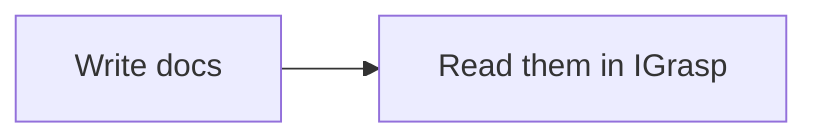

# Mermaid diagrams

Fenced code blocks with the `mermaid` language are rendered as diagrams with the official
[`mermaid`](https://mermaid.js.org) library:

````markdown

````

## Rendering

- Mermaid (the app's largest dependency) is loaded the first time a diagram is shown.
- `securityLevel: 'strict'`: Mermaid sanitizes labels and disables click handlers, so diagrams
  cannot run script.
- Look and themes follow the app theme: Mermaid 12's modern `neo` look with the `redux-color`
  (light) and `redux-dark-color` (dark) themes; High Contrast uses the `base` theme with
  black, white and yellow variables.
- Results are cached per diagram source and theme; switching theme re-renders once.
- A diagram with a syntax error shows the error message and its source instead of breaking the
  page.

## Tools

The toolbar appears when the diagram is hovered or focused, and always in full screen (in the
top-right corner of the window, whatever the diagram's size):

| Tool | Mouse | Keyboard (diagram focused) |
|---|---|---|
| Zoom in / out | Toolbar, or Ctrl + wheel | `+` / `-` |
| Pan | Drag the diagram | — |
| Fit to view | Toolbar | `F` |
| Reset (1:1) | Toolbar | `0` |
| Full screen | Toolbar | `Enter`, `Esc` to leave |
| Copy source | Toolbar | — |

Inline, the mouse wheel scrolls the document; hold Ctrl to zoom the diagram. In full screen, the
wheel zooms directly, by small steps (a touchpad zooms gradually). Full screen is a window-sized overlay (not the OS full-screen mode); focus
returns to the diagram when it closes.

Exporting diagrams as SVG or PNG and the visual editor come in later phases.
