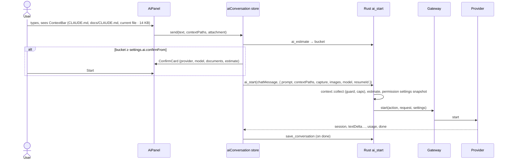
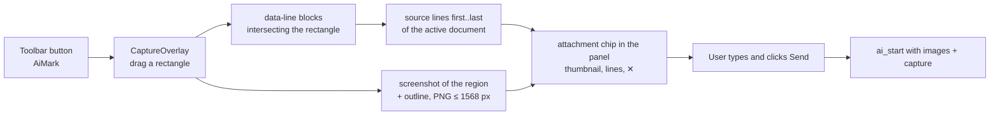

# Phase 3 — Claude implementation plan

Status: **draft for review** · Branch: `phase-3-claude` · Release: `v0.3.0`

Phase 3 turns the proof of concept of the `poc-claude-cli` branch ([ADR 0014](../decisions/0014-claude-cli-integration.md),
[ADR 0015](../decisions/0015-ai-provider-abstraction-and-gateway.md)) into the first AI feature of
the app: a Claude chat about the open project, with the two non-negotiable rules of the
specification enforced in code and in tests (**no token without a user action**, **the provider is
replaceable**), the context of what the user is reading, permission prompts with sane defaults,
proposed markdown edits reviewed as an **inline diff in the preview**, **region capture**, and a
**chat history per folder**. The pieces that the quiz (Phase 4) and the tutorials (Phase 5) will
reuse are built here as shared modules: the "uses AI" marker, the confirmation card with a size
estimate, the usage display and cancel, and the rendered markdown diff.

Everything the app does in this phase stays outside the opened folder, with one exception that
the specification allows: a markdown edit the user **accepts** in the diff UI is written by the
provider, as the direct result of that click.

---

## 1. Scope

### 1.1 In scope (definition of done)

| Area | Deliverable |
|---|---|
| Provider abstraction, finished | The neutral contracts of the proof of concept completed: a **permission kind** on every prompt, a decision that carries a **neutral edit** instead of a tool input, **context documents** with content, **per-model** image input, a **size estimate** type. The gateway picks the provider from the **"AI provider" setting** (Claude only) and refuses a change while an operation runs. Provider id and model are recorded with every conversation. |
| Claude CLI provider | Maps the new contracts (kind classification, edit → tool input, inlined context, per-model capabilities), keeps every protocol shape under test, and is **verified on Linux** (the table of ADR 0014 completed). |
| Mock provider | `src/ipc/mock/mockAi.ts` and `src-tauri/src/ai/providers/mock.rs` speak the finished contracts and script every situation the UI must handle (single hunk, several hunks, whole-file rewrite, new file, command, image, slow answer, resume, read-only refusal, logged out, crash). |
| No token without a user action | The gateway stays the only door and gains the **permission policy**; process lifetime is unchanged (ends with the operation; killed on cancel, new conversation, folder, window and app close). Shared UI: the **"uses AI" marker**, the **confirmation card** with provider, model, what may be read and a small / medium / large estimate, the **usage line** (tokens, cost) and **Cancel** everywhere an operation can run. The **no-call test** covers opening a folder, every view, every tab kind, disk changes, settings, history and region capture, in Vitest and in Rust. |
| Chat modal | A **floating, movable, resizable** chat panel over the viewport (position and size remembered), opened from the toolbar button, **View → AI Chat** and `Ctrl+Alt+C`; status line, model picker (aliases plus free text, **remembered**), streamed answers, tool calls, usage, Stop, New conversation, **history list** of past conversations of this folder. |
| Context | Every message carries the **current file** (document or code tab) and **every instruction file** (`CLAUDE.md`, `CLAUDE.local.md`, …, the names the provider declares) from the file's folder up to the root, read in Rust through the root guard, bounded, shown to the user before sending. |
| Permissions | App defaults: reads inside the folder are free; a **markdown edit asks through the diff UI**; a **command**, a **non-markdown edit**, a **web access** or anything else **always asks**. Settings change the defaults per category (Ask / Allow / Deny). Prompts are answered by the user, by the policy, or by "Allow for this conversation"; every automatic decision is visible in the chat. |
| Inline diff in the preview | A proposed markdown edit opens the document in **review mode**: the rendered preview shows removed blocks red and added blocks green, with **Accept / Reject per change** and **Accept all / Reject all**. Partial acceptance sends the provider only the accepted changes. The **rendered markdown diff** is a shared module (`src/features/diff/`) reused by the Tutorials and Git phases. |
| Region capture | A toolbar button starts a **rectangle selection** over the viewport; the region is captured as a **PNG with the selection outlined**, the **underlying markdown source** of the blocks in the rectangle is extracted, and the chat opens with both attached and the current file as context. Sending is still the user's click. |
| Settings | An **AI** section: provider (Claude), default model, permission defaults, confirmation threshold, history retention. |
| Quality | Rust and Vitest coverage for every new module, Playwright smoke tests for the chat, the inline diff, region capture and the no-call rule, the Linux verification of the CLI integration, docs and README updated, `v0.3.0` released from `main`. |

### 1.2 Explicitly out of scope (later phases)

- Quiz, tutorials, project profile, grounding pipeline (Phases 4 and 5). This phase only makes
  sure their shared pieces exist: the confirmation card, the estimate, the usage display, the
  read-only policy, the `AiUserAction` variants, structured output in the request.
- Editing the document by hand, saving, file management (Phase 6). The only write in the folder
  is an accepted AI edit, performed by the provider.
- Rendered diff between **commits** or against the **last-read snapshot** (Phase 7). The diff
  module is built so that it only needs two markdown strings.
- A second provider. The paper check of ADR 0015 stays on paper; the "AI provider" setting has
  one entry.
- API-key providers and keychain storage.
- A long-lived CLI process (ADR 0014 keeps one process per turn).
- Attaching arbitrary files or images from disk to the chat (region capture is the only image
  source).

---

## 2. What the proof of concept gives us, and what changes

| Existing piece | Phase 3 |
|---|---|
| `ai/types.rs` neutral contracts | **Extended, not replaced** (§3.2): `AiPermissionKind`, `PermissionDecision::Allow { updated_edit }`, `AiRequest.context`, `AiContextDocument`, `AiModel.image_input`, `AiSizeEstimate`, `AiEvent::PermissionDecided`. ts-rs regenerates the TypeScript. |
| `ai/gateway.rs` (user action, one at a time, cancel on close) | Keeps its role; gains the **policy step** before forwarding a prompt, the **provider selector**, the **read-only defence**, and exposes `starts()` to integration tests. |
| `ai/process.rs` (job object), `turn.rs` kill tree, run-loop `cancel_all` | Unchanged. Verified on Linux. |
| `providers/claude_cli/{cli,turn,protocol}.rs` | `protocol.rs` classifies prompts into kinds and maps a neutral edit back to `Edit` / `MultiEdit` / `Write` input; `mod.rs` inlines context documents; capabilities get per-model image input. |
| `providers/mock.rs` (Rust) | New scripts for the gateway and policy tests. |
| `src/ipc/mock/mockAi.ts` | New scripts (§4.3), conversation ids, the `starts` log already used by the tests. |
| `src/stores/ai.ts`, `features/ai/timeline.ts`, `diff.ts` | The store splits into **conversation** (items, usage, resume id, history) and **panel** (open, geometry, composer draft, attachments). `timeline.ts` learns the new events. `diff.ts` (line diff) stays for the chat card and non-markdown edits; the rendered diff is new. |
| `features/ai/AiChatDialog.tsx` | Becomes the floating panel (§6.4): same content, new chrome (drag, resize, history, attachments). |
| `noTokenWithoutAction.test.ts`, `neutrality.test.ts` | Extended (§9). The neutrality scan also covers `src/features/diff/` and `src/features/capture/`. |
| `appdata/` (versioned JSON, atomic writes, recovery) | New `AiSettings` in `settings.json`; new `conversations/` folder with one file per root. |
| `features/preview` (`data-line` markers, `blockForLine`, `MarkdownPreview`, pipeline) | Region capture maps the rectangle to source lines through `data-line`; the rendered diff renders both versions through the same pipeline. |
| `features/titlebar/menuActions.ts`, `shortcuts/keymap.ts` | New actions `ai.capture`, `ai.newConversation`, `ai.history`, `ai.cancel`; actions gain a `usesAi` flag that renders the marker. |
| `components/VirtualRows.tsx` | The history list and the context list. |
| `e2e/ai.spec.ts`, `helpers.ts` | Extended for the new flows. |

---

## 3. Backend design (Rust)

### 3.1 Module layout

```
src-tauri/src/
├─ ai/
│  ├─ mod.rs          AiProvider / AiOperation traits (unchanged), provider registry
│  ├─ types.rs        neutral contracts (extended, §3.2)
│  ├─ gateway.rs      the single door: provider selection, policy, one operation at a time
│  ├─ policy.rs       NEW permission policy: kind × settings → Ask | Allow | Deny
│  ├─ context.rs      NEW instruction files up to the root, bounded document contents
│  ├─ estimate.rs     NEW size estimate (bytes → approximate tokens → bucket)
│  ├─ process.rs      unchanged
│  └─ providers/
│     ├─ mod.rs
│     ├─ mock.rs      scripted provider for tests (extended)
│     └─ claude_cli/  cli.rs, turn.rs, protocol.rs, mod.rs (extended)
├─ appdata/
│  ├─ settings.rs     + AiSettings, AiPermissionSettings
│  └─ conversations.rs NEW per-root conversation files
├─ commands/
│  └─ ai.rs           + ai_context, ai_estimate, ai_set_provider, conversation commands
└─ state.rs           the gateway is built from the settings
```

### 3.2 Neutral contracts (`ai/types.rs`)

Additions, all exported by ts-rs. Nothing names a provider.

```rust
/// What a permission request would let the AI do; the policy and the UI key on this.
pub enum AiPermissionKind {
    /// Edit or create a markdown file inside the folder (reviewed as a diff).
    MarkdownEdit,
    /// Edit or create any other file inside the folder.
    FileEdit,
    /// Run a command or a script.
    Command,
    /// Fetch a URL or search the web.
    Web,
    /// Read outside the folder, or anything the provider cannot classify.
    Other,
}

// PermissionRequest gains `kind: AiPermissionKind`.

pub enum PermissionDecision {
    /// Run the tool; with `updated_edit`, run it on these hunks only (a subset of the proposed
    /// edit, or the whole-file content composed by the user). The provider maps it back to its
    /// own tool input; the frontend never builds a tool input.
    Allow { updated_edit: Option<ProposedEdit> },
    Deny { message: String },
}

/// Emitted when the policy or a "for this conversation" rule answered without asking.
AiEvent::PermissionDecided { tool: String, kind: AiPermissionKind, allowed: bool, reason: String }

/// A document the user is looking at, with its content when small enough.
pub struct AiContextDocument {
    pub path: String,          // root-relative
    pub role: AiContextRole,   // CurrentFile | InstructionFile | Capture
    pub content: Option<String>,
    pub bytes: u64,
    pub truncated: bool,
}

// AiRequest: `context_files: Vec<String>` becomes `context: Vec<AiContextDocument>`;
// `capture: Option<AiCapture>` is added for region capture:
pub struct AiCapture { pub source_path: String, pub first_line: u32, pub last_line: u32, pub text: String }

// AiModel gains `image_input: bool` (varies by model); AiCapabilities.image_input stays as
// "at least one model accepts images".

pub struct AiSizeEstimate {
    pub bytes: u64,
    pub approx_tokens: u64,   // bytes / 4, plus a flat cost per image
    pub bucket: AiSizeBucket, // Small (< 20k) | Medium (< 80k) | Large
    pub documents: u32,
    pub images: u32,
}
```

`AiUserAction` keeps its five variants. `AiPolicy` keeps `Interactive | ReadOnly`.

### 3.3 Gateway (`ai/gateway.rs`)

- **Provider selection.** `AiGateway::from_settings(&Settings)` builds the provider named by
  `settings.ai.provider` through a small registry in `ai/mod.rs` (`provider_ids()`,
  `build(id)`); unknown ids fall back to `claude-cli` with a warning. `set_provider(id)` swaps the
  boxed provider under the lock and fails with `AppError::Ai` while an operation runs. The
  frontend gets the provider list for the setting from `ai_providers()` (ids and display
  names, no probe, no token).
- **Policy step.** `start` takes an `AiPermissionSettings` snapshot (from the settings at that
  moment, so a settings change never alters a running operation) and the request's policy. The
  sink wrapper intercepts every `PermissionRequest` before it reaches the frontend:
  - `ReadOnly` policy: anything that is not a read is **denied** with a message ("read-only
    operation"), whatever the provider already enforced through its own flags (defence in
    depth; the provider's flags remain the first line).
  - Otherwise `policy::decide(kind, &settings)` → `Ask` forwards the event; `Allow` answers the
    provider and emits `PermissionDecided { allowed: true, reason: "allowed by your settings" }`;
    `Deny` answers with a message the model sees and emits `PermissionDecided { allowed: false }`.
  - A **markdown edit outside the folder** or without a `proposed_edit` is treated as `Other`.
- **Conversation rules.** "Allow for this conversation" lives in the frontend (it is a UI
  convenience over the same `respond` call); the gateway does not keep state across operations
  beyond the running one. Rationale: the gateway stays stateless and testable, and the rule is
  bound to the conversation shown on screen, not to the process.
- **Observability.** `starts()` becomes `pub` (behind `#[cfg(any(test, debug_assertions))]`) so
  the state-level integration test (§9) can assert zero starts; every start is logged with the
  action, provider, model, policy and estimate bucket.

### 3.4 Permission policy (`ai/policy.rs`)

```rust
pub enum PermissionRule { Ask, Allow, Deny }

pub struct AiPermissionSettings {
    pub markdown_edits: PermissionRule, // default Ask (the diff UI)
    pub file_edits: PermissionRule,     // default Ask
    pub commands: PermissionRule,       // default Ask
    pub web: PermissionRule,            // default Ask
    pub other: PermissionRule,          // default Ask
}

pub fn decide(kind: AiPermissionKind, s: &AiPermissionSettings) -> PermissionRule
```

Pure, fully tested. Reads inside the folder never reach the policy because providers do not
prompt for them (and the Claude CLI does not). The settings UI explains each category in one
sentence and shows a warning next to **Allow** for commands and non-markdown edits.

What the app cannot enforce: the CLI's own allow rules from the user's `~/.claude/settings.json`
or the project's `.claude/settings.json` (for example `Bash(npm test)`) bypass the prompt inside
the CLI. They are the user's explicit choices for that folder; the app documents this in the
feature page and shows every tool call in the chat anyway (`ToolUse` events), so nothing runs
invisibly.

### 3.5 Context (`ai/context.rs`)

`fn collect(guard: &RootGuard, current: Option<&str>, names: &[String], caps: Caps) -> Vec<AiContextDocument>`

- Walks from the current file's folder up to the root and, for each folder, checks each name
  from `AiCapabilities.context_file_names` (`CLAUDE.md`, `CLAUDE.local.md` for Claude) on disk
  through the root guard (a `.gitignore`d `CLAUDE.local.md` is not in the index, so this does
  not rely on the index). Order: root first, then down to the file's folder, then the current
  file last, so the model reads the general rules before the specific ones.
- Reads the content when `bytes <= cap` (instruction files 32 KB, current file 96 KB; both
  settings-free constants), else `content: None, truncated: true` and the provider asks the
  model to read the path itself. Non-UTF-8 or binary current files (a code tab on an image is
  impossible, but a `.bin` is) are listed by path only.
- Never writes, never follows symlinks out of the root (the guard refuses), never runs anything.
- Two steps, both in Rust. The frontend calls `ai_context(currentPath)` **when the panel opens
  or the active tab changes** and shows the list it gets back ("Context: CLAUDE.md,
  docs/CLAUDE.md, docs/plan/phase-3.md · 14 KB"), paths and sizes only. When the user sends,
  the frontend passes the paths still in the list (a document removed with its ✕ is left out for
  that message) and `ai_start` reads their contents through the same function. The contents never
  travel to the frontend, and the user sees exactly what will be sent.

### 3.6 Size estimate (`ai/estimate.rs`)

`fn estimate(prompt_bytes, &[AiContextDocument], images: u32) -> AiSizeEstimate`: bytes of the
prompt and of every document (full size, even when truncated: the model will read it), 4 bytes
per token, 1 500 tokens per image, buckets Small < 20k, Medium < 80k, Large. No file is read
that `collect` did not already read; sizes come from metadata. The thresholds are constants
with a comment; the quiz will reuse the function with its own inputs.

### 3.7 Claude provider changes

- `protocol.rs`: `permission_kind(tool, input, root)`: `Edit` / `MultiEdit` / `Write` /
  `NotebookEdit` on a `.md` / `.markdown` inside the root → `MarkdownEdit`, other paths inside
  the root → `FileEdit`, `Bash` / `Task` / `KillShell` → `Command`, `WebFetch` / `WebSearch` →
  `Web`, everything else (including an edit outside the root and MCP tools) → `Other`.
  `tool_input_for(tool, original_input, &ProposedEdit) -> Value`: `Edit` → `old_string` /
  `new_string` of the single accepted hunk; `MultiEdit` → the `edits` array filtered to the
  accepted hunks (same order); `Write` → `content` replaced by the composed content. An
  `updated_edit` with zero hunks is impossible (the frontend sends `Deny` instead) and is treated
  as a deny with the standard message if it ever arrives.
- `mod.rs`: `prompt_with_context` inlines each document with content as a fenced block headed by
  its path and role, lists truncated ones as paths to read, appends the capture text with its
  line range when present; images go through the existing content blocks. Capabilities:
  `models` = `sonnet`, `opus`, `haiku` (labels from the CLI aliases), each with
  `image_input: true`; a custom id is assumed to accept images, and an image refused by the model
  surfaces as the CLI's error result.
- `turn.rs`: adds `--permission-mode default` explicitly (the policy lives in the app), keeps
  the read-only tool lists, caps the stdin message at 4 MB (images are downscaled by the frontend
  to fit well under it).
- `cli.rs`: the status probe result is cached for 60 s per gateway (a status check costs two
  processes); **Check again** bypasses the cache.
- **Linux verification**: the two `#[ignore]` tests and the three manual probes of the ADR 0014
  table run on a Linux machine (or a container with the CLI and a login) before step 24; the
  table in the ADR is completed with the results.

### 3.8 App data

`settings.json` (version stays 1; new fields have serde defaults):

```jsonc
"ai": {
  "provider": "claude-cli",
  "model": "sonnet",                 // last choice of the picker (empty = provider default)
  "permissions": { "markdownEdits": "ask", "fileEdits": "ask", "commands": "ask", "web": "ask", "other": "ask" },
  "confirmFrom": "large",            // show the confirmation card from this bucket ("medium" | "large" | "never")
  "historyLimit": 100                // conversations kept per folder
}
```

`conversations/` folder (new `appdata/conversations.rs`): `index.json` maps each canonical root
path to a file id (`c0001`, …); `c0001.json` holds `{ version, root, conversations: [...] }`.
One conversation:

```jsonc
{
  "id": "ulid-like string", "title": "first user message, 80 chars",
  "createdMs": 0, "updatedMs": 0,
  "providerId": "claude-cli", "model": "claude-sonnet-4-5" /* from the Session event */,
  "resumeId": "opaque", "usage": { "inputTokens": 0, "outputTokens": 0, "costUsd": null },
  "items": [ /* ChatItem[]: user, assistant, tool (summary, result, isError), capture (thumbnail path omitted), permission outcomes, notices */ ]
}
```

Written **once per operation end** (not per delta) and on New conversation; trimmed to
`historyLimit` conversations and 400 items per conversation; a conversation is never written
inside the opened folder. The CLI owns the real transcript (`--resume`); the app's copy is what the
user sees in the history, so a conversation remains readable even if the CLI's session is gone,
and sending into it then fails with the CLI's own error ("No conversation found") shown with a
**Start a new conversation from here** button that re-sends with no resume id.

Capture thumbnails are not stored (the PNG stays in memory for the operation); the history shows
the capture's text and line range.

### 3.9 Errors

New `AppError` uses (no new variants): `Ai` for policy and provider errors, `InvalidPath`
through the guard for context paths, `Io` for conversation files (recovered like the other app
data files, with `appdata://recovered`).

---

## 4. IPC contracts

### 4.1 Commands

| Command | In | Out | Notes |
|---|---|---|---|
| `ai_status` | — | `AiProviderStatus` | Unchanged; cached 60 s, `force: bool` bypasses. |
| `ai_capabilities` | — | `AiCapabilities` | Per-model `imageInput`. |
| `ai_providers` | — | `AiProviderInfo[]` (`id`, `displayName`) | For the setting. No probe. |
| `ai_set_provider` | `id` | `Settings` | Fails while an operation runs. |
| `ai_context` | `currentPath: string \| null` | `AiContextDocument[]` | Paths, sizes, roles; contents are not sent to the frontend (they are re-read by `ai_start`). |
| `ai_estimate` | `AiEstimateInput { promptBytes, contextPaths, images }` | `AiSizeEstimate` | Metadata only. |
| `ai_start` | `action`, `AiStartRequest { prompt, model?, resumeId?, contextPaths, capture?, images, policy, outputSchema? }` | operation id | Rust collects the documents from `contextPaths` (guard, caps), builds `AiRequest`, snapshots the permission settings, starts. |
| `ai_respond_permission` | `operationId`, `requestId`, `PermissionDecision` | — | `Allow.updatedEdit` is a neutral `ProposedEdit`. |
| `ai_cancel` | `operationId` | — | Unchanged. |
| `list_conversations` | — | `ConversationSummary[]` (id, title, updatedMs, model, usage) | Current root. |
| `get_conversation` | `id` | `Conversation` | |
| `save_conversation` | `Conversation` | — | Upsert; trims. |
| `delete_conversation` | `id` | — | |
| `update_settings` | `SettingsPatch` | `Settings` | Patch gains `ai?: AiSettingsPatch`. |

### 4.2 Events

`ai://event` carries the extended `AiEvent` (new `permissionDecided`, `permissionRequest.kind`).
No new event name. `appdata://recovered` may name `conversations/c0001.json`.

### 4.3 Frontend IPC layer and mock

- `ipc/types.ts` adds the methods above to `Backend`; `ipc/tauri.ts` wires them; the generated
  types are regenerated by `cargo test`.
- `ipc/mock/mockAi.ts` implements the same contracts and the policy (the mock backend must
  behave like Rust, so the mock gateway applies `settings.ai.permissions` and the read-only
  defence too). Scripts, keyed on words in the prompt, with the fixture project:
  - `edit README.md` → one `Edit` hunk (kind `markdownEdit`);
  - `edit twice README.md` → `MultiEdit` with two hunks in different paragraphs;
  - `rewrite README.md` → `Write` of a new whole content changing three blocks;
  - `create notes/new.md` → `Write` of a file that does not exist;
  - `edit src/main.ts` → `fileEdit` kind, no proposed diff in the preview (line diff card);
  - `command` → `Bash` (kind `command`); `fetch` → `web`;
  - `image` → acknowledges an attached image with its byte size (asserts `images.length`);
  - `slow` → ten deltas over two seconds (cancel tests); `crash` → `Done { Failed }`;
  - a prompt in a conversation with a `resumeId` the mock does not know → the "No conversation
    found" error (history fallback test);
  - `policy: readOnly` plus any writing script → the write is auto-denied (`permissionDecided`).
  - `window.__igraspMock.state.ai`: `installed`, `loggedIn`, `starts` (actions), `conversations`,
    `lastRequest` (the `AiRequest` the mock received, so tests assert context and images).
- `mock/index.ts` stores conversations and `settings.ai` in memory like the other app data.

---

## 5. Frontend architecture

### 5.1 Component tree (additions in bold)

```
App
├─ TitleBar / Toolbar
│  ├─ AI Chat button (AiMark) ─ existing
│  └─ **Region capture button (AiMark)**
├─ WorkspaceLayout
│  ├─ Main area
│  │  ├─ DocumentTab
│  │  │  ├─ Rendered (existing)
│  │  │  └─ **InlineEditReview** (review mode: RenderedDiff + ChangeToolbar + ReviewBar)
│  │  └─ **CaptureOverlay** (rectangle selection over the viewport, portal)
│  └─ StatusBar
│     └─ **AiActivityItem** ("Claude is working… · Stop", pending prompt badge)
├─ **AiPanel** (floating, draggable, resizable; replaces AiChatDialog)
│  ├─ PanelHeader (title with provider name, history button, new conversation, close; drag handle)
│  ├─ StatusLine (existing: status, version, account, Check again)
│  ├─ **HistoryList** (VirtualRows: past conversations, delete, filter)
│  ├─ Transcript (Message, ToolItem, **PermissionDecidedItem**, **CaptureItem**, **UsageLine**)
│  │  ├─ PermissionCard (non-edit prompts: Allow / Deny / **Allow for this conversation**)
│  │  └─ **EditCard** (markdown edits: summary, "Review in preview", Accept all / Reject all; full line diff for non-markdown or outside-root edits)
│  ├─ **ConfirmCard** (shared: what, provider + model, what may be read, estimate bucket, Start / Cancel)
│  ├─ **ContextBar** (documents that will be sent, size, ✕ per document, **capture attachment chip** with thumbnail)
│  └─ Composer (textarea, ModelPicker, Send with AiMark, Stop)
└─ SettingsTab
   └─ **AI section** (provider, default model, permission defaults, confirmation threshold, history limit, "Forget this folder's conversations")
```

Shared modules:

- `src/components/AiMark.tsx`: the small sparkle marker with the tooltip "Uses AI (Claude)"
  (name from the status). Used by every control that starts an operation and by menu items whose
  action has `usesAi: true`.
- `src/features/ai/ConfirmCard.tsx`, `UsageLine.tsx`, `CancelButton.tsx`: props only (no store
  coupling) so the quiz and tutorials can embed them.
- `src/features/diff/`: `blocks.ts` (markdown → top-level blocks with line ranges, via
  `remark-parse` which is already a dependency), `blockDiff.ts` (LCS over normalized block text
  with the `diff` package → `same | removed | added | changed` groups, each with its old and new
  line ranges), `RenderedDiff.tsx` (renders both versions through the existing pipeline and
  composes the groups, red and green), `changes.ts` (groups ↔ hunks mapping and composition of
  the accepted result).
- `src/features/capture/`: `CaptureOverlay.tsx`, `capture.ts` (rectangle → `data-line` blocks →
  source line range and text), `screenshot.ts` (DOM region → PNG with outline).

### 5.2 Stores

| Store | Role |
|---|---|
| `ai` (existing, split) | **`aiProvider`**: status, capabilities, checking, model (persisted through settings), providers list. **`aiConversation`**: id, items, resumeId, usage, operationId / starting / buffered, permissions pending, conversation rules ("allow Bash for this conversation"), `pendingReview` (the markdown edit under review: requestId, path, proposedEdit, old content), history summaries, `load(id)`, `save()` after `done`, `newConversation()`. **`aiPanel`**: open, geometry `{ x, y, w, h }` (persisted in the session's layout, clamped to the window), composer draft, attachment (capture: png, text, lines, sourcePath), context documents and the ones removed for the next message, confirm state. |
| `settings` | `ai` sub-object; the model picker writes `settings.ai.model`. |
| `tabs` | A document tab gets an optional `review` flag read from `aiConversation.pendingReview` (derived, not stored): `DocumentTab` renders `InlineEditReview` when a pending markdown edit targets its path. Opening the review focuses or opens the tab (preview tab semantics). |
| `session` | Saves the panel geometry and `open` per folder. |
| `eventBridge` | Routes `ai://event` to `aiConversation.onEvent` (unchanged entry point). |

### 5.3 Data flows

**Sending a message with context**



**A markdown edit reviewed in the preview**

```mermaid
sequenceDiagram
  participant Pr as Provider
  participant G as Gateway (policy)
  participant S as aiConversation
  participant T as DocumentTab (review mode)
  actor User
  Pr-->>G: permissionRequest { kind: markdownEdit, proposedEdit }
  G->>G: decide(markdownEdit) = Ask (default)
  G-->>S: permissionRequest
  S->>S: pendingReview = { path, proposedEdit, oldContent (documents store) }
  S->>T: open or focus the tab of path
  T->>T: RenderedDiff(old, new) with ChangeToolbar per group
  User->>T: Reject change 2, Accept all remaining
  T->>S: respond(Allow { updatedEdit: accepted hunks })
  S->>G: ai_respond_permission
  G->>Pr: respond → provider maps to its tool input
  Pr->>Pr: writes the file (the user's click)
  Pr-->>S: toolResult, text, done
  Note over T: live reload shows the written file; review mode ends
```

**Region capture**



---

## 6. Feature details

### 6.1 "Uses AI" marker

- `AiMark` renders a 12 px sparkle with `aria-label="Uses AI"` and a tooltip "Uses AI (Claude)".
  Placed on: the AI Chat toolbar button (opening the panel is free, but the button leads to
  spending: the marker says "this is the AI feature"; the tooltip says "Opening the chat is free;
  sending a message uses Claude"), the Send button, the region capture button, the ConfirmCard's
  Start button, "Start a new conversation from here", and every menu item whose action has
  `usesAi: true` (`ai.capture`; `ai.chat` has `aiFeature: true` and shows the marker with the
  "free to open" tooltip).
- A Vitest test renders the menu bar and the toolbar and asserts that every action flagged
  `usesAi` shows the marker and that no unflagged control does.

### 6.2 Confirmation card and size estimate

- `ConfirmCard { title, provider, model, documents: { path, bytes }[], images, estimate, onStart,
  onCancel }`: "Claude (sonnet) will read 3 documents (14 KB) and 1 image · Medium". Nothing is
  started before **Start**; Escape cancels.
- The chat shows it when the estimate bucket is at or above `settings.ai.confirmFrom`
  (default **large**, so a normal chat message never shows it). The quiz and tutorials will show
  it always, with their own inputs.
- The estimate comes from `ai_estimate`, computed in Rust from metadata (§3.6), so the frontend
  never reads files to count bytes.

### 6.3 Usage display, cancel, and the running indicator

- `UsageLine` under each assistant answer: "1 200 in · 80 out · $0.003 · 4.2 s" (cost only
  when reported); the panel header shows the conversation total. Hidden when the provider does
  not report usage (`capabilities.usageReporting`).
- **Stop** in the composer (existing), **Cancel** in the ConfirmCard, and `ai.cancel` action
  (`Escape` while the panel has focus and an operation runs, after confirming nothing else owns
  Escape).
- The panel can be closed while an operation runs (the operation belongs to the user's action,
  not to the window): the status bar shows **`AiActivityItem`** "Claude is working…" with a Stop
  button and a badge when a permission waits; clicking it reopens the panel. Closing the folder
  still cancels.

### 6.4 Chat modal

- An in-page **floating panel** (not a second OS window; §15 Q1): `position: fixed`, draggable
  by its header with pointer events (no library), resizable from its edges and corner (min
  360 × 320, max the window), kept inside the window on resize, geometry saved per folder in
  the session (default bottom-right, 420 × 560). `role="dialog"`, `aria-modal="false"`: the
  document stays usable (the inline review needs it).
- Header: provider name and model, **History** (toggles the list), **New conversation**,
  **Close**. Transcript, context bar, composer as today.
- Keyboard: `Ctrl+Alt+C` toggles; `Escape` closes when nothing runs, stops the operation when
  one runs (first press stops, second closes); focus returns to the toolbar button.
- Markdown in answers is rendered with the existing pipeline (sanitized), code blocks
  highlighted; links in answers open like preview links (internal ones in the app).

### 6.5 Model selection

- `ModelPicker`: the provider's models (`sonnet`, `opus`, `haiku` with labels) and **Custom…**
  revealing a text field (validated like the provider: letters, digits, `.-_:/`). The choice is
  written to `settings.ai.model` (debounced) and is the default for new conversations; a loaded
  conversation keeps the model it was started with (the `Session` event's resolved model is shown
  in the header).
- Disabled while an operation runs. Image attachments are refused (with an explanation) when the
  selected model has `imageInput: false`.

### 6.6 Chat history per folder

- **History** list in the panel: conversations of this folder, newest first, title, relative
  date, model, usage; `Delete` per row (confirmation), filter box; `VirtualRows`.
- Selecting one loads its items, resume id, model and usage; sending continues it with
  `resumeId`. The resume failure fallback is §3.8.
- Saved on `done` and on New conversation (if it has at least one user message), trimmed per
  §3.8. Settings → AI → **Forget this folder's conversations** deletes the file for the root.
- `New conversation` cancels the running operation (existing behaviour), saves the previous
  one, starts an empty one.

### 6.7 Context

- `ContextBar` under the transcript lists what the next message carries: instruction files from
  the root down to the current file's folder, then the current file, with sizes and a ✕ to drop
  one for this message (restored on tab change). Hover shows the path; click opens the file.
- Recomputed through `ai_context` when the panel opens and when the active tab changes
  (document or code tab; a settings or shortcuts tab contributes no current file). Never on a
  timer; a disk change refreshes the list only when the panel is open **and** the next
  `ai_context` call happens (opening or tab change), not on `fs://changes`.
- The provider receives the documents' contents inlined (§3.7); the CLI's own loading of the root
  `CLAUDE.md` is left alone (duplication of a few KB is accepted in exchange for a provider-neutral
  mechanism; §15 Q6).

### 6.8 Permission defaults, prompts and settings

- Defaults (§3.4): everything that is not a read inside the folder **asks**. Markdown edits ask
  through the inline diff (§6.9); every other kind through `PermissionCard` (tool name, one-line
  summary, the input pretty-printed and collapsible, **Allow**, **Deny**, **Allow for this
  conversation** which auto-allows the same tool and kind until New conversation and is listed in
  the panel header's "Rules" popover with a ✕).
- Automatic decisions (settings or conversation rules) appear in the transcript as a small
  `PermissionDecidedItem`: "Allowed by your settings: Edit notes.md" / "Denied by your settings:
  Bash npm test". Nothing runs invisibly.
- Settings → AI → **Permissions**: one row per category with Ask / Allow / Deny, a sentence
  explaining the category, a warning icon when Allow is chosen for commands, non-markdown edits,
  web or other, and a **Reset to defaults** button. Changing a setting affects the next
  operation only.
- The rejection message to the model stays "The user rejected this in IGrasp."; the automatic
  one says "Denied by the user's IGrasp settings.".

### 6.9 Inline diff in the preview

- When a `permissionRequest` with `kind: markdownEdit` and a `proposedEdit` inside the root
  arrives: the conversation store records `pendingReview`, loads the current content (from the
  `documents` store when the tab is open, else through `read_markdown`; an absent file means a
  **new file**, old content empty), and opens or focuses the document tab (preview tab
  semantics). `DocumentTab` renders `InlineEditReview` instead of `Rendered`.
- **Change units.** `Edit` and `MultiEdit`: one unit per **hunk**; `Write`: the block-level
  groups of the diff between the current content and the new content. Each unit knows its old
  line range, so it is rendered in place: removed blocks (red background, left bar, strikethrough
  off: content stays readable), added blocks (green). A unit's toolbar (sticky to the group's
  top-right): **Accept** / **Reject**, state shown after the click (✓ / ✗, undo). A top
  `ReviewBar`: "Claude proposes 3 changes to docs/a.md" · **Accept all** · **Reject all** ·
  **Open in chat** · the count of decided units; **Apply** when every unit is decided and at least
  one is accepted; Reject all sends `Deny` immediately.
- **Result.** Accepted hunks → `Allow { updatedEdit: { hunks } }` for `Edit` / `MultiEdit`; for a
  `Write`, `changes.compose(old, groups, accepted)` builds the new content → `Allow { updatedEdit:
  { wholeFile: true, hunks: [{ old: "", new: content }] } }`. All rejected → `Deny`. The provider
  maps it (§3.7). The tab leaves review mode on the decision; the written file arrives through
  live reload; the chat card shows "Applied 2 of 3 changes".
- **Rendered markdown diff module** (shared, §15 Q3): `blocks.ts` splits a document into
  top-level mdast blocks (position lines; front matter and reference definitions are their own
  blocks); `blockDiff.ts` runs `diffArrays` on normalized block texts (collapsed whitespace),
  pairing a removed block followed by an added one as `changed`; `RenderedDiff` renders the old
  and new documents **through the existing pipeline** (sanitized, same slugs, same components),
  cuts both rendered trees at the top-level element boundaries that match block start lines
  (`data-line`; lists and tables get a `data-line` on the container too, a one-line pipeline
  change) and composes: same blocks once (from the new document), removed then added blocks for
  a changed group. Everything stays inside the sanitized tree: the diff adds wrappers, never raw
  HTML. Hunk-to-group attribution: a hunk's old text is located in the old content (first
  occurrence, as the provider would do), its line range overlaps one or more groups; two hunks in
  one paragraph form one unit (explained in the toolbar: "2 edits in this paragraph").
- Fallbacks: a markdown edit **outside the root**, a non-markdown edit, or a file the pipeline
  refuses (over `MAX_RENDERED_CHARS`) uses the existing line-diff card in the chat with
  Accept / Reject of the whole edit. The review also works when the chat panel is closed (the
  status bar badge leads to it).
- Theming: four new tokens (`--diff-added-bg`, `--diff-added-fg`, `--diff-removed-bg`,
  `--diff-removed-fg`) in `src/styles`, checked in the three themes; high contrast adds a
  pattern border so colour is not the only cue; `prefers-reduced-motion` disables the flash.

### 6.10 Region capture

- `ai.capture` (toolbar button with the marker, View → **Ask about a region**, `Ctrl+Alt+R`):
  needs an active document or code tab. `CaptureOverlay` covers the main area with a crosshair
  cursor; the user drags a rectangle (min 24 × 24 px; Escape cancels); on release:
  1. **Text**: every element with `data-line` whose box intersects the rectangle gives the source
     line range (min start line to the next block's start line minus one, or the document end);
     the markdown source is sliced from the `documents` store (code tab: the text file's lines).
     If nothing intersects (an image only), the text is empty and the capture still carries the
     line of the nearest block.
  2. **Screenshot**: `modern-screenshot` (`domToCanvas`) renders the scroll container's visible
     content to a canvas, clipped to the rectangle plus a 12 px margin, draws a 2 px accent
     outline on the selection, downsizes so the long edge is at most 1568 px, exports PNG base64
     (kept under 1.5 MB, else JPEG 0.85). Images served through the asset protocol are drawn
     when the webview allows it (same-origin `asset:`); a failure falls back to a text-only
     capture with a notice ("The screenshot could not be taken; the text was attached.").
  3. The panel opens with an **attachment chip** (thumbnail, "docs/a.md lines 40–58", ✕) and the
     composer pre-filled with "About this region:" and focused. **Nothing is sent** until Send.
- `AiStartRequest.capture { sourcePath, firstLine, lastLine, text }` and `images: [png]` go to
  Rust; the provider inlines the text under "The user selected this region of `<path>` (lines
  40–58); the image shows how it is rendered:" and attaches the image as a content block. The
  capture item in the transcript shows the thumbnail and the line range; the history keeps the
  text only.
- Not done through an OS-level screenshot (§15 Q2): the DOM render is portable, needs no new
  Tauri capability, works on Wayland, and captures exactly what the preview shows.

### 6.11 Settings page: AI section

Provider (segmented, one entry, disabled with "Claude is the only provider for now"), default
model (same picker), permission rows (§6.8), confirmation threshold (Medium / Large / Never),
history limit (25 / 100 / 500), **Forget this folder's conversations**, and the provider status
with **Check again** (reuses `StatusLine`). Every control's help text names the provider through
its display name.

### 6.12 Keyboard and accessibility

| Shortcut | Action |
|---|---|
| `Ctrl+Alt+C` | Toggle the AI chat panel (existing) |
| `Ctrl+Alt+R` | Ask about a region (capture) |
| `Ctrl+Alt+N` | New conversation (panel focused) |
| `Ctrl+Alt+H` | Toggle history (panel focused) |
| `Escape` | Cancel capture; stop the operation / close the panel (§6.4) |
| `Alt+Shift+A` / `Alt+Shift+R` | Accept all / Reject all in review mode (document focused) |
| `Enter` / `Shift+Enter` | Send / new line (existing) |

Review mode: each change unit is a focusable region (`role="group"`, `aria-label="Change 2 of
3: replaced paragraph"`), `Tab` moves between units and their buttons, `A` / `R` on a focused
unit accept / reject, a live region announces decisions. The capture overlay is also operable
by keyboard: arrow keys move a 200 × 120 rectangle from the viewport centre, `Shift+arrows`
resize, `Enter` captures. The floating panel is movable by keyboard from its header
(`Alt+arrows`). The marker, the diff colours and the status badge pass contrast in the three
themes.

### 6.13 Provider status and setup

Unchanged behaviour (not installed, not logged in, late login error) with the 60 s cache; the
settings page and the panel share `StatusLine`. The version is shown so a protocol break is
easy to report.

---

## 7. The two rules: enforcement checklist

| Rule | Code | Test |
|---|---|---|
| Only `ai_start` reaches a provider | `ai::providers` private; `AiGateway` the only owner; `ai_start` the only caller | Rust: `starts() == 0` after open_root, scan, graph build, watcher batch, searches, settings and conversation commands (new `state` test with `MockProvider`); Vitest `noTokenWithoutAction` extended (§9) |
| Process life = operation | `ClaudeTurn::drop`, `cancel_all` on exit / destroy, job object | Existing ignored test on Windows; Linux run |
| Every AI control marked | `usesAi` flag on actions → `AiMark`; direct controls use `AiMark` | Vitest marker test; Playwright checks the tooltip on Send and capture |
| Confirmation before large work | `ai_estimate` → `ConfirmCard` gate in `send` | Vitest: a Large estimate shows the card and `starts` stays empty until Start |
| Usage visible, cancel always | `UsageLine`, Stop, status bar item | Vitest and Playwright (slow script + Stop) |
| Read-only operations stay read-only | provider flags + gateway defence | Rust gateway test; mock TS test |
| Provider neutrality | `neutrality.test.ts` over `features/ai`, `features/diff`, `features/capture`, stores, IPC, mock | Vitest |
| Nothing written in the folder by the app | only the provider writes, only on Allow | Playwright: reject → file unchanged; Rust: `context::collect` and conversations never write under the root (test with a read-only temp root) |

---

## 8. Libraries

### 8.1 Backend

No new crate is required. (`which`, `win32job`, `serde_json`, `tempfile` already cover the needs;
conversation ids are `<updatedMs>-<counter>` strings, no UUID crate.)

### 8.2 Frontend

| Package | Version | Licence | Use |
|---|---|---|---|
| `diff` | 8.0.x | BSD-3-Clause | `diffArrays` for block-level and `diffLines` for line-level diffs (replaces the hand-written LCS in `features/ai/diff.ts`) |
| `modern-screenshot` | 4.6.x | MIT | DOM region → canvas → PNG for region capture |

Pinned exact versions like the rest of `package.json`; both MIT-compatible. Dragging, resizing,
the overlay and the floating panel are written with pointer events (no library).

---

## 9. Testing strategy

- **Rust** (`cargo test`): `policy` (every kind × rule), `context` (walk, caps, ignored
  `CLAUDE.local.md`, symlink out of root refused, missing current file), `estimate` buckets,
  `conversations` (round trip, trim, recovery, index), gateway (policy applied, read-only
  defence, provider swap refused while running, `PermissionDecided` emitted), `protocol`
  (`permission_kind` table, `tool_input_for` for Edit / MultiEdit / Write, inlined context
  prompt), the **state lifecycle no-start test**, ts-rs exports. Ignored: the two real-CLI tests,
  run on Windows and Linux before step 24.
- **Vitest**: `blocks`, `blockDiff`, `changes` (compose, hunk attribution) with a fixture corpus
  (`src/test/fixtures/diff/*.md` pairs: paragraph edit, list item added, heading renamed, table
  row removed, front matter change, whole rewrite, new file); `RenderedDiff` snapshot of the
  group structure; `InlineEditReview` (accept one / reject one / all → the decision sent);
  `capture.ts` (rectangle → lines with a jsdom layout stub); `screenshot.ts` behind an
  interface (jsdom has no canvas: the capture tests inject a fake renderer); `AiPanel` (drag
  clamps, geometry persisted, history load, resume failure fallback, context bar ✕, confirm
  gate, image refused on a model without image input); `aiConversation` (save on done, rules,
  auto-decided items); settings AI section; the marker test; `neutrality.test.ts` with the new
  folders; `noTokenWithoutAction.test.ts` extended: settings tab, shortcuts tab, a code tab, the
  outline and backlinks, the history list, loading a past conversation, changing the model,
  changing permission settings, drawing a capture rectangle (text extracted, image faked),
  switching the active tab with the panel open (context refresh). Only `send` and Start on the
  confirm card add to `starts`.
- **Playwright** (`e2e/ai.spec.ts`, new `e2e/ai-review.spec.ts`, `e2e/ai-capture.spec.ts`):
  send with the context bar listing `README.md`; a `MultiEdit` reviewed in the preview with one
  change rejected → the file shows only the accepted change; Reject all leaves the file
  untouched; a `Write` rewrite with block groups; history: two conversations, reload the first,
  continue it; Stop on the slow script; settings → markdown edits Allow → the next edit is
  applied with a "Allowed by your settings" item; region capture by mouse → chip with line range
  and the mock's `lastRequest` has one image and the capture text; `Ctrl+Alt+R` by keyboard;
  browsing starts nothing (existing, extended).
- **Manual on both OSes** before the release: real CLI chat, an edit accepted in the preview, a
  command denied, capture with an image in the document, panel drag at 150 % DPI, HC theme.

---

## 10. Architecture Decision Records to write

| ADR | Decision |
|---|---|
| 0017 | **Rendered markdown diff at block level**, built from two markdown strings through the existing sanitized pipeline, shared by AI review (Phase 3), tutorial review (Phase 5) and Git diffs (Phase 7); line diff as the fallback. |
| 0018 | **Region capture by rendering the DOM** (`modern-screenshot`) with the `data-line` source mapping, instead of an OS screenshot. |
| 0019 | **Permission policy in the gateway, conversation history owned by the app**: kinds classified by the provider, decisions by the app's settings, the CLI's transcript as the resume source and the app's copy as the readable history; chat as an in-page floating panel. |
| 0014, 0015 | Status updated to Accepted (Linux table completed; "not done in the proof of concept" list resolved with pointers to this plan). |

---

## 11. Documentation to update

- `docs/architecture.md`: `ai/` row (policy, context, estimate), `appdata` row (conversations),
  commands and events tables, a "Sending a message" flow, the state-on-disk list.
- `docs/features/ai-chat.md` rewritten as the feature page (drop "proof of concept"): using,
  context, permissions and settings, inline review, region capture, history, failure handling,
  what the app cannot enforce (§3.4), testing.
- `docs/features/markdown-preview.md` (review mode), `themes-and-settings.md` (AI section,
  diff tokens), `keyboard.md` (§6.12), `tabs-and-session.md` (panel geometry).
- `docs/decisions/README.md` (0017–0019, status of 0014 / 0015), `CLAUDE.md` (new modules,
  the rule that the frontend never builds a tool input, the diff and capture folders),
  `CHANGELOG.md` `[0.3.0]`, `README.md` (features, screenshots of the panel, the inline review
  and a capture; roadmap Phase 3 ticked; requirements unchanged).

---

## 12. Risks and mitigations

| Risk | Mitigation |
|---|---|
| The CLI's hidden `--permission-prompt-tool stdio` protocol changes | Protocol tests on recorded samples; version shown; the chat degrades to the CLI's own errors (ADR 0014). Re-record samples on the CLI version used for the release. |
| `updatedInput` for `MultiEdit` / `Write` is not honoured by some CLI version | The ignored real-CLI test exercises a partial accept. If a CLI version ignores the updated input, the provider falls back to **denying** the tool call with a message that lists the accepted hunks and asks the model to propose exactly those; the app never edits a file itself to repair the result. Decided from the test's outcome before step 17 and recorded in ADR 0019. |
| Block diff attribution of a hunk inside a paragraph is confusing | The toolbar says "2 edits in this paragraph"; the line-diff card in the chat remains available ("Show as text"). |
| `modern-screenshot` cannot draw asset-protocol images on WebKitGTK | Graceful text-only fallback with a notice; manual Linux check; ADR 0018 records it. |
| Floating panel over a resizing window / DPI changes | Geometry clamped on every window resize; reset button in the header menu. |
| Conversation files grow | Trim per §3.8; items store summaries of tool results (first 2 KB). |
| Status probe slow or stuck | Existing timeouts; 60 s cache; probe runs on a blocking thread. |
| A pending prompt while the panel is closed | Status bar badge; the CLI denies on a closed stdin anyway. |
| Linux unverified for the CLI path | Step 24 is a hard gate before the release; CI already runs the non-ignored Rust tests on Ubuntu. |
| The user's own CLI allow rules bypass the app's defaults | Documented; every tool call is visible in the transcript. |

---

## 13. Order of work (small, committable steps)

Each step is one commit (Conventional Commits, `Co-Authored-By` trailer) on `phase-3-claude`,
builds, and passes `npm run check`. Rust commands land **with** their mock implementation and
`Backend` method. "Verify" is what to run or try before committing.

**M0 — Plan**
1. `docs: add phase 3 implementation plan` (this file; answers in §15 after review).

**M1 — Contracts, policy, context, settings (backend first, mock alongside)**
2. `feat(ai): permission kinds and neutral edit decisions` — `AiPermissionKind` on
   `PermissionRequest`, `PermissionDecision::Allow { updated_edit }`, `AiEvent::PermissionDecided`;
   `protocol.rs` `permission_kind` and `tool_input_for`; Rust and TS mocks updated; store and
   cards adapted (the chat still sends whole-edit decisions). Verify: existing chat flows in the
   browser; `cargo test` regenerates the types.
3. `feat(ai): permission policy in the gateway and AI settings` — `policy.rs`, `AiSettings` /
   `AiPermissionSettings` in `settings.rs` with `SettingsPatch.ai`, gateway snapshot and
   decision step, read-only defence, `PermissionDecidedItem` in the transcript; mock gateway
   applies the same policy. Verify: set `commands: allow` in the mock settings → "command" script
   runs with the item shown.
4. `feat(ai): context documents and size estimate` — `context.rs`, `estimate.rs`,
   `AiContextDocument` / `AiCapture` / `AiSizeEstimate`, `AiStartRequest` with `contextPaths`,
   `ai_context`, `ai_estimate`; provider inlines documents; mock returns fixture sizes and
   records `lastRequest`. Verify: the Rust test with a temp root (`CLAUDE.md` at two levels,
   an ignored `CLAUDE.local.md`); the mock's `lastRequest.context`.
5. `feat(ai): provider registry, "AI provider" setting and model persistence` — `ai_providers`,
   `ai_set_provider`, gateway built from settings, `settings.ai.model` written by the picker,
   per-model `imageInput`, 60 s status cache with `force`. Verify: picker survives a restart in
   the browser (mock settings), `ai_set_provider` refused while the slow script runs.
6. `feat(appdata): conversations per folder` — `conversations.rs` (index, files, trim,
   recovery), the four commands, mock storage; Rust tests. Verify: files under the app-data
   folder only.

**M2 — Shared pieces and the no-call tests**
7. `feat(ai): "uses AI" marker on every AI control` — `AiMark`, `usesAi` / `aiFeature` on
   actions, menu and toolbar rendering, marker test.
8. `feat(ai): confirmation card, usage line, cancel and running indicator` — `ConfirmCard`,
   `UsageLine`, `CancelButton`, `AiActivityItem` in the status bar, confirm gate in `send` with
   `confirmFrom`; `settings.ai.confirmFrom`. Verify: set `confirmFrom: medium` and send with a
   large fixture file open → card, nothing starts until Start; close the panel during the slow
   script → status bar item, Stop works.
9. `test(ai): no token without a user action, end to end of the app's lifecycle` — Rust state
   test with `MockProvider` (open, scan, graph, watcher batch, searches, settings, conversations
   → `starts() == 0`); Vitest test extended to every view, tab kind, settings, history and
   model changes. Verify: both suites green; temporarily add a forbidden call to see each test
   fail, then remove it.

**M3 — Chat panel, history, context bar**
10. `feat(ai): floating chat panel with drag, resize and remembered geometry` — `AiPanel`
    replaces `AiChatDialog`, `aiPanel` store, session field, clamping, keyboard move, Escape
    semantics. Verify: drag, resize, restart restores; 150 % DPI.
11. `feat(ai): conversation history per folder` — `aiConversation` split from the store, save on
    done and on New conversation, `HistoryList`, load and continue, delete, resume-failure
    fallback, `Ctrl+Alt+N` / `Ctrl+Alt+H`, "Forget this folder's conversations" in Settings.
    Verify: two conversations with the mock, reload each, continue one.
12. `feat(ai): context bar with the current file and the instruction files` — `ai_context` on
    open and tab change, `ContextBar` with ✕, paths sent with the message, provider prompt
    checked in the Rust test; mock `lastRequest.context`. Verify: open `docs/guide/getting-started.md`
    in the fixture → `CLAUDE.md` entries appear (fixture gains `CLAUDE.md` and `docs/CLAUDE.md`).
13. `feat(ai): permission prompts with conversation rules and the AI settings section` —
    `PermissionCard` with **Allow for this conversation**, rules popover, Settings → AI
    (provider, default model, permissions with warnings, threshold, history limit, status).
    Verify: deny a command, set a rule, the next command runs without a prompt and is listed.

**M4 — Rendered markdown diff and inline review**
14. `feat(diff): markdown blocks and block-level diff` — `blocks.ts`, `blockDiff.ts`, the fixture
    corpus and tests; `diff` dependency; `features/ai/diff.ts` reimplemented on `diffLines`.
15. `feat(diff): rendered markdown diff component` — `RenderedDiff` through the pipeline,
    `data-line` on list and table containers, diff tokens in the three themes, HC pattern,
    reduced motion. Verify: a visual check page in the browser dev mode (`?diff=` query reading
    two fixture files) on the three themes.
16. `feat(ai): inline edit review in the preview` — `pendingReview`, tab focus / open (new
    file case), `InlineEditReview` with `ChangeToolbar`, `ReviewBar`, hunk attribution,
    composition, decisions → `updatedEdit`, keyboard (`A` / `R`, `Alt+Shift+A/R`), chat
    `EditCard` with "Review in preview" and the line-diff fallback. Verify: the three mock
    scripts (one hunk, two hunks, rewrite) and `create notes/new.md`; reject one of two → the
    file has one change.
17. `feat(ai): partial accept mapped to the provider's tool input` — `tool_input_for` wired in
    `turn.rs` `respond`, the ignored real-CLI test extended with a two-hunk `MultiEdit` partially
    accepted; the §12 fallback decided from its result and recorded in ADR 0019. Verify: the
    ignored test on Windows.

**M5 — Region capture**
18. `feat(capture): rectangle selection over the viewport with source line mapping` —
    `CaptureOverlay` (mouse and keyboard), `capture.ts` (`data-line` → lines → text, code tabs),
    `ai.capture` action, toolbar button with the marker, `Ctrl+Alt+R`, attachment chip, composer
    pre-fill; text-only at this step. Verify: select a paragraph and a list → the right lines.
19. `feat(capture): screenshot of the region with the selection outlined` — `screenshot.ts`
    with `modern-screenshot`, outline, downscale, PNG/JPEG budget, fallback notice, thumbnail in
    the chip and the transcript, `images` sent, image refused on models without image input.
    Verify: a capture including an image of the fixture; the mock's `lastRequest.images`; Linux
    manual check with an asset-protocol image.

**M6 — Verification, tests, docs, release**
20. `test: Playwright smoke tests for the chat, the inline review and region capture` — the §9
    list; `e2e/helpers.ts` gains `openChat`, `capture(rect)`, `aiMock` helpers.
21. `feat: accessibility and theme pass for the AI features` — focus order (toolbar → panel →
    document in review), live regions, contrast of the marker, diff colours and badge in the
    three themes, tooltips, reduced motion; Settings help texts through the provider name.
22. `perf: conversation and review budgets` — a 400-item conversation renders in under 50 ms
    per event (virtualized transcript if needed), a 5 000-line document in review mode diffs in
    under 200 ms (measured, recorded in `docs/features/ai-chat.md`).
23. `docs: ADRs 0017–0019, feature pages, architecture, CLAUDE.md, README for 0.3.0` — §10 and
    §11 in full; `CHANGELOG.md` `[0.3.0]`; screenshots.
24. `docs(adr): complete the Linux verification of the Claude CLI integration` — the ADR 0014
    table filled from the Linux run of the ignored tests and probes (and any fix they require,
    in its own `fix(ai):` commit before this one). **Gate for the release.**
25. `chore: release 0.3.0` — version bump in `package.json`, `src-tauri/Cargo.toml`,
    `tauri.conf.json` and lockfiles. Merge to `main` and tag `v0.3.0` happen in the close-phase
    step, after review, when the maintainer asks.

Optional if time allows (after 19): "Show as text" toggle on the inline review; dragging a
capture chip into the composer of a loaded conversation; `confirmFrom: always` for users who
want the card on every message.

---

## 14. Definition of done checklist

- [ ] Every row of §1.1 demonstrable on Windows 11 and Ubuntu 22.04 builds, with the real CLI.
- [ ] ADR 0014 table completed on Linux; ADRs 0014 and 0015 marked Accepted; 0017–0019 written.
- [ ] `npm run check` green on both OSes in CI; e2e suite extended per §9; the two no-call tests
      (Rust and Vitest) and the neutrality scan cover the new code.
- [ ] No write inside the opened folder except an edit the user accepted, performed by the
      provider; no new Tauri capability; the webview never navigates (answers' links go through
      the preview link handling).
- [ ] Settings, conversations and panel geometry live in the OS app-data folder; a corrupt
      conversation file is recovered like the other app-data files.
- [ ] Feature docs, architecture, `CLAUDE.md`, README, CHANGELOG updated; §15 answers recorded.
- [ ] Phase summary given to the maintainer before Phase 4 starts.

---

## 15. Questions for the plan review

| # | Question | Recommendation |
|---|---|---|
| 1 | **Chat as an in-page floating panel** (draggable, resizable, remembered) versus a separate Tauri window. The specification says "a small, modern, movable modal window". | In-page panel: one webview keeps the stores shared, the inline review and region capture need the main document, no second capability set, and it works identically on Windows and Linux (a second window on Wayland cannot be positioned by the app). Record in ADR 0019. |
| 2 | **Region screenshot by rendering the DOM** (`modern-screenshot`) versus an OS-level capture of the window region. | DOM render: portable, no new permission, exact to the preview, and the outline is drawn by us. Limitation: an asset image may be missing on WebKitGTK (text-only fallback). |
| 3 | **Diff granularity**: block-level rendered diff with hunks as change units (Edit / MultiEdit) and block groups for a rewrite (Write), versus word-level highlighting inside blocks. | Block level now; word-level emphasis inside a `changed` pair is a later enhancement of the same module (the Git phase may want it). |
| 4 | **Chat history**: the app keeps its own readable copy per folder in app data and uses the CLI's session only to resume, versus relying on the CLI's transcript files. | Own copy: provider-neutral, survives a deleted CLI session, readable without the provider; small and trimmed. |
| 5 | **Model remembered globally** (`settings.ai.model`) versus per folder. | Global: the specification says "the last choice is remembered"; the conversation records the model it ran with. |
| 6 | **Context delivery**: inline the contents of the current file and the instruction files in the prompt (bounded, provider-neutral) versus listing the paths for the CLI to read (cheaper, but tool calls and provider-specific behaviour). | Inline with caps (32 KB per instruction file, 96 KB for the current file), list beyond. The root `CLAUDE.md` is also loaded by the CLI itself: a few KB of duplication accepted. |
| 7 | **Permission settings granularity**: five categories (markdown edits, other edits, commands, web, other) with Ask / Allow / Deny, versus the specification's three sentences only. | Five categories, with warnings on Allow for the risky ones; defaults equal the specification. |
| 8 | **Confirmation card threshold for chat**: default **large** (a normal message never shows it), configurable to medium or never. | Keep chat frictionless by default; the quiz and tutorials always show the card. |
| 9 | **The CLI's own allow rules** (`.claude/settings.json`) bypass the app's prompts for the tools they allow. Accept and document, or run the CLI with `--settings` pointing at an app-controlled file to neutralize them? | Accept and document: the rules are the user's explicit choices for that folder; every tool call is visible in the transcript. Revisit if users ask for a strict mode. |
| 10 | **Status probe cache** of 60 s (two processes per check otherwise). | Yes; **Check again** bypasses it. |
| 11 | **`Escape` semantics** in the panel: first press stops a running operation, second closes. | Yes, with the composer tooltip saying so. |
| 12 | **Phase 3 writes in the folder**: only through the provider on an accepted edit. The app itself never writes there (not even a review backup). Confirm. | Confirm; the Editing phase introduces the app's own writes. |
