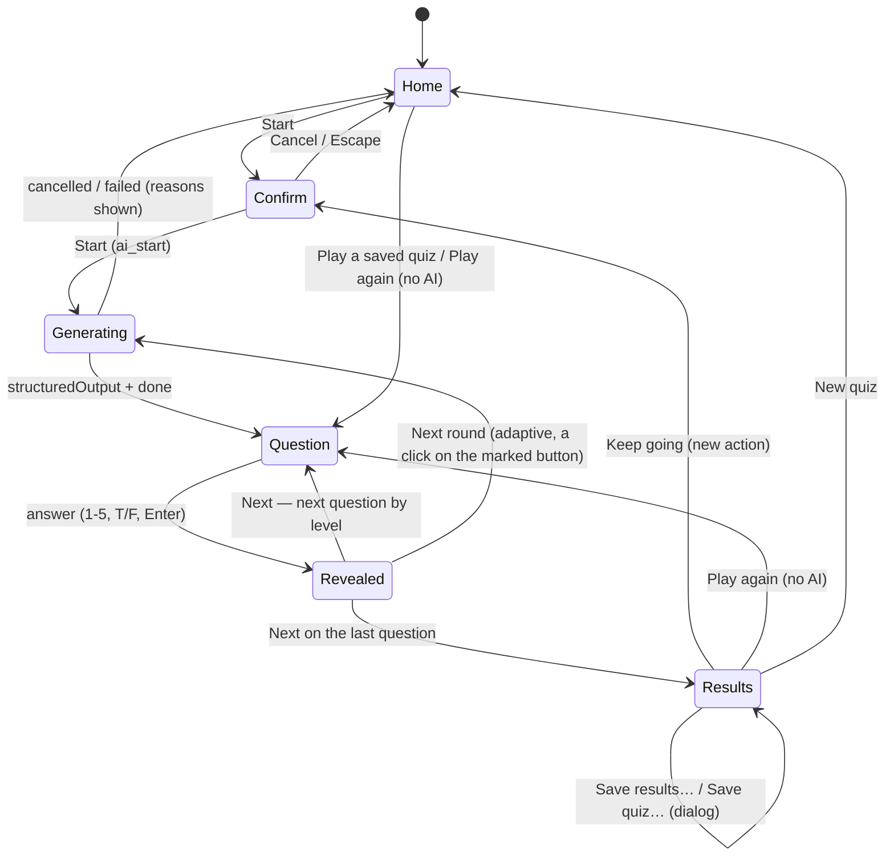

# Phase 4 — Quiz and Hoot implementation plan

Status: **accepted** (§16 answered) · Branch: `phase-4-quiz` · Release: `v0.4.0`

Phase 4 adds the first **learning feature** of the app ([ADR 0016](../decisions/0016-learning-features-grounded-in-the-project.md)):
a quiz about the open project, generated by the AI provider from the **whole project** (code,
configuration, build scripts, tests and docs, not only markdown), played in a **card-based**,
animated experience guided by **Hoot**, an original owl mascot. Every question is about *this*
project and cites its files; nothing generic survives validation.

Everything the quiz needs from the AI exists since Phase 3 and is **reused, not rebuilt**: the
single gateway and its "no token without a user action" rule, the provider abstraction (Claude
through its CLI today, a mock in tests), the "uses AI" marker, the confirmation card with its
size estimate, the usage line and Cancel, the read-only policy and the structured-output request
field. Phase 4 adds what the quiz is the first to need and what Phase 5 (Tutorials) will reuse:
the **project profile** built locally without AI, the **subject proposals** derived from it, the
**grounding pipeline** (provider-neutral prompt and schema, validation, capped retries inside one
operation), **Hoot**, and the quiz UI itself.

The app still writes nothing inside the opened folder on its own. Two explicit user actions of
this phase write there, both through a save dialog: **"Save results…"** (a markdown file of the
results) and **"Save quiz…"** (the quiz itself as a shareable markdown file that teammates can
**replay without the AI**).

---

## 1. Scope

### 1.1 In scope (definition of done)

| Area | Deliverable |
|---|---|
| Project profile (shared module) | `src-tauri/src/profile/`: a walk of the whole folder with the scan's ignore rules, detecting **project kinds** (game, web front end, web back end, mobile, desktop, library, CLI, service, data/ML, infrastructure, embedded, monorepo, documentation), **engines** (Unity, Unreal, Godot, Bevy, custom), **frameworks**, **languages** by file count and bytes, **main dependencies**, **modules**, **build, test and CI** tooling, with the evidence paths for each detection. Shown to the user as a card with **Edit**; corrections remembered **per folder in app data** and applied on every later build. Declarative **fixtures for each kind** in the Rust tests, plus the app's own repository as a dogfooding fixture. Local, no token, under 2 s on the 10k-file generated project. |
| Subject proposals (shared) | Built locally from the profile and the walk (`learning/subjects.rs`): every subject phrased about this project, with its anchor files and a material score; only subjects with enough material are proposed, plus **"No specific subject"**. Reused by Phase 5 for its subject cards. |
| Corpus and source rules (shared) | `learning/corpus.rs`: the quiz reads the whole project with the scan's ignore rules (`.git` and `node_modules` always skipped), dot-folders included, binary files by name only, **secret-looking files excluded entirely**, **agent instruction files** (`CLAUDE.md`, `AGENTS.md`, `.claude/`, `.cursor/`, `.github/copilot-instructions.md`, …) sent for context but **never accepted as a citation**. |
| Generation through the provider layer | One user action → one **read-only** operation through `ai_start` with `AiUserAction::QuizGeneration`; the prompt, the JSON schema and the validation are **owned by the app and provider-neutral** (`learning/`); the model is chosen with the same picker as the chat. **Structured output** arrives as a new neutral event; invalid or ungrounded output is **rejected and regenerated within the same operation**, at most twice, visibly. Nothing runs in the background, nothing is prefetched. |
| Grounding enforced | Validation rejects a question that cites nothing, cites an agent file, a secret, a binary, a path outside the corpus or lines that do not exist; a question whose self-check says it is not project-specific or whose text names nothing of the project; "all of the above" style choices; hints that give the answer; duplicates. The repair prompt lists the rejected items and their reasons. |
| Adaptive difficulty | Questions come with a difficulty 1–5 in a planned distribution; the player's level moves with consecutive right and wrong answers and picks the next question; a **visible level indicator** (flames) shows it. Two **modes** chosen at the start: **Fixed** (one generation, the level changes the order) and **Adaptive** (generated in **rounds** as the player progresses, each round written at the level reached, each round started by the player's click on a marked button, with a caveat on the option that it calls the AI during the quiz); **"Keep going"** at the end generates more at the current level (a new user action). |
| Sources option | **Whole project** (default: code, configuration, build, tests, docs; the quiz is about the project itself, its tech and architecture, not only its documentation) or **Documentation only** (the project's markdown files; citations must be documentation). |
| Quiz UI | A **Quiz tab** in the main view (never a chat): home with the profile card, subject chips, question count, mode, sources, model and the Start button carrying the AI marker; the confirmation card; a progress screen with Hoot thinking and the files being read; question cards (multiple choice and true/false, keyboard-first) with **Hint**, answer reveal, gentle explanation and **"Read more →"** opening the cited file at its lines; **particles, confetti and streak effects**; a results screen with **Save results…**, **Save quiz…** and **Play again**; the quiz in progress survives a restart. |
| Shareable quizzes, replay without AI | **Save quiz…** writes the quiz as a markdown file (front matter plus one fenced `igrasp-quiz` block per question, readable on GitHub) at a path chosen in a dialog, default `<root>/quizzes/`. Quiz files found in the open folder are listed on the home under **Saved quizzes**, and a quiz file opened in the preview shows a **Play this quiz** banner. Playing a saved quiz, or **Play again** on a finished one, runs the same cards with **no AI call**, no marker, no card; citations are checked locally and flagged when the file moved; results of a replay can be saved. |
| Hoot | An original **SVG owl** with five animation states (**idle, thinking, cheering, explaining, encouraging**), CSS-animated, themed, respecting reduced motion; local speech lines per state; **personality and tone guidelines** written into the generation prompt and documented. |
| Settings | A **Learning** section: number of questions, default mode, default sources, quiz effects on/off, results folder and quizzes folder names; the AI section is unchanged. |
| Quality | Rust and Vitest coverage for every new module; the two no-call tests and the neutrality scan extended to the new code; Playwright smoke tests for the quiz flow, the profile edit and keyboard-only play; docs, ADRs and README updated; `v0.4.0` released from `main`. |

### 1.2 Explicitly out of scope (later phases)

- Tutorials, the Academy home, the course map, step types, sharing and freshness (Phase 5). This
  phase builds their shared pieces: the profile, the subjects, the corpus rules, the grounding
  pipeline, Hoot, the quick-check card (the quiz's question card is written so Phase 5 can embed
  it), and the `learning` settings section.
- "Quiz me on this tutorial" (Phase 5): the generation input already accepts a source scope so
  it only needs a caller.
- "Suggest more subjects" with the AI (Phase 5). Phase 4 proposes subjects locally only.
- Open-ended or typed answers. Multiple choice and true/false only, as the specification says.
- A second provider, API-key providers, images in the quiz. The pipeline uses the provider's
  `structured_output` capability and falls back to parsing the last text block when a provider
  lacks it (the mock exercises both paths).
- Any write inside the folder other than the two saves (results, quiz). Quiz results history,
  the current quiz and the profile corrections live in app data.
- Rendering a quiz file's fenced blocks as **interactive cards inside the preview**. Phase 4
  renders them as readable cards with a **Play this quiz** banner that opens the Quiz tab; Phase 5
  decides the in-preview interactivity for its tutorial blocks and the quiz follows.
- Generating a round **ahead** of the player in adaptive mode (prefetching is forbidden by rule 1).

---

## 2. What Phase 3 gives us, and what changes

| Existing piece | Phase 4 |
|---|---|
| `ai/types.rs` neutral contracts | **Extended**: `AiEvent::StructuredOutput { value }` (the answer that follows `AiRequest::output_schema`), `AiEvent::Attempt { number, of, reason }` (a retry inside the operation), `AiStartRequest.quiz: Option<QuizGenerationInput>` (what the user chose; the backend composes the prompt). `AiUserAction::QuizGeneration` already exists. |
| `ai/gateway.rs` (user action, one at a time, policy, cancel) | Keeps its role and gains the **validated run**: an operation may consist of up to `1 + MAX_RETRIES` provider attempts, each resuming the previous one with a repair prompt, under one operation id. The validator is chosen by the action; `start()` of the gateway stays the only entry and is still called only by `ai_start`. |
| `ai/policy.rs`, `AiPolicy::ReadOnly` | Unchanged. The quiz always starts read-only; the gateway's defence denies anything that asks, whatever the settings. |
| `ai/estimate.rs` | Reused with the quiz's inputs (prompt, inlined documents); the card says the estimate is a **floor** because the model reads more files with its tools. |
| `ai/context.rs` | Unchanged for the chat. The quiz does not send the current file: its context is the profile, the corpus map and the anchor files, built by `learning/`. |
| `providers/claude_cli/` | `protocol.rs` maps the result's `structured_output` to the new event; `turn.rs` already passes `--json-schema` and the read-only tool lists. `mod.rs` keeps `structured_output: true`. |
| `providers/mock.rs` (Rust), `src/ipc/mock/mockAi.ts` | New scripts: a valid quiz, an invalid-then-valid quiz (retry), always-invalid (cap reached), insufficient material, a quiz without the structured-output capability (text fallback), cancel during a retry. |
| `index/scanner.rs` `walk_builder` | Reused by the profile and corpus walks (ignore rules, always-skipped folders, scoped walks). |
| `graph/parse.rs`, `graph/mod.rs` | The parser records whether a document's front matter declares `igrasp: quiz`; the graph answers `list_quiz_files` (the **Saved quizzes** of the home) and the watcher keeps it current like every other graph fact. |
| `features/preview` | A document whose front matter declares a quiz shows a **Play this quiz** banner; its fenced `igrasp-quiz` blocks render as readable question cards (answers folded) through the existing sanitized pipeline. |
| `appdata/` (versioned JSON, atomic, recovered) | New `learning.rs`: profile corrections, quiz history and the current quiz, per folder, in a `learning/` folder beside `conversations/`. `settings.rs` gains `learning`. |
| `features/ai/ConfirmCard.tsx`, `UsageLine.tsx`, `CancelButton.tsx`, `ModelPicker.tsx`, `components/AiMark.tsx` | Embedded as they are (props only, no store coupling). The model picker gets an optional `value`/`onChange` pair so the quiz home can hold its own choice. |
| `features/ai/StatusLine.tsx`, provider status | The quiz home shows the same provider problems (not installed, logged out) with the same **Check again**. |
| `stores/tabs.ts` special tabs (`settings`, `shortcuts`) | A new special tab kind `quiz`. `PendingScroll { line, endLine }` already opens code at a range and documents at a line: "Read more →" needs no new tab feature. |
| `features/titlebar/menuActions.ts`, `shortcuts/keymap.ts` | New actions `learn.quiz`, `learn.profile`, `quiz.hint`, `quiz.next`, `quiz.save` (opening the tab is free; the Start button inside carries the marker); a **Learn** menu between View and Help. |
| `features/ai/ViewportToolbar.tsx` | A Hoot button ("Quiz me", with the AI marker because the tab's Start spends tokens) next to the chat sparkle. |
| `noTokenWithoutAction.test.ts`, `no_start.rs`, `neutrality.test.ts` | Extended (§10): the profile, the subjects, the quiz home, playing, saving spend nothing; retries are bounded; `features/quiz`, `features/hoot`, `features/profile` and the new stores are provider-neutral. |

---

## 3. AI integration principles applied to the quiz

The two rules of the specification, as they apply here (checklist in §8):

1. **No token without a user action.** The only call is `ai_start(QuizGeneration, …)` from the
   **Start** button of the confirmation card (or **Keep going** on the results screen, which shows
   the card again). Opening the Quiz tab, building the profile, proposing subjects, editing the
   profile, playing, revealing hints and explanations, saving results: all local. No call on
   folder open, on file change, on a timer, on idle, on opening the tab, no prefetching of
   questions, no warm-up, no automatic retry beyond the operation's cap. In **adaptive mode**
   every round is its own operation, started by the player's click on **Next round** (a button
   with the marker) once the previous round is played; the first round starts from the
   confirmation card like a fixed quiz; nothing is generated ahead of the player. **Replaying a
   saved quiz never calls the AI**: no marker, no card, no operation.
2. **One action, one bounded operation.** Retries on invalid output belong to the operation,
   are capped at `MAX_RETRIES = 2`, run only while the operation runs (cancel stops them) and
   are visible ("Checking the questions… retry 1 of 2"). After the cap, the valid questions are
   kept if there are enough (§4.7), otherwise the operation fails with a reason and a suggestion.
3. **Read-only.** `AiPolicy::ReadOnly` on every quiz request: the provider is told to read, list
   and search only (the Claude provider's tool lists), and the gateway denies any permission
   request anyway. No file is edited, no command runs, no web access, whatever the settings say.
4. **Shared UI, same look.** The Start button and the toolbar button carry the **"uses AI"
   marker** with the provider's name; the **confirmation card** (title "Generate a quiz",
   provider, model, the documents inlined, the size class) always shows for a quiz, whatever
   `settings.ai.confirmFrom`; the **usage line** (tokens, cost, duration, summed over the
   attempts) shows on the results screen; **Cancel** is available during the whole generation,
   including between attempts; the status bar item of Phase 3 shows the running operation when
   the tab is not active.
5. **Provider-neutral and owned by the app.** The prompt (§4.5), the schema (§4.4), the
   validator (§4.6) and the repair prompt live in `src-tauri/src/learning/` and never name a
   provider; a test asserts it. The provider receives `AiRequest { prompt, model, policy:
   ReadOnly, output_schema, resume_id }` and nothing else. Provider-specific adjustments (how
   the schema is passed, how the structured answer comes back) stay inside the provider. The
   frontend shows the questions and never sees or builds a prompt.
6. **Recorded.** Every quiz record in app data carries the provider id, the model, the usage and
   the number of attempts, like conversations do.

---

## 4. Backend design (Rust)

### 4.1 Module layout

```
src-tauri/src/
├─ profile/                   NEW shared module (Phase 4 and 5): the project profile, local
│  ├─ mod.rs                  ProjectProfile, build(root, options, corrections) → profile
│  ├─ walk.rs                 one ignore-aware walk → FileFacts (paths, sizes, extensions, names)
│  ├─ languages.rs            extension → language, shares by files and bytes
│  ├─ markers.rs              the detection table: marker → kind / engine / framework / tool
│  ├─ manifests.rs            readers for package.json, Cargo.toml, pyproject, go.mod, *.csproj,
│  │                          build.gradle, pubspec.yaml, Podfile, *.uproject, project.godot …
│  ├─ modules.rs              main modules or areas from the folder layout and workspaces
│  ├─ summary.rs              the one-line summary, the docs facts and the human labels
│  └─ tests/                  declarative fixtures, one per project kind (§4.2.6)
├─ learning/                  NEW shared pipeline (Phase 4 and 5)
│  ├─ mod.rs
│  ├─ corpus.rs               the files the quiz may read and cite; secrets; the map; anchors
│  ├─ agent_files.rs          what counts as an agent instruction file
│  ├─ subjects.rs             subject proposals from the profile and the corpus
│  ├─ hoot.rs                 the tone block shared by every learning prompt
│  └─ quiz/
│     ├─ mod.rs               QuizGenerationInput → AiRequest (compose), QuizValidator
│     ├─ schema.rs            the JSON schema (serde_json::Value) and the typed output structs
│     ├─ prompt.rs            the generation prompt and the repair prompt (text, placeholders)
│     ├─ validate.rs          shape → typed → semantic checks → accepted / rejected with reasons
│     ├─ difficulty.rs        the difficulty plan for a count and a starting level; rounds
│     └─ file.rs              the shareable quiz file: QuizRecord ↔ markdown with igrasp-quiz blocks
├─ ai/
│  ├─ types.rs                + StructuredOutput, Attempt, QuizGenerationInput on AiStartRequest
│  ├─ gateway.rs              + validated runs (attempts under one operation id)
│  ├─ run.rs                  NEW the attempt loop: OutputValidator trait, MAX_RETRIES, events
│  └─ providers/claude_cli/protocol.rs   + structured_output of the result
├─ appdata/
│  ├─ settings.rs             + LearningSettings
│  └─ learning.rs             NEW per-folder: profile corrections, quiz history, current quiz
├─ commands/
│  ├─ learning.rs             NEW get_project_profile, set_profile_corrections, list_subjects,
│  │                          get/save/clear current quiz, quiz history, save_quiz_markdown,
│  │                          list_quiz_files, read_quiz_file
│  └─ ai.rs                   ai_start composes the quiz request when action == QuizGeneration
├─ graph/parse.rs             + the `igrasp: quiz` front-matter flag
└─ state.rs                   the Workspace caches the profile and the corpus per generation
```

### 4.2 Project profile (`profile/`)

Built **locally, without AI**, from one walk of the folder. It is the vocabulary every
generation receives, the source of the subject proposals, and what the user sees and corrects.

#### 4.2.1 Data model (exported by ts-rs)

```rust
pub struct ProjectProfile {
    /// From the main manifest when it has one, else the folder name.
    pub name: String,
    pub kinds: Vec<Detected<ProjectKind>>,
    /// "Unity 2022.3", "Unreal Engine 5.4", "Godot 4.3", "Bevy 0.15", "Custom engine".
    pub engines: Vec<Detected<String>>,
    /// "React", "Next.js", "Tauri", "Django", "Spring Boot", "Flutter", "ASP.NET Core", …
    pub frameworks: Vec<Detected<String>>,
    pub languages: Vec<LanguageShare>,          // name, files, bytes, percent (by bytes)
    /// Notable dependencies from the manifests, deduplicated, at most 40.
    pub dependencies: Vec<String>,
    /// Main areas: workspace members, top-level source folders, engine modules, plugins.
    pub modules: Vec<Module>,                   // name, path, role hint, files, bytes
    pub build: Vec<Detected<String>>,           // "npm scripts", "Cargo", "CMake", "Gradle", "make", "UnrealBuildTool"
    pub tests: Vec<Detected<String>>,           // "Vitest", "cargo test", "pytest", "Playwright", "Unity Test Framework"
    pub ci: Vec<Detected<String>>,              // "GitHub Actions", "GitLab CI", "Azure Pipelines"
    pub docs: DocsFacts,                        // readme, feature pages, adr folder, docs folders
    pub repository: bool,                       // a .git folder at the root
    /// One line: "Tauri v2 desktop app in Rust and TypeScript (React), tested with Vitest and cargo test."
    pub summary: String,
    pub corrections: ProfileCorrections,        // the user's, already applied above
    pub files_seen: u64,
    pub truncated: bool,                        // the walk hit its budget
    pub built_ms: u64,
}

pub struct Detected<T> {
    pub value: T,
    pub confidence: Confidence,                 // High | Medium | Low
    /// Root-relative paths that justify it (at most 5).
    pub evidence: Vec<String>,
}

pub enum ProjectKind {
    Game, WebFrontend, WebBackend, Mobile, Desktop, Library, Cli, Service,
    DataMl, Infrastructure, Embedded, Monorepo, Documentation, Unknown,
}

pub struct ProfileCorrections {
    pub add_kinds: Vec<ProjectKind>,
    pub remove_kinds: Vec<ProjectKind>,
    pub add_engines: Vec<String>, pub remove_engines: Vec<String>,
    pub add_frameworks: Vec<String>, pub remove_frameworks: Vec<String>,
    /// Free text the user adds ("this is also a dedicated server"), sent verbatim in prompts.
    pub notes: String,
}
```

A corrected item is `Detected` with `confidence: High` and `evidence: ["(you)"]`, so the card
can show it as the user's. A removed item never reappears while the correction stands.

#### 4.2.2 The walk (`walk.rs`)

- One `scanner::walk_builder(root, opts, respect_ignore = true, None)` with
  `show_dotfiles = true` (CI workflows, `.github/`, `.gitlab-ci.yml` matter; the UI toggle is
  about the tree, not the project), the user's `ignorePatterns`, `.git` and `node_modules`
  always skipped (`ALWAYS_SKIPPED`), parallel like the scan, cancellable with the workspace.
- Collects `FileFacts`: relative path, size, extension, lowercase name, depth; per-folder
  counts. No file is read here except the **manifests** (§4.2.4), each capped at 256 KB.
- Budget: 200 000 entries or 10 s, then `truncated = true` (the profile still says what it saw).
  Target on the generated 10k-document project (`scripts/gen-large-project.mjs`): under 2 s,
  asserted by an ignored perf test like `perf.rs`.
- The result is cached in the `Workspace` with the **scan generation** and the corrections'
  version; a watcher batch marks it stale and the **next request** rebuilds it. Nothing rebuilds
  on its own: cheap, but there is no reason to spend it while nobody looks.

#### 4.2.3 Detection table (`markers.rs`)

A data table, not code paths: `Marker { matches: Glob | FileName | Content(manifest key), then:
Kind | Engine | Framework | Build | Test | Ci, confidence }`. The table is the single place a new
ecosystem is added, and the fixtures assert it. The initial table (abridged; the code holds the
full one):

| Evidence | Detection |
|---|---|
| `*.uproject`, `Source/**/*.Build.cs`, `Config/DefaultEngine.ini`, `Content/**/*.uasset` (names) | Engine **Unreal Engine** (version from `EngineAssociation`), kind Game; modules from `Source/<Module>/`; build UnrealBuildTool; `Plugins/*/*.uplugin` as modules |
| `ProjectSettings/ProjectVersion.txt`, `Assets/`, `Packages/manifest.json`, `*.unity`, `*.asmdef` | Engine **Unity** (version from `m_EditorVersion`), kind Game; modules from `*.asmdef` and `Assets/Scripts/*`; tests "Unity Test Framework" when a `Tests/` folder has an `*.asmdef` referencing `UnityEngine.TestRunner` |
| `project.godot`, `*.tscn`, `*.gd`, `*.gdshader` | Engine **Godot** (version from `config/features`), kind Game |
| `Cargo.toml` with `bevy`, `godot`, `macroquad`, `ggez` | Engine Bevy / … , kind Game |
| `CMakeLists.txt` with SDL, GLFW, raylib, Vulkan, `*.hlsl`, `*.glsl`, `*.shader` without an engine above | Engine **Custom engine** (Medium), kind Game (Medium) |
| `package.json` (`dependencies` keys): `react`, `vue`, `svelte`, `@angular/core`, `solid-js` | Framework; kind WebFrontend (unless a desktop or mobile marker claims the UI) |
| `next.config.*`, `nuxt.config.*`, `astro.config.*`, `svelte.config.*`, `remix.config.*`, `vite.config.*` | Framework (Next.js, Nuxt, Astro, SvelteKit, Remix, Vite) |
| `express`, `fastify`, `koa`, `@nestjs/core`, `hono` in `package.json`; `Django` in `pyproject`/`requirements`; `fastapi`, `flask`; `spring-boot` in `pom.xml`/`build.gradle`; `Microsoft.AspNetCore` in `*.csproj`; `gin`, `echo`, `fiber`, `net/http` in `go.mod`/`*.go`; `actix-web`, `axum`, `rocket` in `Cargo.toml`; `rails` in `Gemfile`; `laravel/framework` in `composer.json` | Framework; kind WebBackend or Service (Service when no templates/static folder and an API-only marker: `openapi.*`, `*.proto`, `asyncapi.*`) |
| `src-tauri/tauri.conf.json`; `electron` in `package.json`; `*.xcodeproj` with AppKit; `WinUI`/`WPF`/`Avalonia` in `*.csproj`; `Qt` in CMake; `gtk` crate | Framework (Tauri, Electron, …); kind Desktop |
| `pubspec.yaml` with `flutter`; `react-native` in `package.json`; `android/` + `build.gradle` with `com.android.application`; `ios/` or `*.xcodeproj` with UIKit/SwiftUI; `*.kts` with `androidApplication` | Framework; kind Mobile |
| `Cargo.toml` `[lib]` without `[[bin]]`; `package.json` with `main`/`exports` and no app marker; `setup.py`/`pyproject` with no entry point; `*.csproj` `OutputType` Library; `go.mod` without a `main` package | Kind Library |
| `[[bin]]`, `clap`/`commander`/`yargs`/`typer`/`click`/`cobra`/`System.CommandLine`, `bin/` scripts | Kind Cli |
| `Dockerfile`, `docker-compose*.yml`, `helm/`, `*.tf`, `pulumi.*`, `serverless.yml`, `cdk.json`, `ansible/`, `k8s/` | Kind Infrastructure (High when the folder is mostly these, Low as a companion) |
| `*.ipynb`, `dvc.yaml`, `mlflow`, `torch`, `tensorflow`, `scikit-learn`, `pandas` in a Python manifest, `data/` with `*.parquet`/`*.csv` | Kind DataMl |
| `platformio.ini`, `Kconfig`, `zephyr/`, `*.ioc` (STM32), `CMakeLists.txt` with `pico_sdk`, `embedded-hal`, `Makefile` with `arm-none-eabi` | Kind Embedded |
| `pnpm-workspace.yaml`, `workspaces` in `package.json`, `[workspace]` in `Cargo.toml`, `go.work`, `nx.json`, `turbo.json`, `lerna.json`, `settings.gradle` with several `include` | Kind Monorepo; members become modules |
| Only markdown and images, `mkdocs.yml`, `docusaurus.config.*`, `book.toml` | Kind Documentation |
| `.github/workflows/*.yml`, `.gitlab-ci.yml`, `azure-pipelines.yml`, `Jenkinsfile`, `.circleci/` | Ci |
| `vitest`/`jest`/`mocha` in `package.json`; `pytest` config; `#[cfg(test)]` count in `*.rs`; `*Test.java`; `*.Tests.csproj`; `*_test.go`; `playwright.config.*`, `cypress.config.*` | Tests |
| `Makefile`, `justfile`, `CMakeLists.txt`, `build.gradle(.kts)`, `pom.xml`, `*.sln`, `Cargo.toml`, `package.json` scripts, `Taskfile.yml`, `meson.build`, `BUILD.bazel` | Build |

Languages come from the extension table (`languages.rs`), shares by bytes, generated and vendor
folders excluded (`dist/`, `build/`, `target/`, `vendor/`, `*.min.js`, `*.generated.*`, and
`src/ipc/generated/`-style folders by path). Kinds are ranked High > Medium > Low, then by
evidence count; the summary names the High ones and the first Medium one.

#### 4.2.4 Manifest readers (`manifests.rs`)

Small, tolerant readers that pull a handful of facts, never a full parse: `package.json`
(`name`, `dependencies`, `devDependencies` keys, `workspaces`, `scripts` names), `Cargo.toml`
(`[package].name`, `[dependencies]` keys, `[workspace].members`, `[lib]`/`[[bin]]`),
`pyproject.toml`/`requirements*.txt`/`setup.cfg` (names), `go.mod` (module, requires),
`pubspec.yaml`, `*.csproj` (`Sdk`, `OutputType`, `PackageReference`), `build.gradle(.kts)`
(plugins and dependency coordinates by regex), `pom.xml` (`artifactId`), `Gemfile`,
`composer.json`, `*.uproject` (`EngineAssociation`, `Modules`, `Plugins`),
`ProjectSettings/ProjectVersion.txt`, `Packages/manifest.json` (Unity packages), `project.godot`
(`config/name`, `config/features`). JSON goes through `serde_json`; `toml` (MIT) is added for
`Cargo.toml` and `pyproject.toml` because their structure matters; YAML and INI-like files are
read by line scanning for the few keys needed.

#### 4.2.5 Modules and docs facts (`modules.rs`, `summary.rs`)

Workspace members, `Source/<Module>` and `Plugins/<Plugin>` (Unreal), `*.asmdef` folders
(Unity), `addons/` and top-level scene folders (Godot), top-level folders of `src/`, `lib/`,
`app/`, `packages/`, `services/`, `crates/`, `cmd/`, `internal/`, `pkg/`, each with a role hint
from its name and content (`commands`, `ipc`, `ui`, `tests`, `docs`, `infra`, `assets`), at most
24 modules, ordered by bytes. Documentation facts: README path, `docs/features/*.md`, an ADR
folder (`docs/decisions`, `docs/adr`, `adr/`), other `docs/` subfolders. These feed the subjects.

#### 4.2.6 Fixtures (`profile/tests/`)

Declarative: a `tree(&[("path", "content")])` helper writes a temp folder, `build` runs on it,
and the test asserts kinds, engines, frameworks, languages, modules, build, tests and CI. One
fixture per kind, with only the files the detection needs (a manifest and a few empty files):

`unreal_game`, `unity_game`, `godot_game`, `bevy_game`, `custom_engine_cpp`, `web_next_react`,
`web_django`, `web_spring_boot`, `service_go_grpc`, `mobile_flutter`, `mobile_react_native`,
`mobile_android_kotlin`, `desktop_tauri` (this app's layout), `desktop_electron`,
`library_rust`, `library_python`, `cli_go_cobra`, `data_ml_python`, `infra_terraform_helm`,
`embedded_platformio`, `monorepo_pnpm_cargo`, `documentation_mkdocs`, `empty_folder`
(`Unknown`, nothing crashes), `ignored_and_dotfiles` (a `.gitignore`d `build/` manifest must not
count; `.github/workflows` must). Plus a **dogfooding** test that runs `build` on the repository
root (`CARGO_MANIFEST_DIR/..`) and asserts `Desktop` with Tauri, Rust and TypeScript, Vitest,
cargo test, Playwright and GitHub Actions: the profile card of IGrasp opened on itself must be
right. The mock fixture (`src/ipc/mock/fixture.ts`) gains a `package.json` and a
`.github/workflows/ci.yml`; `mockProfile.ts` returns a hand-written profile that matches what
Rust would say for it (kinds Library and Cli, TypeScript, make and npm, GitHub Actions), with
corrections applied the same way.

### 4.3 Corpus and source rules (`learning/corpus.rs`, `agent_files.rs`)

The **corpus** is the set of files the quiz may read and cite. One walk (shared with the profile
when the generation is the same, otherwise rebuilt), same ignore rules, dot-folders included:

- **Text or binary**: by extension first (a table of known text and known binary extensions),
  then a 1 KB sniff for unknown extensions (NUL byte → binary). Binary files are listed in the
  map by name and folder only ("may be used as evidence of layout, never of content"). Text files
  above 1 MB are listed but marked "large: read parts of it".
- **Secrets excluded entirely** (not listed, never inlined): `.env`, `.env.*`, `*.pem`,
  `*.key`, `*.p12`, `*.pfx`, `*.jks`, `*.keystore`, `id_rsa*`, `id_ed25519*`, `*.secret*`,
  `secrets.*`, `credentials*`, `.netrc`, `*.tfstate`. The prompt says they are off limits; the
  validator rejects a citation of one; what the provider's own tools can read is the
  provider's sandbox, documented as a limitation like the CLI's allow rules in Phase 3.
- **Agent instruction files** (`agent_files.rs`): `CLAUDE.md`, `CLAUDE.local.md`, `AGENTS.md`,
  `GEMINI.md`, `.cursorrules`, `.cursor/**`, `.claude/**`, `.github/copilot-instructions.md`,
  `.github/instructions/**`, `.windsurfrules`, `.clinerules`, `.aider*`, `.codex/**`, `.junie/**`,
  `.continue/**`, `*.prompt.md`, `*.instructions.md`, plus the provider's `context_file_names`.
  They are **inlined for context** (each capped at 16 KB, the set at 48 KB) under a heading that
  says what they are, so the generator knows the conventions, and they are **never a valid
  citation**: the prompt says so and the validator rejects them. The list is one table with a
  test, shared with Phase 5.
- **The corpus map** sent in the prompt: the profile summary, then folders with their file
  counts and the files of the first two levels with sizes and language, then the modules with
  their counts, capped at 400 lines (deeper folders summarized as `src/features/ (14 folders,
  212 files, 1.9 MB)`). Then the **anchor files**: the subject's evidence files (or, for "No
  specific subject", the README, the main manifest, the architecture page when present and the
  largest module's entry file), inlined up to 64 KB total, 24 KB each, with line numbers so the
  model can cite ranges without re-reading. Everything else the model reads with its read-only
  tools, as it does in the chat.
- The **size estimate** for the card: `estimate(prompt_bytes, inlined documents, 0)`, labelled
  "at least": the card lists the inlined documents and says the model will read other files of
  the project while it works.
- **Source scope** (`SourceScope`): **Whole project** is the default and the point of the
  feature: the quiz is about the project itself (its code, tech, architecture, build, tests),
  not only what its documentation says. **Documentation only** restricts the corpus to the
  markdown files the tree shows (plus the README when it is not markdown-named), for a "did I
  read the docs" quiz: the map lists only those files, the anchors are the README, the
  architecture page and the subject's documentation pages, the prompt says the code is not
  available in this quiz, and the validator rejects any citation outside the scope. A third
  variant, **Paths**, limits the corpus to given files (Phase 5: "Quiz me on this tutorial").
  Agent files stay context-only in every scope.

### 4.4 Quiz output schema (`learning/quiz/schema.rs`)

Owned by the app, sent as `AiRequest::output_schema`, and mirrored by typed structs with
`#[serde(deny_unknown_fields)]` that the validator deserializes into (the structs *are* the
schema check; no JSON-schema crate is needed). Field names are what the specification asks for:
question, choices, correct answer, hint, explanation, source file and line range, difficulty.

```json
{
  "$schema": "https://json-schema.org/draft/2020-12/schema",
  "type": "object",
  "additionalProperties": false,
  "required": ["questions", "insufficientMaterial"],
  "properties": {
    "insufficientMaterial": {
      "type": "boolean",
      "description": "true when the project has too little material for the subject; then questions may be short or empty and suggestedSubjects says what to ask instead."
    },
    "materialNote": { "type": "string", "maxLength": 400 },
    "suggestedSubjects": { "type": "array", "maxItems": 5, "items": { "type": "string", "maxLength": 120 } },
    "questions": {
      "type": "array",
      "maxItems": 40,
      "items": {
        "type": "object",
        "additionalProperties": false,
        "required": ["id", "kind", "question", "choices", "answer", "hint", "explanation", "sources", "difficulty", "selfCheck"],
        "properties": {
          "id": { "type": "string", "pattern": "^q[0-9]{1,3}$" },
          "kind": { "enum": ["multipleChoice", "trueFalse"] },
          "question": { "type": "string", "minLength": 12, "maxLength": 400 },
          "choices": {
            "type": "array", "minItems": 2, "maxItems": 5,
            "items": { "type": "string", "minLength": 1, "maxLength": 200 },
            "description": "Exactly [\"True\", \"False\"] for trueFalse; 3 to 5 distinct answers for multipleChoice."
          },
          "answer": { "type": "integer", "minimum": 0, "maximum": 4, "description": "Index of the correct choice." },
          "hint": { "type": "string", "minLength": 1, "maxLength": 300, "description": "Points towards the answer without giving it; names where to look." },
          "explanation": { "type": "string", "minLength": 20, "maxLength": 900, "description": "Why the answer is right in this project, developer to developer, gentle; names the cited file." },
          "sources": {
            "type": "array", "minItems": 1, "maxItems": 4,
            "items": {
              "type": "object", "additionalProperties": false,
              "required": ["path"],
              "properties": {
                "path": { "type": "string", "description": "Root-relative with / separators, as listed in the corpus map." },
                "firstLine": { "type": "integer", "minimum": 1 },
                "lastLine": { "type": "integer", "minimum": 1 },
                "why": { "type": "string", "maxLength": 200 }
              }
            },
            "description": "The first source is the 'Read more' link. Text files carry a line range (at most 120 lines). A binary asset may be listed by path only, never alone."
          },
          "difficulty": { "type": "integer", "minimum": 1, "maximum": 5 },
          "selfCheck": {
            "type": "object", "additionalProperties": false,
            "required": ["projectSpecific", "reason"],
            "properties": {
              "projectSpecific": { "type": "boolean", "description": "false if the question would still be true and useful in an unrelated project." },
              "reason": { "type": "string", "maxLength": 200 }
            }
          }
        }
      }
    }
  }
}
```

The Rust side: `QuizOutput { insufficient_material, material_note, suggested_subjects,
questions: Vec<RawQuestion> }` → after validation `QuizQuestion` (exported by ts-rs: the same
fields, plus a `kind` per source — `markdown | code | binary` — so the UI knows which tab to
open). A ts-rs test exports `QuizQuestion`, `QuizSource`, `QuizRecord`, `QuizGenerationInput`,
`ProjectProfile` and friends to `src/ipc/generated`.

### 4.5 Generation prompt (`learning/quiz/prompt.rs`)

The prompt is assembled from fixed blocks and placeholders; a snapshot test keeps it stable and
a neutrality test asserts it names no provider. The Hoot tone block (`learning/hoot.rs`) is
shared with Phase 5. The text, as sent (placeholders in `{braces}`):

```
You are Hoot, the quiz master of IGrasp, writing a quiz about ONE specific software project
for the developer who has it open. You can read, list and search the project's files; you
cannot change anything. Work only from what is actually in this project.

# Audience
Developers. They know how to program and how to use common tooling, but they may be new to
this project, or new to a domain it uses ({domain_gap_or_none}). Never explain programming
basics (functions, variables, loops, git, package managers, what a framework is). Talk
developer to developer: precise, concise, no hand-holding. Respect their expertise.

# This project
{profile_summary}
Kinds: {kinds}. Engines: {engines}. Frameworks: {frameworks}. Languages: {languages}.
Main modules: {modules}. Build: {build}. Tests: {tests}. CI: {ci}.
{user_notes_block}            ← "The developer adds: {notes}" when corrections.notes is set
Use the project's own vocabulary (what its code and docs call things), not generic terms.

# Your task
Write {count} questions about {subject_phrase}, with these difficulties: {difficulty_plan}
(1 = a newcomer who read the README can answer it; 3 = you must have read the relevant code;
5 = you must understand how several parts of this project interact).
{scope_block}                 ← Documentation only: "Sources are limited to the project's
                                documentation listed below; cite documentation files only. The
                                code is not available in this quiz; questions are about what the
                                documentation says about this project and how its parts fit."
{round_block}                 ← Adaptive: "This is round {n} of a quiz you write while the
                                developer plays. They answered {right} of {asked} so far and are
                                now at level {level}: write this round at that level. Do not
                                repeat the questions of the previous rounds of this conversation."
{exclusions_block}            ← "Do not reuse these questions or their exact sources: …" on Keep going
Kinds: multiple choice (3 to 5 distinct choices, exactly one correct, the wrong ones plausible
for someone who skimmed this project) and true/false (choices exactly ["True", "False"]).
Mix them, at most one third true/false.

# Grounding rules (non-negotiable)
1. Every question is about THIS project: what a file does here, why it is done that way here,
   how it connects to the rest of this project. A question that would make sense unchanged in
   another project is invalid: no "What does HTTP 404 mean?", no "What is a MonoBehaviour?".
2. Every question cites at least one source: a root-relative path from the corpus below, with
   the line range that holds the fact (at most 120 lines) for text files. The first source is
   what the developer opens to read more. Cite what you actually read; never invent a path or
   a line range.
3. Domain knowledge appears only as a bridge: one or two sentences of concept, immediately
   applied to this project's code ("Unreal replicates properties marked Replicated; here
   AShipPawn replicates Health and Shield but computes Speed locally, see ShipPawn.h:42-58").
4. Files written for AI agents (listed under "Agent instructions" below) are context about
   conventions. Never cite them, never ask about their content: the quiz is about the project,
   not about agent instructions.
5. Binary assets (images, models, .uasset, .umap, …) cannot be read. Their names and folders
   may be evidence of layout; never claim what one contains. A binary path may be a secondary
   source, never the only one.
6. Files that may hold secrets (.env, keys, certificates, credentials) are off limits: do not
   read them, do not cite them, do not quote them.
7. If the project has too little material for {subject_phrase}, say so: set
   insufficientMaterial to true, explain in materialNote, suggest better subjects in
   suggestedSubjects, and write only the questions the material supports. Never fill the gap
   with generic content.

# Self-check (do it for every question before answering)
Ask: "Would this question, its answer and its explanation still be true and useful in an
unrelated project?" If yes, rewrite it around something specific to this project, or drop it.
Record the verdict in selfCheck (projectSpecific must be true for a kept question; reason says
what makes it specific: a path, an identifier, a decision).
Also check: the hint does not contain the answer; the choices are distinct and none is "all of
the above" or "none of the above"; the line range exists in the file you read.

# Voice: Hoot
{hoot_tone_block}

# Output
Answer with JSON only, following the schema you were given. No prose outside the JSON.

# Corpus (root-relative paths; sizes; language)
{corpus_map}

# Anchor files (with line numbers)
{anchor_files}

# Agent instructions (context only, never a source)
{agent_files_or_none}
```

The **Hoot tone block** (`learning/hoot.rs`), used by the quiz's hints and explanations and
later by the tutorials' cards:

```
Hoot is a wise, slightly goofy owl mentor: warm, dry humour, never silly about the facts.
- Explanations: 2 to 4 sentences. Name the file and what it does here. State the mechanism,
  then the "why" when the project shows it (a comment, an ADR, a test).
- Wrong answer in mind: never scold. "Close:" or "Not quite:" then the real thing. No
  "Unfortunately", no "Sadly", no exclamation storms.
- Hints: point at where to look ("the watcher's debounce, in the index module") without the
  answer.
- At most one light touch of humour per explanation, and only after the facts. No emojis. No
  owl puns in every sentence (one per quiz is plenty).
- Never talk about being an AI, a model or a tool. Never explain programming basics. Never
  condescend; the reader is a developer.
```

The **repair prompt** (second and third attempts, `resume_id` of the previous attempt):

```
Thank you. IGrasp checked your questions against the project. {kept} were accepted.
Replace the following {rejected_count} questions with new ones that respect the rules, and
return the complete JSON again with the accepted questions unchanged (same ids):
- {id}: {reason}                 e.g. "q3: cites CLAUDE.md, an agent instruction file"
- {id}: {reason}                      "q5: src/index/watcher.rs has 212 lines; lines 400-420 do not exist"
- {id}: {reason}                      "q7: generic; the question names nothing of this project"
{missing_levels_block}            ← "The plan still needs: one question of difficulty 4."
Same schema, JSON only.
```

### 4.6 Validation (`learning/quiz/validate.rs`)

Pure, given the `QuizOutput`, the corpus (paths, text/binary, sizes), a line counter (reads a
cited text file through the root guard, cached per path during the run), the profile vocabulary
and the generation input. Returns `Validated { accepted: Vec<QuizQuestion>, rejected:
Vec<(id, reason)>, insufficient: Option<MaterialNote> }`. Rules, each with a test:

| Check | Rejects when |
|---|---|
| Shape | The JSON does not deserialize into the typed structs (unknown field, missing field, wrong type, out-of-range number): the **whole answer** is rejected with the serde error as reason (the repair asks for the full JSON again). |
| Kind and choices | `trueFalse` without exactly `["True", "False"]`; `multipleChoice` with fewer than 3 choices, duplicate choices (case- and punctuation-insensitive), an empty choice, or a choice matching `all|none|both of the above|the above`; `answer` outside `choices`. |
| Sources | No source; a path not in the corpus (unknown, ignored, or outside the root); an **agent instruction file**; a **secret-looking** file; a text source without a line range when the file has more than 40 lines; `firstLine > lastLine`; a range longer than 120 lines; `lastLine` beyond the file's line count; a **binary** source with a line range, or as the **only** source. |
| Project citation required | The question text plus the explanation name nothing of the project: no corpus path or file name, no identifier of the cited lines (words of 4+ characters that appear in the cited range and not in a stop list), no module name, no project name. Generic patterns (`^what (is|does) (a|an|the) [A-Z]`, `in general`, `typically`, `best practice`) without a project token. |
| Self-check | `selfCheck.projectSpecific == false`. |
| Hint | Contains the correct choice verbatim (case-insensitive, 6+ characters), or equals the explanation. |
| Difficulty | Outside 1–5 is a shape error; a kept question may have any level. The plan is only enforced as "missing levels" in the repair prompt when a level of the plan has no accepted question at all. |
| Duplicates | Same normalized question text, or same first source range and same correct choice as an accepted one: the later one is rejected as a duplicate. |
| Insufficient material | `insufficientMaterial == true` is **accepted** as an outcome: the kept questions (if any) are played and `materialNote` and `suggestedSubjects` are shown; no retry is spent on it. |

Grounding rules are enforced here, not trusted from the prompt. The reasons are written for
the model (the repair prompt) and for the user (the progress screen lists them in plain
language: "3 questions rejected: 2 cited agent files, 1 was generic").

### 4.7 Attempts, retries and the gateway (`ai/run.rs`, `gateway.rs`)

One operation may run several provider attempts. Rule 1 says retries are capped, belong to the
operation and are visible; the gateway owns them so no feature can loop on its own.

```rust
/// Decides whether the structured answer of an attempt is good enough, and what to ask next.
pub trait OutputValidator: Send {
    /// Called once per attempt with the `StructuredOutput` value (or the parsed last text block
    /// when the provider has no structured output). Returns the accepted result, or the repair
    /// prompt for the next attempt with the user-facing reason.
    fn check(&mut self, attempt: u32, output: &serde_json::Value) -> Verdict;
    /// What to do when the last allowed attempt is still not good enough.
    fn on_exhausted(&mut self) -> Verdict;
}
pub enum Verdict {
    Accept(serde_json::Value),            // emitted as the final `StructuredOutput`
    Retry { repair_prompt: String, reason: String },
    Fail { message: String },
}
pub const MAX_RETRIES: u32 = 2;
```

- `AiGateway::start` takes an optional `Box<dyn OutputValidator>` (built by `ai_start` from the
  action: `QuizGeneration` → `QuizValidator`; the chat passes none). Without a validator the
  behaviour is Phase 3's. With one, the gateway wraps the provider operation in a `ValidatedRun`
  (implements `AiOperation`, so cancel, `is_done` and the slot work unchanged): it forwards every
  event of the attempt except the raw `StructuredOutput` and `Done(Completed)`; on completion it
  calls `check`; on `Retry` it emits `Attempt { number: 2, of: 3, reason }`, starts the provider
  again with `AiRequest { prompt: repair_prompt, resume_id: <session of attempt 1>, ..same }`
  and keeps the operation id; on `Accept` it emits the accepted `StructuredOutput` then
  `Done(Completed)`; on `Fail` it emits `Error` then `Done(Failed)`. `Usage` events are
  forwarded per attempt; the frontend sums them.
- The attempts counter is per operation and hard-capped: a test with the Rust mock scripted to
  always answer invalid asserts exactly `1 + MAX_RETRIES` provider starts, then `Done(Failed)`.
  Cancel between or during attempts kills the current process and ends with `Done(Cancelled)`.
- `no_start.rs` keeps its source scan (`.start(` on the gateway only in `ai_start`) and adds:
  "a `ValidatedRun` never starts a provider attempt after `Done`, after cancel, or beyond the
  cap". The provider's `start` is called by the gateway module only (a second source scan).
- When the provider's capabilities say `structured_output: false`, the run parses the **last
  `Text` block** as JSON (after stripping a fenced code block if present) and feeds it to the
  validator; a parse failure counts as an invalid attempt. The Rust and TS mocks have a
  capability switch for this path.
- `on_exhausted` for the quiz: if at least `min(3, count / 2)` questions were accepted, `Accept`
  them with `materialNote = "Hoot could verify N of the M questions"`; otherwise `Fail` with
  the reasons and the suggested subjects.

### 4.8 Composing the request in `ai_start`

`AiStartRequest.quiz: Option<QuizGenerationInput>`:

```rust
pub struct QuizGenerationInput {
    pub subject_id: Option<String>,      // from list_subjects; None = no specific subject
    pub count: u32,                      // questions to write in this operation (a whole fixed
                                         // quiz, or one round in adaptive mode); 3..=30
    pub mode: QuizMode,                  // Fixed | Adaptive
    pub round: Option<QuizRound>,        // adaptive: { number, of, asked, right, level }
    pub start_level: u32,                // 1..=5 (2 for a new quiz; the current level afterwards)
    pub exclude: Vec<QuizExclusion>,     // questions already asked (text + first source)
    pub scope: SourceScope,              // WholeProject | DocumentationOnly | Paths(Vec<String>)
    pub domain_gap: Option<String>,      // "I'm new to …" (optional field, reused by Phase 5)
}
```

When `action == QuizGeneration`, `ai_start` ignores `prompt`, `context_paths`, `capture`,
`images` and `output_schema` from the frontend and builds the request in Rust:
`learning::quiz::compose(&workspace, &profile, &corpus, &settings, input) → (AiRequest, Box<dyn
OutputValidator>)` with `policy = ReadOnly`, `output_schema = schema()`, the prompt of §4.5 and
`model` from the request. `resume_id` is honoured: an adaptive round resumes the conversation of
the previous round, so the model keeps what it read and the exclusions stay short. The frontend
never writes a prompt and cannot make a quiz request interactive. `ai_estimate` gains the same
`quiz` input so the card shows the real inlined set (for adaptive mode, the first round's).

### 4.9 Difficulty plan and adaptive order (`learning/quiz/difficulty.rs`, `src/stores/quiz.ts`)

- **Plan** for `count` questions starting at level `s`: weights centred on `s` over levels 1–5,
  e.g. for 10 at level 2: `[2, 3, 3, 1, 1]`; for 10 at level 4: `[1, 1, 3, 3, 2]`. Written in the
  prompt as "2 of difficulty 1, 3 of difficulty 2, …". The plan is a pure function with tests
  (sums to `count`, never zero at `s`, monotone around `s`).
- **Level** (frontend, pure reducer in `quizEngine.ts`): the level starts at `s`; two correct
  answers in a row raise it by one (max 5); two wrong in a row lower it by one (min 1); a wrong
  answer at level 5 lowers it at once. The next question is the unplayed one of the current pool
  whose difficulty is nearest to the level (ties: lower first, then original order).
- **Fixed mode** (default): one operation writes the whole quiz; the whole pool is played and
  adaptation changes the **order**, not the content. One card, one usage.
- **Adaptive mode**: the quiz is written in **rounds** of `ROUND_SIZE = 5` questions (the last
  round takes the remainder; a quiz of 10 is two rounds). Round 1 is generated from the
  confirmation card at level `s`; when its questions are played, the **Next** button of the last
  reveal becomes **Next round** with the AI marker, and the click starts round `n + 1` as a new
  operation at the level reached, resuming the previous round's conversation, with the plan
  centred on that level and the asked questions excluded. Between rounds the generation screen
  shows (Hoot thinking); nothing is generated ahead. The caveat on the mode option and on the
  card: "Adaptive mode calls the AI between rounds while you play (about N calls for this quiz),
  each one started by your click, with a short wait each time". The round counter is bounded by
  `count`; the usage line sums the rounds. Cancel during a round keeps the played rounds and ends
  the quiz on the results screen.
- **Keep going**: on the results screen, generates `count` more at the current level with the
  played questions excluded (ids are not stable across operations; exclusions carry the
  question text and the first source). A new user action with its own confirmation card, in
  both modes (in adaptive mode it simply adds rounds).
- **Level indicator**: five flames; the lit ones are the level; a change animates (a flame grows
  or dims) and is announced to screen readers ("Level 3 of 5").

### 4.10 App data (`appdata/learning.rs`, `settings.rs`)

- `settings.json` gains `learning: { quizQuestions: 10 (5–30), quizMode: "fixed" | "adaptive",
  quizScope: "wholeProject" | "documentationOnly", effects: true, quizResultsFolder:
  "quiz-results", quizzesFolder: "quizzes" }` with a patch type like `ai`. Phase 5 adds its
  defaults there.
- `learning/index.json` maps a folder (canonical path, like conversations) to `l0001.json`:

```rust
pub struct FolderLearning {
    pub version: u32,
    pub profile_corrections: ProfileCorrections,
    /// The quiz being played, restored when the tab reopens (None when finished or cleared).
    pub current_quiz: Option<QuizRecord>,
    /// Finished quizzes, newest first, at most 20.
    pub history: Vec<QuizRecord>,
}
pub struct QuizRecord {
    pub id: String, pub started_ms: i64, pub finished_ms: Option<i64>,
    pub provider_id: String, pub model: String,
    pub subject: Option<String>, pub subject_title: String,
    pub mode: QuizMode, pub scope: SourceScope,
    /// Generated here, replayed from app data, or played from a quiz file (its path).
    pub origin: QuizOrigin,                  // Generated | Replay { of: String } | File { path: String }
    pub questions: Vec<QuizQuestion>,
    pub answers: Vec<QuizAnswer>,            // index, chosen, correct, used_hint, level_at
    pub level: u32, pub score: u32, pub best_streak: u32,
    pub usage: ConversationUsage,            // the Phase 3 type: tokens, cost, duration; zero on replay
    pub attempts: u32, pub rounds: u32, pub material_note: Option<String>,
}
```

  Written atomically, recovered when corrupt (`appdata://recovered`), trimmed; the current quiz is
  saved after each answer (a small file). Nothing in the opened folder.

### 4.11 Saving results and quizzes as markdown (`commands/learning.rs::save_quiz_markdown`)

The frontend composes the markdown (`features/quiz/quizMarkdown.ts` for results,
`quizFile.ts` for a quiz, both snapshot-tested) and calls `save_quiz_markdown(kind, markdown,
suggested_name)` with `kind: Results | Quiz`. Rust opens the **save dialog** (the dialog plugin
is already in use for Open Folder) with the default folder `<root>/<quizResultsFolder>` or
`<root>/<quizzesFolder>` by kind (when it does not exist the dialog opens on the root; Rust
creates the folder only after the user confirms a path inside it) and the suggested name
`quiz-results-<project>-<YYYY-MM-DD>-<HHmm>.md` or `quiz-<subject-slug>.md`; writes the file at
the chosen path (anywhere the user picks, inside or outside the root) and returns it. The
frontend never passes a path, so the command cannot be used to write elsewhere; the write is
the direct result of the dialog's OK. A toast with "Open" shows the file in the preview when it
is inside the root (the watcher adds it to the tree; the links in it work because they are
relative to the chosen folder).

**Results format**: front matter (`title`, `project`, `subject`, `date`, `provider`, `model`,
`mode`, `score`, `level`, `questions`), a summary table, then one section per question in the
order played: the question, the choices as a task list (`[x]` the user's, `✓` marks the correct
one), the explanation, and `Sources: [src/index/watcher.rs:120-141](../src/index/watcher.rs#L120-L141)`.
The file reads well on GitHub and in IGrasp.

### 4.12 Shareable quiz files and replay (`learning/quiz/file.rs`, `features/quiz/quizFile.ts`)

A quiz the AI wrote is worth more than one play: **Save quiz…** exports it so a teammate (or the
same developer later) can **replay it without the AI**. The format is the one the specification
chose for shared tutorials, so Phase 5 inherits it:

````markdown
---
igrasp: quiz
id: 7f3a…                      # the record id; stable across copies
title: "IGrasp — How the AI gateway works"
project: IGrasp
subject: "How the AI gateway works"
scope: wholeProject
level: 2                        # the starting level
generated: 2026-10-24T14:02:00Z
provider: claude-cli            # recorded, like conversations; the file never needs it
model: sonnet
commit: e92b572                 # when the folder is a repository
sources:                        # every cited range with a hash of its lines (freshness)
  - path: src-tauri/src/ai/gateway.rs
    lines: 120-141
    sha256: 9c1e…
---

# How the AI gateway works

A quiz about IGrasp written by Hoot. Open this file in IGrasp to play it.

## 1. Which component is the only one that may start an AI operation?

```igrasp-quiz
id: q1
kind: multipleChoice
difficulty: 2
choices:
  - The chat panel
  - The AI gateway (`ai/gateway.rs`)
  - The provider
  - The event bridge
answer: 1
hint: Rule 1 of the AI integration principles names one door.
explanation: >
  Every operation goes through `AiGateway::start`, which only `ai_start` calls …
sources:
  - path: src-tauri/src/ai/gateway.rs
    lines: 120-141
```
````

- GitHub shows the front matter, a heading per question and a readable YAML block; IGrasp's
  preview shows the heading and the block as a **question card** with the choices and the answer
  folded, plus the **Play this quiz** banner at the top (`features/preview` recognises the front
  matter and the fence language; the block content goes through the sanitized pipeline like any
  code block before it is read as YAML). The answers are in the file in clear: the file is a
  learning aid shared on purpose, and the plan says so in the docs.
- The format is written and read in **TypeScript** (`quizFile.ts`, with the `yaml` dependency
  already present and the preview's front-matter parsing) because the frontend owns both the
  saving and the replay; **Rust** validates on write only that the markdown starts with the
  `igrasp: quiz` front matter when `kind == Quiz`, and the graph parser records the flag so
  `list_quiz_files()` can list the folder's quizzes without reading them again.
- **Reading** a quiz file tolerates hand edits: a block that does not parse is skipped with a
  notice; citations are checked **locally** when the quiz loads (file exists, lines exist, hash
  matches) and a changed source shows "the source changed since this quiz was written" on the
  reveal panel (the question is still playable); a missing file shows the path as text. No AI is
  involved; this is the local freshness check Phase 5 generalises.
- **Replay** runs the same engine and cards from the file's questions (level from the front
  matter, order adapted as usual, effects, hints, explanations), with `origin: File { path }`;
  **Play again** on a finished quiz of the history does the same from app data with `origin:
  Replay`. The results of a replay can be saved like any other; the usage line shows "no AI
  call" instead of tokens.
- Where quizzes come from: **Saved quizzes** on the home lists `list_quiz_files()` (newest first,
  with title, subject, question count and the author from git when known: Phase 9 brings git,
  so Phase 4 shows the file's `generated` date only), the preview banner, and **Open quiz
  file…** in the Learn menu (a file dialog; the file may be outside the root, in which case its
  citations are resolved against the open folder and flagged when they do not match).

### 4.13 Errors

New `ErrorCode` values: `ProfileUnavailable` (no folder), `QuizInvalidOutput` (cap reached,
with the reasons), `SaveCancelled` (the dialog was dismissed; the frontend shows nothing),
`NotAQuizFile` (a file opened as a quiz has no `igrasp: quiz` front matter). A cancelled
generation is just `Done(Cancelled)`. Everything else is `AppError::Ai` or `Io` as today.

---

## 5. IPC contracts

### 5.1 Commands

| Command | Does | Tokens |
|---|---|---|
| `get_project_profile(force?)` | The profile of the open folder (cached per scan generation and corrections; `force` rebuilds). Local walk. | none |
| `set_profile_corrections(corrections)` | Saves the corrections in app data and returns the corrected profile. | none |
| `list_subjects()` | Subject proposals from the profile and the corpus, with material scores; "No specific subject" is added by the UI. | none |
| `ai_estimate({ quiz })` | Size of the quiz request (prompt + inlined anchor and agent files); unchanged for the chat. | none |
| `ai_start(QuizGeneration, { model, resumeId?, quiz })` | The one call that spends tokens: composes the request in Rust, read-only, with the validator; returns the operation id. A fixed quiz, a Keep going, or one adaptive round (with the previous round's `resumeId`). | **yes** |
| `ai_cancel`, `ai_status`, `ai_capabilities` | Unchanged. | none |
| `get_current_quiz()`, `save_current_quiz(record)`, `clear_current_quiz()` | The quiz in progress of the open folder (app data). | none |
| `list_quiz_history()`, `get_quiz_record(id)`, `forget_quizzes()` | Finished quizzes of the folder (summaries), one record for **Play again**, "Forget this folder's quizzes". | none |
| `save_quiz_markdown(kind, markdown, suggestedName)` | Save dialog (default folder by kind: results or quizzes), then writes where the user chose; returns the path or `SaveCancelled`. | none |
| `list_quiz_files()` | Markdown files of the open folder whose front matter declares `igrasp: quiz`, from the graph (path, title, mtime). | none |
| `read_quiz_file(path?)` | The text of a quiz file inside the root (through the root guard), or, without a path, a file dialog for **Open quiz file…**; `NotAQuizFile` when the front matter is missing. The frontend parses it. | none |
| `get_settings` / `update_settings` | `learning` section added to `Settings` and `SettingsPatch`. | none |

### 5.2 Events

| Event | Addition |
|---|---|
| `ai://event` | `attempt { number, of, reason }` when a retry starts; `structuredOutput { value }` once, with the accepted output (`QuizOutput` shape after validation: accepted questions only, plus `materialNote`, `suggestedSubjects`, `rejectedCount`); `usage` per attempt; `toolUse` as today (the progress screen shows "Reading src/index/watcher.rs"). |
| `graph://ready`, `graph://changed` | Unchanged shape; a quiz file added, changed or removed refreshes **Saved quizzes** through them (the `quiz` flag is a graph fact). |

### 5.3 Frontend IPC layer and mock

- `Backend` gains the methods above; `tauri.ts` maps them; `mock/` implements them:
  `mockProfile.ts` (the hand-written fixture profile with corrections applied),
  `mockSubjects.ts`, `mockLearning.ts` (corrections, current quiz, history in memory, the
  "save" dialog as a controllable stub that records the markdown and returns a path),
  `mockAi.ts` quiz scripts keyed on `request.outputSchema` being present and the prompt's
  task block ("Write N questions about"): `valid` (10 fixture questions citing `src/main.ts`,
  `docs/architecture.md`, `Makefile`, `README.md`, with difficulties 1–5), `retry` (the word
  `retry` in the subject: attempt 1 cites `AGENTS.md` and a bad range, attempt 2 is valid),
  `exhaust` (always invalid → three attempts → failed), `thin` (`insufficientMaterial` with
  two questions and suggestions), `textOnly` (the capability switch: the JSON comes in a text
  block), `slow` (one tool use per second, for the progress screen and Cancel), `docsOnly`
  (cites markdown files only when the scope says so; cites `src/main.ts` on purpose when the
  word `leak` is in the subject, to show the scope rejection), and rounds (a request with
  `quiz.round` and a `resumeId` returns 5 questions at the round's level with distinct texts).
- `mockGraph.ts` records the `igrasp: quiz` front-matter flag; the fixture gains
  `quizzes/quiz-architecture.md`, a hand-written quiz file (three questions citing
  `docs/architecture.md` and `src/main.ts`, one with a stale hash) so the Saved quizzes list,
  the preview banner and the replay can be tested without any generation.
- The mock backend applies the **same validator rules** (`mockQuizValidate.ts`, a port of the
  Rust table, tested on the same JSON fixtures: `src/test/fixtures/quiz/*.json` with the
  expected accepted and rejected ids are asserted by Vitest and by `cargo test`, like the slug
  fixtures) and the same attempt loop with the same cap, so the browser dev mode and the tests
  see exactly what Rust does.

---

## 6. Frontend architecture

### 6.1 Component tree (additions in bold)

```
App
├─ WorkspaceLayout
│  ├─ TitleBar (menus: File, Edit, View, **Learn**, Help)
│  ├─ ViewportToolbar (AI tools: chat, selection, region, **Quiz me** with AiMark)
│  ├─ Tabs → TabContent
│  │  ├─ DocumentTab (**+ QuizFileBanner "Play this quiz", quiz blocks as folded cards**) /
│  │  │   CodeTab / SettingsTab (**+ Learning section**) / ShortcutsTab
│  │  └─ **QuizTab** (features/quiz/QuizTab.tsx) — one screen at a time:
│  │     ├─ **QuizHome**: ProfileCard (features/profile) · SubjectChips · CountField ·
│  │     │   ModeToggle (Fixed | Adaptive, with the caveat) · SourcesToggle (Whole project |
│  │     │   Documentation only) · ModelPicker · StartButton (AiMark) · ContinueCard ·
│  │     │   LastResultsCard (Play again) · **SavedQuizzes** (quiz files of the folder, Play) ·
│  │     │   provider StatusLine / Check again
│  │     ├─ ConfirmCard (features/ai, embedded)
│  │     ├─ **GenerationScreen**: Hoot(thinking) · ActivityLine (toolUse summaries) ·
│  │     │   AttemptLine ("Checking the questions… retry 1 of 2: 3 rejected") · RoundLine
│  │     │   ("Round 2 of 2 at level 3") · CancelButton
│  │     ├─ **QuestionScreen**: ProgressDots · LevelFlames · StreakBadge · Hoot(idle|explaining|
│  │     │   cheering|encouraging) · **QuestionCard** (ChoiceButtons | TrueFalseButtons ·
│  │     │   HintButton · RevealPanel: verdict, explanation, SourceLinks "Read more →",
│  │     │   stale-source notice on replay) · NextButton | **NextRoundButton (AiMark)** ·
│  │     │   EffectsCanvas (particles, confetti, streak)
│  │     └─ **ResultsScreen**: ScoreRing · LevelFlames · BestStreak · UsageLine ("no AI call"
│  │         on replay) · ReviewList (every question, your answer, correct, sources) ·
│  │         SaveResultsButton · **SaveQuizButton** · **PlayAgainButton** (no AI) ·
│  │         KeepGoingButton (AiMark) · NewQuizButton · materialNote / suggestedSubjects
│  └─ StatusBar (AiActivityItem shows the running generation when the tab is not active)
├─ **ProfileEditDialog** (features/profile): kinds, engines, frameworks as removable chips,
│   add fields with suggestions, notes textarea, evidence tooltips, Reset to detected
└─ **Hoot** (features/hoot/Hoot.tsx): the SVG and its states, used by the screens above
```

### 6.2 Stores

| Store | State | Actions |
|---|---|---|
| `projectProfile.ts` (new) | `profile`, `loading`, `error`, `subjects` | `load(force)`, `saveCorrections(c)`, `loadSubjects()`; IPC lives here. Reused by Phase 5. |
| `quiz.ts` (new) | `screen` (`home \| confirm \| generating \| question \| results`), `setup` (subject, count, mode, scope, model), `estimate`, `operationId`, `resumeId` (adaptive rounds), `round`, `activity` (last tool summaries), `attempt`, `record: QuizRecord \| null`, `engine` (level, streak, order, current index, revealed, usedHint, pool), `usage` (summed), `effects` queue, `savedQuizzes` | `openHome()`, `prepare()` (estimate → confirm), `start()` (**the only `aiStart`**, also used by `nextRound()` and `keepGoing()` after their own click or card), `cancel()`, `onEvent(e)` (reducer over `ai://event` via the event bridge), `answer(choice)`, `hint()`, `next()`, `nextRound()` (adaptive: a click on the marked button → `start()` for round n + 1), `finish()`, `keepGoing()` (→ confirm), `saveResults()`, `saveQuizFile()`, `playFile(path)` and `playAgain(id)` (replay: no AI, `origin` set), `loadSavedQuizzes()`, `restoreCurrent()`, `newQuiz()`. The pure reducer `quizEngine.ts` (order, level, streak, score, rounds) is tested without React. |
| `aiProvider.ts` | unchanged | the quiz reads status, capabilities and models from it. |
| `aiConversation.ts` | unchanged | a quiz operation is **not** a conversation: `eventBridge` routes `ai://event` by operation id to whichever store started it (a small registry `operationOwners` in the bridge). |
| `tabs.ts` | `TabKind` gains `'quiz'` | `openSpecial('quiz')`; title "Quiz". Not restored by the session (special tabs never are); the quiz record is restored from app data when the tab opens. |
| `settings.ts` | `learning` section | existing `update`. |

### 6.3 Data flows

#### Generating a quiz

```mermaid
sequenceDiagram
  actor User
  participant Q as QuizTab + quiz store
  participant C as Rust commands
  participant L as learning:: (compose, validate)
  participant G as AI gateway (ValidatedRun)
  participant P as Provider
  User->>Q: Learn → Quiz (or toolbar, Ctrl+Alt+Q)
  Q->>C: get_project_profile, list_subjects (local walk, no token)
  C-->>Q: profile, subjects
  User->>Q: picks a subject, count, model → Start
  Q->>C: ai_estimate({ quiz })
  C-->>Q: size (inlined documents, "at least")
  Q->>User: confirmation card
  User->>Q: Start
  Q->>C: ai_start(quizGeneration, { model, quiz })
  C->>L: compose(profile, corpus, input) → AiRequest(readOnly, schema) + QuizValidator
  C->>G: start(action, request, validator)
  G->>P: attempt 1
  P-->>G: session, toolUse (Read, Grep…), structured output, usage, done
  G->>L: validator.check(output)
  alt rejected questions
    G-->>Q: attempt { 2 of 3, "3 rejected: 2 cited agent files, 1 generic" }
    G->>P: attempt 2 (resume, repair prompt)
    P-->>G: …, done
    G->>L: check
  end
  G-->>Q: structuredOutput (accepted questions), done(Completed)
  Q->>C: save_current_quiz(record)
  Q->>User: first question (level 2), Hoot idle
  opt adaptive mode, after the last question of the round
    User->>Q: Next round (button with the AI marker)
    Q->>C: ai_start(quizGeneration, { model, resumeId, quiz: { round: 2, level: 3, exclude } })
    Note over C,P: same path; the conversation of round 1 is resumed
  end
```

#### Replaying a saved quiz (no AI)

```mermaid
sequenceDiagram
  actor User
  participant D as Preview / Quiz home
  participant Q as quiz store
  participant C as Rust commands
  User->>D: opens quizzes/quiz-architecture.md, or picks it under Saved quizzes
  D->>Q: playFile(path)
  Q->>C: read_quiz_file(path) (root guard; app data untouched)
  C-->>Q: markdown
  Q->>Q: quizFile.parse → questions; check citations locally (exists, lines, hash)
  Q->>C: save_current_quiz(record with origin File)
  Q->>User: first question; stale sources flagged on reveal; usage line "no AI call"
```

#### Playing



"Read more →" calls `useTabs.openFile(kind, path, { pin: false, scroll: { line, endLine } })`
for code and `{ line }` for markdown (the preview scrolls to the block of the line, as search
does); the Quiz tab stays open and the user comes back to it with the tab strip or `Alt+←`.

---

## 7. Feature details

### 7.1 Entry points

- **Learn** menu: **Quiz…** (`Ctrl+Alt+Q`), **Open quiz file…** (a saved quiz, replayed
  without AI), **Project Profile…** (opens the Quiz tab's home with the edit dialog; Phase 5
  adds **Academy**). All free; the Start button inside spends.
- A quiz file opened in the preview (from the tree, a link or Ctrl+T) shows the **Play this
  quiz** banner; its blocks render as folded question cards.
- **AI tools** toolbar over the view: a Hoot button "Quiz me" with the AI marker (the marker's
  tooltip names the provider: "Generating a quiz uses Claude").
- Status bar: while a generation runs with the Quiz tab inactive, the Phase 3 activity item
  shows "Generating a quiz… Stop"; clicking it activates the tab.
- A folder must be open; without one the menu item is disabled like the chat.

### 7.2 Quiz home

- **Profile card** (`features/profile/ProfileCard.tsx`, shared with Phase 5): the summary line,
  chips for kinds, engines, frameworks, the language bar (shares), modules as a compact list,
  build / tests / CI, "n files seen" and the time; an **Edit** button; a `Low` confidence chip is
  dotted and its tooltip shows the evidence paths (clickable: opens the file).
- **Profile edit dialog**: remove a chip (×), add one (a combobox with the detector's known
  values plus free text), **notes** ("this is also a dedicated server"), evidence shown per
  item, **Reset to detected**. Saved per folder; the card shows "corrected by you" on those.
- **Subject chips**: from `list_subjects`, phrased about this project ("How the AI gateway
  works", "The document graph", "Replication in this game", "Build and CI"), each with a tooltip
  of its anchor files and a material badge; **No specific subject** first and selected by
  default. Subjects without enough material are not shown; a message says when the project is
  small ("Hoot found enough material for 3 subjects").
- **Count** (5–30, default from settings), **Model** (the Phase 3 picker, the chat's remembered
  model as default; the choice is remembered in `settings.ai.model`, one setting as decided in
  Phase 3), **Start** with the marker.
- **Mode**: **Fixed** ("all questions written now, one AI call") or **Adaptive** ("written in
  rounds of 5 as you play, at the level you reach"), with the caveat under the option: *"Adaptive
  mode calls the AI between rounds while you play: about N calls for this quiz, each started by
  your click on Next round, with a short wait each time."* Default from `settings.learning.quizMode`
  (fixed). The confirmation card repeats the caveat and the number of rounds.
- **Sources**: **Whole project** (default; "code, configuration, build, tests and docs: the quiz
  is about how this project is made") or **Documentation only** ("what the project's markdown
  files say"). Default from `settings.learning.quizScope`. Subject chips whose material is only
  code are hidden under Documentation only.
- **Continue your quiz** card when `current_quiz` exists (subject, progress "4 of 10", level,
  mode), **Last results** card from the history (score, date, subject) with **Play again** (the
  same questions, no AI) and "New quiz on this subject" (AI marker).
- **Saved quizzes**: the quiz files of the open folder (`list_quiz_files`), newest first, with
  title, subject, question count, date and a **Play** button (no marker: no AI); empty state
  "Save a quiz to share it with your team; saved quizzes are replayed without the AI".
- Provider problems (not installed, logged out) show the Phase 3 status block with its help text
  and **Check again**; Start is disabled meanwhile.

### 7.3 Confirmation card

The Phase 3 `ConfirmCard`, always shown (the setting's threshold does not apply to quizzes):
title "Generate a quiz" (or "Generate round 1 of N" in adaptive mode, with the caveat line), the
provider, the model, the sources option, the inlined documents (anchor files, agent files marked
"context only"), the size class with the note "at least: the AI reads other files of the project
while it works", **Start** / **Cancel**, Escape cancels, focus on Start. Later adaptive rounds
show no card: the player's click on **Next round** is the action, and the card said how many
rounds to expect.

### 7.4 Generation screen

Hoot **thinking**; a one-line activity under it from the `toolUse` summaries ("Reading
src/index/watcher.rs", "Searching for debounce"); a counter of files read; the **attempt line**
when a retry starts ("Checking the questions… retry 1 of 2: 3 rejected (2 cited agent files, 1
was generic)"); the elapsed time; **Cancel**. No streamed text is shown (the answer is JSON). A
`Failed` ends on the home with the reasons and, when the material was thin, the suggested
subjects as chips ready to start.

### 7.5 Question card

- Header: progress dots (played, current, remaining), the **level flames**, the **streak badge**
  (appears at 2, grows at 3, 5, 8), the subject.
- The card: the question; **choices** as big buttons labelled 1–5 (or **True** / **False**);
  **Hint** (reveals the hint under the question and marks the answer as "with hint"); keyboard:
  `1`–`5`, `T`/`F`, `H`, `Enter`/`Space` next, `Escape` → home with the quiz kept (Continue
  card).
- **Reveal**: the chosen button turns right (green) or wrong (red, the correct one outlined
  green); Hoot goes **cheering** or **encouraging**, then **explaining** while the explanation
  panel slides in: the verdict line in Hoot's voice (local lines, §7.8), the explanation from the
  AI, the **sources** as links "Read more → src/index/watcher.rs:120-141" (first = primary), the
  difficulty as small flames; on a replay, a small notice when a source changed or moved since
  the quiz was written. **Next** (or, on the last one, **See results**; in adaptive mode on the
  last question of a round that is not the last, **Next round** with the AI marker: the click
  starts the next generation, `Enter` triggers it too since the button has focus and is labelled).
- Effects (§7.7): confetti burst from the chosen button on a right answer, a bigger one on a
  streak of 3 and 5, a level-up ring on the flames; a soft shake on a wrong answer, no red flash.
- The card is a component Phase 5 embeds as its **Quick check** step (`QuestionCard` props:
  question, state, callbacks; no store).

### 7.6 Results screen

Score ring (animated count-up), level reached, best streak, time, the **usage line** (tokens and
cost summed over attempts and rounds, with "2 attempts" or "3 rounds" when it applies, or "no AI
call" on a replay), Hoot **cheering** (score ≥ 70 %) or **encouraging**; the review list (every
question with your answer, the correct one, the explanation folded, the sources); **Save
results…** (§4.11), **Save quiz…** (§4.12, the questions as a shareable file; shown for
generated quizzes and for replays of app-data records, not for a quiz played from a file that
already exists), **Play again** (the same questions again, no AI), **Keep going** (AI marker:
confirmation card, then more questions at the current level), **New quiz** (home). The finished
record moves from `current_quiz` to the history.

### 7.7 Particles, confetti and streak effects

- One `EffectsCanvas` over the Quiz tab (`features/quiz/effects/`): a small particle system of
  our own (about 200 lines, no dependency): emitters for `confetti(x, y, count, colours)`,
  `sparks(x, y)` (streak), `ring(x, y)` (level up), a frame loop with `requestAnimationFrame`,
  stopped when idle, DPR-aware, colours from the theme tokens (`--ai-accent`, `--quiz-good`,
  `--quiz-bad`, `--quiz-flame`).
- **Reduced motion** (`prefers-reduced-motion` or `settings.learning.effects = false`): no
  particles, no shakes, no count-up; the verdict colours and Hoot's static poses remain.
- Performance: at most 400 particles alive, the loop idles at 0 % when nothing moves (asserted
  by a unit test on the simulation, not on the canvas).

### 7.8 Hoot the owl (`features/hoot/`)

**Design** (an original SVG, no third-party asset): a round, plump owl facing the viewer. Big
round **glasses** (thin frames with a glint), eyes with large pupils behind them, two
**eyebrow tufts** that act as eyebrows, a small triangular beak, a cream belly with a feather
scallop, brown-amber feathers, two short **wings** that can raise, two feet on a thin branch
(the branch doubles as the card's baseline). Palette through tokens (`--hoot-feather`,
`--hoot-belly`, `--hoot-beak`, `--hoot-frame`, `--hoot-eye`, `--hoot-blush`), defined in the
three themes; High Contrast uses thick dark outlines and flat fills. Sizes 40 (status), 96
(card header), 160 (home), the same `viewBox`, crisp at any DPI. The SVG lives in `Hoot.tsx` as
JSX with class names on its groups (`.hoot-head`, `.hoot-eyes`, `.hoot-glasses`,
`.hoot-wing-left`, `.hoot-wing-right`, `.hoot-brows`, `.hoot-beak`, `.hoot-body`), no `id`s so
several Hoots can share a page.

**States** (`HootState`), driven by `data-state` on the root and CSS keyframes in `hoot.css`;
each has a static pose for reduced motion:

| State | Motion | Static pose |
|---|---|---|
| `idle` | Slow bob (3 s), blink every 4–6 s (randomized in JS, two quick blinks sometimes), pupils drift towards the pointer a little (optional, off under reduced motion). | Neutral, eyes open. |
| `thinking` | Head tilts 8°, pupils up-left, left wing taps the beak rhythmically, three dots in a thought bubble pulse; the glasses slide down a bit. | Tilted head, dots static. |
| `cheering` | Both wings up, two hops, eyes become happy arcs, tufts perk, a little blush, the glasses glint sweeps. 900 ms, then back to idle. | Wings up, happy arcs. |
| `explaining` | Right wing rises to the glasses and **pushes them up** (the signature move), one slow nod, pupils to the viewer, a brief glint. Loops gently while the explanation is open. | Wing on the frame. |
| `encouraging` | Head tilt the other way, soft smile (beak curve), one slow wing wave, tufts relaxed; no sad face, no droop. 1.2 s, then idle. | Tilted, wing mid-wave. |

Transitions crossfade through `idle` poses (CSS transitions on transforms, 200 ms) so a state
change never jumps. `Hoot` takes `state`, `size`, `label` (an `aria-label`; the SVG is
`role="img"`) and an optional `line` rendered in a **speech bubble** next to it.

**Local lines** (`hootLines.ts`): short sentences per state, picked at random without immediate
repetition, never generated by the AI ("Let me look around.", "Reading the watcher…" with the
file name when known, "Nailed it.", "Three in a row. Keep it up.", "Close. Here is what the
code does:", "Not this time. Have a look at the source:"). Developer tone: short, dry, warm. The
AI writes only the hint and the explanation. Lines are in one file so they can be reviewed as a
whole for tone and, later, translated.

**Personality and tone** (the block of §4.5, also in `docs/features/quiz.md`): wise but goofy,
cheers good answers, pushes its glasses up when explaining, encourages after wrong answers, never
intimidates, never awkward, respects the developer, no emojis in content, one light joke per quiz
at most, never talks about being an AI.

### 7.9 Settings → Learning

Number of questions (5–30), default mode (Fixed / Adaptive, with the caveat), default sources
(Whole project / Documentation only), quiz effects (on/off; "also off when your system asks for
reduced motion"), results folder and quizzes folder names (relative to the project root,
defaults `quiz-results` and `quizzes`, validated as simple relative paths without `..`),
**Forget this folder's quizzes** (history and current quiz; saved quiz files are the user's and
stay), and the profile corrections of the open folder with **Reset**. The AI section is
unchanged (provider, model, permissions, threshold, history).

### 7.11 Replaying a saved quiz

- Entry: **Play** on a Saved quizzes row, the **Play this quiz** banner of a quiz file in the
  preview, **Open quiz file…** in the Learn menu, **Play again** on a results screen or a
  history card. None carries the AI marker; none shows a confirmation card; none calls
  `ai_start`.
- Loading: the file is parsed (`quizFile.ts`); questions that fail to parse are skipped with a
  notice ("2 of 12 questions could not be read"); each citation is checked against the open
  folder (exists, line range exists, hash of the lines) and marked `fresh`, `changed` or
  `missing`; a quiz whose file lives outside the root resolves citations against the open folder
  anyway and says so when nothing matches.
- Playing: the same cards, engine, level, hints, explanations, effects and Hoot. The reveal panel
  shows the citation state when it is not fresh. Results can be saved; the record (origin
  `File { path }` or `Replay { of }`) joins the history; **Save quiz…** is hidden for a quiz
  played from a file, since the file exists.
- A quiz file is an ordinary markdown file: visible in the tree, searchable, readable in the
  preview, versioned by the team like any doc; the app never modifies it (a replay writes
  nothing).

### 7.10 Keyboard and accessibility

- Every control reachable by keyboard; the card's buttons are a `radiogroup` of real buttons
  with `aria-pressed`; the verdict and the explanation are announced through the Phase 3
  `AiAnnouncer` live region ("Correct. Level 3 of 5. Streak 2."); the flames carry
  `aria-label="Level 3 of 5"`; progress dots `aria-valuenow`.
- Shortcuts inside the tab (`1`–`5`, `T`, `F`, `H`, `Enter`, `Space`, `Escape`) are active only
  when focus is inside the question card and never override the global keymap; listed in the
  Keyboard Shortcuts tab under "Quiz".
- Contrast of the verdict colours, flames, chips and Hoot's outlines checked in the three
  themes; focus rings visible on the big buttons; reduced motion honoured everywhere (§7.7, §7.8).
- Hoot's speech bubble is `aria-live="polite"` only on state changes the user caused; idle
  chatter is `aria-hidden`.

---

## 8. The two rules: enforcement checklist

- [ ] `ai_start` remains the only caller of `AiGateway::start` (source scan) and the gateway
      module the only caller of a provider's `start` (new source scan).
- [ ] The Vitest no-call test opens the Quiz tab, builds the profile, edits and saves
      corrections, lists subjects, switches mode and sources, opens the confirmation card and
      cancels it, restores a current quiz, answers, hints, saves results and a quiz file (mock
      dialog), lists saved quizzes, **plays the fixture quiz file to the end**, plays again from
      the history, opens a quiz file in the preview, changes every Learning setting → `starts`
      stays empty; **Start** on the card adds one; in adaptive mode playing round 1 to its last
      reveal adds nothing, and **Next round** adds exactly one; **Keep going** adds one more only
      after its card's Start.
- [ ] The Rust `no_start.rs` test adds: profile build, subjects, corpus, estimate with `quiz`,
      current quiz and history commands, settings patch → `starts() == 0`; a `ValidatedRun` with
      an always-invalid mock makes exactly `1 + MAX_RETRIES` provider attempts, then stops; cancel
      during attempt 2 makes no attempt 3.
- [ ] Every quiz request is `ReadOnly`; a Rust test scripts the mock to ask for a markdown edit
      during a quiz and asserts the gateway denies it with `REASON_READ_ONLY` whatever
      `settings.ai.permissions` says.
- [ ] The toolbar button, the home's Start, the Keep going button carry `AiMark`; the marker test
      of Phase 3 lists them.
- [ ] The confirmation card appears for every quiz start regardless of `confirmFrom`; the usage
      line appears on the results; Cancel works during attempts and between them (test on the
      `slow` + `retry` scripts).
- [ ] No provider name in `features/quiz`, `features/hoot`, `features/profile`,
      `stores/quiz.ts`, `stores/projectProfile.ts`, the mock files, `learning/` prompts
      (Rust test: the assembled prompt contains none of `Claude`, `Anthropic`, `GPT`, `OpenAI`,
      `Gemini`, `Codex`, `Ollama`).
- [ ] The frontend never sends a prompt or a schema for a quiz: `AiStartRequest.quiz` is the
      only quiz input, and `ai_start` discards the rest for that action (test).
- [ ] No write in the opened folder except `save_quiz_markdown` after the dialog's OK: the Rust
      test runs a full quiz against a temp root and asserts the folder's listing is unchanged;
      the e2e test checks the mock disk after a complete run and after a replay.
- [ ] Adaptive rounds are bounded: the engine refuses a round beyond `ceil(count / ROUND_SIZE)`
      plus the Keep going rounds the user confirmed; a round never starts without `nextRound()`
      being called from the button's click handler (the no-call test drives the UI, not the
      store).

---

## 9. Libraries

### 9.1 Backend

| Crate | Use | License |
|---|---|---|
| `toml` 0.8 | `Cargo.toml`, `pyproject.toml` reads | MIT / Apache-2.0 |
| (existing) `ignore`, `serde_json`, `regex`, `globset` | the walks, the schema, the markers | — |

No JSON-schema validator crate: the typed structs with `deny_unknown_fields` are the schema check,
and the semantic rules are code. YAML manifests (`pubspec.yaml`, workflows) are read by line
scanning for the few keys needed; a YAML crate is not worth a dependency for that.

### 9.2 Frontend

No new runtime dependency. The particle system, the owl and the quiz cards are ours.
`lucide-react` provides the small icons (flame, hint, save). Playwright, Vitest and Testing
Library as before.

---

## 10. Testing strategy

**Rust**
- `profile/`: one test per fixture of §4.2.6 (kinds, engines with versions, frameworks,
  languages, modules, build, tests, CI); corrections applied and remembered; ignore rules and
  dotfolders; the budget and `truncated`; the dogfooding test on the repository; the ignored
  perf test on the generated large project (under 2 s).
- `learning/corpus.rs`, `agent_files.rs`: agent files listed as context and refused as sources;
  secrets absent; binaries by name; the map's caps; a text file of 1 MB+ marked large.
- `learning/subjects.rs`: subjects for each profile fixture (phrased about the project, anchors
  exist, no subject without material, "No specific subject" not included here).
- `learning/quiz/`: the difficulty plan; the prompt snapshot (and no provider name); the schema
  is valid JSON and matches the structs (every schema `required` field exists on the struct and
  the reverse); the validator on `src/test/fixtures/quiz/*.json` (shared with Vitest) and on a
  temp root for line counts; the repair prompt's reasons.
- `ai/run.rs` + gateway with the Rust mock: accept first time; retry then accept (resume id of
  attempt 1 used, `Attempt` event emitted, usage per attempt); exhausted → `Done(Failed)` after
  exactly 3 attempts; `on_exhausted` keeps enough questions; cancel between attempts; text-only
  fallback when `structured_output: false`; read-only denial during a quiz.
- `protocol.rs`: a recorded `result` with `structured_output` maps to `StructuredOutput`.
- `appdata/learning.rs`: round trip, trimming, recovery, index per folder.
- `commands/learning.rs::save_quiz_markdown`: the dialog is behind a trait so the test uses a
  stub returning a temp path; the file is written in the folder of its kind; a dismissed dialog
  writes nothing; `kind == Quiz` without the front matter is refused.
- `learning/quiz/file.rs` (the Rust side of the format: the front-matter check and the
  `sources` hashes helper), `graph/parse.rs` (the `igrasp: quiz` flag, `list_quiz_files` after
  a watcher batch adds, edits and removes a quiz file), `read_quiz_file` (root guard,
  `NotAQuizFile`).
- `learning/corpus.rs` scope: Documentation only lists markdown files only; the validator
  rejects a code citation under that scope with a reason naming the scope; `Paths` restricts to
  the given files.
- `learning/quiz/difficulty.rs`: round plans (round 1 at `s`, later rounds centred on the level,
  the last round takes the remainder); the prompt's `round_block` and `scope_block` snapshots.
- `no_start.rs` extended per §8.

**Vitest**
- `quizEngine.ts`: order by level, level moves, streak, score, hint flag, exhaustion of a level,
  `Keep going` exclusions, round boundaries (the last reveal of a round that is not the last
  offers Next round; the round cap); a property-style test that every question is played exactly
  once.
- `quiz.ts` store with the mock: the full flow for each mock script; adaptive mode (round 1 from
  the card, round 2 from `nextRound()` with the previous `resumeId`, cancel during round 2 ends on
  the results with round 1's answers); Documentation only (the request's scope, the mock's
  rejection of a code citation shown in the attempt line); events routed by operation id; the
  current quiz saved after each answer and restored; usage summed; cancel.
- `quizMarkdown.ts` snapshot (front matter, task list, relative links from the chosen folder);
  `quizFile.ts` round trip (record → markdown → record), tolerant parsing (a broken block
  skipped, a missing field reported), the citation check (fresh, changed, missing) on the
  fixture; `playFile` and `playAgain` make no backend AI call and set the origin.
- `QuizFileBanner` and the folded question cards in the preview (`DocumentTab` with the fixture
  quiz file): the banner opens the Quiz tab in replay; the blocks never run as code; sanitization
  still applies.
- `mockQuizValidate.ts` on the shared JSON fixtures (same expectations as Rust).
- `ProfileCard`, `ProfileEditDialog` (remove, add, notes, reset, saved through the backend),
  `QuizHome` (subjects, disabled Start without a provider), `QuestionCard` (keyboard, reveal,
  hint, Read more opens the right tab kind at the right lines), `ResultsScreen`, `Hoot`
  (`data-state`, reduced motion poses, lines without immediate repetition), effects simulation
  (particle cap, idle loop).
- `noTokenWithoutAction.test.ts`, `neutrality.test.ts`, the marker test, extended per §8.
- `a11y.test.tsx`: roles and names of the quiz screens; announcements.

**Playwright** (`e2e/quiz.spec.ts`, `e2e/profile.spec.ts`)
- Open the fixture, Learn → Quiz, the profile card shows TypeScript and GitHub Actions; edit the
  profile (add a "dedicated server" note), reload, still there.
- Start with "No specific subject", the card appears, Start, Hoot thinks, the activity line
  shows a file, 10 questions are played with the keyboard only, the effects canvas is present,
  results show 10 answers and a usage line; Save results… → the mock dialog records a markdown file
  whose first line is the front matter; the mock disk has no other new file.
- The `retry` subject shows the attempt line and ends with 10 questions; the `exhaust` subject
  ends on the home with reasons; Cancel during `slow` returns to the home.
- Adaptive mode with 10 questions: the card says "2 rounds", round 1 plays, **Next round** shows
  the marker and starts round 2 (`starts` grows by one at that click, not before), results sum
  both rounds.
- Replay: open `quizzes/quiz-architecture.md` from the tree, the banner shows, **Play this
  quiz** plays three questions with one "source changed" notice, results appear, `starts` is
  empty throughout; **Save quiz…** on a generated quiz writes a file the mock graph then lists
  under Saved quizzes, and playing it replays the same questions.
- No AI start happens before the card's Start (the `starts` log through `aiMock`).

---

## 11. Architecture Decision Records to write

| ADR | Decision |
|---|---|
| 0021 | **Project profile detected locally from a marker table**, shared by the quiz and tutorials, with per-kind fixtures and corrections stored per folder; no AI, no network, bounded walk. |
| 0022 | **Grounded generation pipeline**: app-owned provider-neutral prompt and schema, typed validation with citation checks, retries capped inside one gateway operation (`ValidatedRun`), structured output as a neutral event with a text fallback, adaptive order over a fixed pool. |
| 0023 | **Hoot**: an original SVG owl animated with CSS states, local speech lines, the AI's voice limited to hints and explanations, tone guidelines shared by every learning prompt. |
| 0024 | **Shareable learning files as markdown with fenced `igrasp-*` blocks** (quiz first, tutorials in Phase 5): front matter with id, provider, model, commit and hashed sources; readable on GitHub, replayed by IGrasp without AI; written only on an explicit save; the preview shows blocks as folded cards and a Play banner; freshness checked locally by hashes. |
| 0016 | Consequences updated with pointers to this plan (the profile module, the citation rules as implemented, the two quiz modes). |

---

## 12. Documentation to update

- `docs/architecture.md`: `profile/` and `learning/` rows, `ai/run.rs`, `appdata/learning.rs`,
  the commands and events tables, a "Generating a quiz" flow, the state-on-disk list
  (`learning/`), the frontend tables (`features/quiz`, `hoot`, `profile`, the two stores).
- New `docs/features/quiz.md`: using it, the profile and its corrections, subjects, the two
  modes and what adaptive mode costs, the sources option, what the AI reads and may not cite,
  the grounding checks and what a rejection looks like, difficulty and the flames, Hoot (design,
  states, tone), saving results, **saving and sharing a quiz** (the file format, answers in
  clear, replay without AI, the freshness notice), settings, limitations (the provider's own
  sandbox, the estimate as a floor), testing.
- `docs/features/markdown-preview.md`: the quiz banner and the folded cards for `igrasp-quiz`
  blocks (no code runs; sanitization unchanged).
- New `docs/features/project-profile.md` (shared with Phase 5): what is detected, how to add an
  ecosystem (the marker table and a fixture), corrections.
- `docs/features/ai-chat.md` (the structured output and attempt events, the Learn entry points),
  `themes-and-settings.md` (Learning section, `--hoot-*` and `--quiz-*` tokens), `keyboard.md`
  (§7.10), `navigation.md` (the Quiz tab), `tabs-and-session.md` (special tab, current quiz in
  app data), `docs/features/README.md`.
- `docs/decisions/README.md` (0021–0024, 0016 note), `CLAUDE.md` (new modules; the rules:
  prompts and schemas in `learning/`, the frontend never sends a prompt for a quiz, agent files
  never cited, Hoot lines local, the quiz file format shared with Phase 5, replay never calls
  the AI), `CHANGELOG.md` `[0.4.0]`, `README.md` (features, a screenshot or GIF of a question
  card with Hoot, roadmap Phase 4 ticked, requirements unchanged).

---

## 13. Risks and mitigations

| Risk | Mitigation |
|---|---|
| The model cites lines it did not read, or paths that do not exist | Anchor files are inlined **with line numbers**; the validator checks existence and ranges; the repair prompt names the exact file length; after the cap, only verified questions are kept. |
| Generic questions slip through the heuristics | Two independent gates: the model's self-check field and the app's project-token check; the fixtures hold known generic examples that must be rejected; the subject's anchor files narrow the model's attention. |
| A project with little text (a Unity project of binary assets) yields few questions | `insufficientMaterial` is a first-class outcome with suggested subjects; binary names remain usable as layout evidence; the home says how much material each subject has before any token is spent. |
| The profile mislabels a project (a game's tooling repo seen as a CLI) | Confidence shown; evidence paths visible; one-click corrections remembered per folder and sent to the generator; the table is data, extended with a fixture whenever a user reports a miss. |
| A 100k-file monorepo makes the walk slow or the map huge | Walk budget and `truncated`; the map caps at 400 lines with folder summaries; the perf test on the generated project; the walk shares the scanner's parallelism. |
| Retries double or triple the cost | Cap of 2, visible, usage summed and shown; a retry resumes the session so the model does not re-read everything; `on_exhausted` keeps verified questions instead of failing when there are enough. |
| The CLI's `--json-schema` output shape changes | The protocol test on a recorded sample; the text-block fallback keeps the quiz working when `structured_output` is absent (with the capability flag flipped by the provider). |
| The provider's read-only tool list lets a tool read a secret | Documented limitation (the provider's sandbox is the CLI's); the app never inlines a secret, never accepts it as a source, and the prompt forbids it; same stance as the Phase 3 allow-rules limitation. |
| Effects make the tab feel like a toy to some developers | Effects toggle in Settings, reduced motion honoured; the content stays precise and developer-grade (the tone block); Hoot never blocks or interrupts. |
| The save dialog default folder does not exist | The dialog opens on the root when the folder is missing, the suggested name is kept; Rust creates the folder only for a path the user confirmed. |
| Adaptive mode feels slow (a wait between rounds) or surprises with its cost | The caveat on the option and on the card states the number of rounds; Fixed is the default; rounds resume the conversation so later rounds are cheaper; the generation screen keeps Hoot and the activity line busy; Cancel ends the quiz gracefully on the results screen. |
| A shared quiz file goes stale as the code moves | Hashed sources in the front matter; the local check flags changed or missing sources on the reveal panel; the question stays playable; Phase 5 adds the AI review with accept/reject for tutorials and the quiz can follow. |
| A quiz file is edited by hand and breaks | Tolerant parser: broken blocks are skipped with a count; the file is never rewritten by the app. |
| Answers in clear in a shared file | Accepted and documented: the file is a team learning aid; the preview folds the answers so a casual reader is not spoiled. |

---

## 14. Order of work (small, committable steps)

Each step is one commit (Conventional Commits, `Co-Authored-By` trailer) on `phase-4-quiz`,
builds, and passes `npm run check`. Rust commands land **with** their mock implementation and
`Backend` method; ts-rs types are regenerated by an unfiltered `cargo test` before each commit.
"Verify" is what to run or try before committing.

**M0 — Plan**
1. `docs: add phase 4 implementation plan` (this file; answers in §16 after review).

**M1 — Project profile (shared module)**
2. `feat(profile): walk the whole folder and count languages` — `profile/walk.rs`,
   `languages.rs`, `ProjectProfile` with languages only, the budget, the fixtures helper and
   the `empty_folder`, `ignored_and_dotfiles` fixtures. Verify: `cargo test profile`.
3. `feat(profile): marker table for kinds, engines and frameworks` — `markers.rs`,
   `manifests.rs` (`toml` dependency), evidence and confidence, ranking; fixtures `unreal_game`,
   `unity_game`, `godot_game`, `bevy_game`, `custom_engine_cpp`, `web_next_react`, `web_django`,
   `web_spring_boot`, `service_go_grpc`, `mobile_flutter`, `mobile_react_native`,
   `mobile_android_kotlin`, `desktop_tauri`, `desktop_electron`, `library_rust`,
   `library_python`, `cli_go_cobra`, `data_ml_python`, `infra_terraform_helm`,
   `embedded_platformio`, `monorepo_pnpm_cargo`, `documentation_mkdocs`.
4. `feat(profile): modules, build, tests, CI, docs facts and the summary line` — `modules.rs`,
   `summary.rs`, the dogfooding test on the repository, the ignored perf test. Verify: the
   summary for this repository reads right.
5. `feat(profile): corrections remembered per folder and the profile command` —
   `appdata/learning.rs` (corrections only at this step), `get_project_profile`,
   `set_profile_corrections`, cache per generation in the `Workspace`, stale on a watcher batch;
   mock `mockProfile.ts`, fixture `package.json` and workflow; `projectProfile` store. Verify:
   `no_start.rs` and the Vitest no-call test still green with the new calls added.
6. `feat(profile): profile card and edit dialog` — `features/profile/` (card, chips, evidence
   tooltips opening files, edit dialog, reset), shown for now in Settings → Learning (the Quiz
   tab comes in M4) so it can be tried in the browser. Verify: edit, reload, kept; three themes.

**M2 — Corpus, agent files, subjects**
7. `feat(learning): corpus with agent files as context only and secrets excluded` —
   `learning/corpus.rs`, `agent_files.rs`, text/binary classification, the map and anchor files
   with caps; tests on a temp root. Verify: `CLAUDE.md` listed under agent files, `.env` absent.
8. `feat(learning): subject proposals from the profile and the corpus` — `subjects.rs`,
   `list_subjects`, `mockSubjects.ts`, material scores; tests per profile fixture.

**M3 — Contracts, validated runs, prompt, schema, validator**
9. `feat(ai): structured output and attempt events` — `AiEvent::StructuredOutput`,
   `AiEvent::Attempt`; `protocol.rs` maps the result's `structured_output` (recorded sample);
   Rust and TS mocks emit it; `timeline.ts` ignores them in the chat. Verify: protocol test.
10. `feat(ai): validated runs with capped retries in the gateway` — `ai/run.rs`
    (`OutputValidator`, `Verdict`, `ValidatedRun`, `MAX_RETRIES`), `start` with an optional
    validator, text-block fallback, source scan for provider starts; Rust mock scripts (accept,
    retry, exhaust, cancel between attempts, text-only); `no_start.rs` additions. Verify: exactly
    three attempts on `exhaust`.
11. `feat(learning): quiz schema, typed output and difficulty plan` — `quiz/schema.rs`,
    `difficulty.rs` (fixed plans and round plans), ts-rs exports (`QuizQuestion`, `QuizSource`,
    `QuizGenerationInput` with `mode`, `round`, `scope`, `QuizOutput`), the schema-vs-struct test.
12. `feat(learning): quiz generation prompt with audience, profile, grounding and Hoot's voice` —
    `quiz/prompt.rs` (including the scope and round blocks), `learning/hoot.rs`, the repair
    prompt, snapshot and neutrality tests.
13. `feat(learning): quiz validator with citation, generic, scope and choice checks` —
    `validate.rs`, the shared JSON fixtures `src/test/fixtures/quiz/*.json`,
    `mockQuizValidate.ts` asserting the same fixtures in Vitest. Verify: both suites agree on
    every fixture.
14. `feat(ai): compose the quiz request in ai_start and estimate it` — `AiStartRequest.quiz`,
    `compose` (whole project and documentation-only corpora, rounds with `resume_id`),
    `QuizValidator` wired, `ai_estimate` with `quiz`, the read-only denial test, the "frontend
    fields discarded for a quiz" test; mock `mockAi.ts` quiz scripts (`valid`, `retry`,
    `exhaust`, `thin`, `textOnly`, `slow`, `docsOnly`, rounds) with the mock attempt loop.
    Verify: from the browser console, `backend.aiStart('quizGeneration', { quiz: {...} })`
    yields events ending with `structuredOutput`; a second call with `resumeId` and `round: 2`
    yields five new questions.
15. `feat(appdata): current quiz and quiz history per folder, learning settings` —
    `QuizRecord` (mode, scope, origin, rounds), `FolderLearning` completed, the six commands,
    `settings.learning` with its patch (mode, scope, folders), mock storage; tests.

**M4 — Quiz UI**
16. `feat(quiz): quiz tab, home, subjects and the confirmation card` — `TabKind 'quiz'`,
    `QuizTab`, `QuizHome` (profile card moved here, subject chips, count, mode toggle with the
    caveat, sources toggle, model picker with value/onChange, Start with `AiMark`, provider
    status), `quiz` store (`prepare`, `start`, `cancel`), `eventBridge` routing by operation
    owner, Learn menu, `Ctrl+Alt+Q`, toolbar Hoot button (a placeholder icon until M5). Verify:
    the no-call test with the new tab; Start → card → Start → `starts` has one entry.
17. `feat(quiz): generation screen with activity, attempts and cancel` — tool summaries,
    attempt line with plain-language reasons, elapsed time, Cancel, failure back home with
    reasons and suggested subjects. Verify: `retry`, `exhaust`, `thin`, `slow` scripts.
18. `feat(quiz): question cards with adaptive order, level flames and streak` — `quizEngine.ts`
    (tests first), `QuestionScreen`, `QuestionCard` (choices, true/false, hint, reveal,
    explanation, sources with Read more → tabs), progress dots, flames, streak badge, keyboard,
    announcements; the current quiz saved after each answer and restored by the Continue card.
    Verify: play the `valid` script fully with the keyboard; reload the browser mid-quiz and
    continue.
19. `feat(quiz): results screen, save results and keep going` — `ResultsScreen`, usage summed,
    review list, `quizMarkdown.ts` (snapshot), `save_quiz_markdown(kind)` with the dialog behind
    a trait and the mock stub, toast with Open, Keep going (exclusions → new card), New quiz,
    history with Play again (replay from app data, no AI). Verify: the saved file renders in the
    preview with working links (write it inside the fixture root through the mock and open it);
    Play again adds nothing to `starts`.
20. `feat(quiz): adaptive mode in rounds` — `quizEngine.ts` round boundaries and cap, the Next
    round button with the marker, `nextRound()` with the previous `resumeId`, the round line on
    the generation screen, the card's caveat and round count, cancel during a round → results.
    Verify: 10 questions adaptive with the mock → two rounds, `starts` grows only on the click.
21. `feat(quiz): shareable quiz files and replay without AI` — `quizFile.ts` (write, tolerant
    read, citation check with hashes), `learning/quiz/file.rs` (front-matter check, hashes
    helper), `graph/parse.rs` flag and `list_quiz_files`, `read_quiz_file`, Save quiz… on the
    results, **Saved quizzes** on the home, **Open quiz file…** in the Learn menu, `playFile`,
    the fixture `quizzes/quiz-architecture.md` and the mock graph flag. Verify: save a generated
    quiz, see it listed, play it with the mock AI logged out; the stale-hash question shows its
    notice.
22. `feat(preview): quiz file banner and folded question cards` — `QuizFileBanner`, the
    `igrasp-quiz` fence rendered as a folded card through the sanitized pipeline, a link from the
    banner to the Quiz tab in replay. Verify: open the fixture quiz file; no script runs; the
    three themes.

**M5 — Hoot**
23. `feat(hoot): the owl, its five states and its lines` — `features/hoot/Hoot.tsx`, `hoot.css`
    (keyframes, transitions, reduced-motion poses), `--hoot-*` tokens in the three themes,
    `hootLines.ts`, tests (`data-state`, reduced motion, no immediate repetition); a dev-mode
    gallery (`?hoot=1`) showing the states side by side for visual review.
24. `feat(quiz): Hoot in the home, generation, question and results screens` — state changes on
    thinking, reveal (cheering / encouraging → explaining), results; the speech bubble lines;
    the toolbar icon becomes Hoot's head. Verify: the gallery and a full run in the three themes.

**M6 — Effects, accessibility, settings**
25. `feat(quiz): particles, confetti, streak and level-up effects` — `effects/` (simulation with
    tests, canvas renderer), triggers, `settings.learning.effects`, reduced motion. Verify:
    confetti on a right answer, sparks at streak 3, ring on level up; nothing under reduced
    motion; 0 frames when idle.
26. `feat(settings): learning section` — count, default mode and sources, effects, results and
    quizzes folders (validated), forget quizzes, profile corrections reset; help texts. Verify:
    settings round trip in the browser.
27. `feat(quiz): accessibility and theme pass` — focus order, roles, live announcements, flames
    and verdict contrast in the three themes, shortcuts listed in the Keyboard Shortcuts tab,
    Hoot outlines in High Contrast, the banner and folded cards in High Contrast.

**M7 — Tests, docs, release**
28. `test: Playwright smoke tests for the quiz, the replay and the project profile` —
    `e2e/quiz.spec.ts`, `e2e/quiz-replay.spec.ts`, `e2e/profile.spec.ts`, helpers `openQuiz`,
    `startQuiz(subject, options)`, `answerAll`, `savedMarkdown`, `playSavedQuiz(path)`.
29. `perf: profile and corpus budgets on the generated project` — the ignored perf test
    recorded in `docs/features/project-profile.md` (walk time, map size), fixes if over budget.
30. `docs: ADRs 0021–0024, feature pages, architecture, CLAUDE.md, README for 0.4.0` — §11 and
    §12 in full; `CHANGELOG.md` `[0.4.0]`; a screenshot or GIF of a question card with Hoot.
31. `chore: release 0.4.0` — version bump in `package.json`, `src-tauri/Cargo.toml`,
    `tauri.conf.json` and lockfiles. Merge to `main` and tag `v0.4.0` happen in the close-phase
    step, after review, when the maintainer asks.

Optional if time allows (after 27): pupils following the pointer in `idle`; a "Copy this question
as markdown" button on the reveal panel; a per-subject best score on the subject chips; the
author of a saved quiz from git (otherwise Phase 9).

---

## 15. Definition of done checklist

- [ ] Every row of §1.1 demonstrable on Windows 11 and Ubuntu 22.04 builds, with the real CLI,
      on this repository and on at least one game project and one web project (manual check
      recorded in `docs/features/quiz.md`).
- [ ] The profile is right for the repository itself (dogfooding test) and for every fixture.
- [ ] `npm run check` green on both OSes in CI; e2e suite extended per §10; the no-call tests
      (Rust and Vitest), the neutrality scan and the marker test cover the new code; the shared
      quiz fixtures agree between Rust and the mock.
- [ ] No write inside the opened folder except `save_quiz_markdown` after the dialog (results or
      quiz); nothing runs without a user action; retries capped and visible; adaptive rounds
      start only on the player's click; every quiz operation read-only; a replay makes no AI
      call.
- [ ] A saved quiz file written on Windows replays on Linux and the other way round (paths with
      `/`, LF endings); the fixture quiz file replays with the provider logged out.
- [ ] Profile corrections, current quiz, history and settings live in the OS app-data folder; a
      corrupt learning file is recovered like the other app-data files.
- [ ] ADRs 0021–0024 written, 0016 updated; feature pages, architecture, `CLAUDE.md`, README,
      CHANGELOG updated; §16 answers recorded.
- [ ] Phase summary given to the maintainer before Phase 5 starts, listing what Phase 5 inherits
      (profile, subjects, corpus and scopes, pipeline with rounds, Hoot, question card, the
      `igrasp-*` file format and its local freshness check, Learn menu, learning settings).

---

## 16. Questions for the plan review

| # | Question | Recommendation |
|---|---|---|
| 1 | **Quiz as a tab** in the main view (one at a time, like Settings) versus a floating window like the chat or a full-screen overlay. | Tab: "Read more →" opens files beside it, the tab strip brings the user back, the status bar item covers an inactive tab, and nothing floats over a document. Overlay and window rejected: the quiz needs the document area. |
| 2 | **Adaptive order over a fixed pool** (one operation gives one quiz; the level changes the order; "Keep going" generates more) versus generating round by round at the current level (several operations per quiz). | Fixed pool: one user action, one card, one usage; strictly conforms to rule 1; the level still visibly adapts. Round-by-round would need a card per round or an "authorize up to N rounds" consent that the specification does not foresee. |
| 3 | **Retries inside the gateway** (`ValidatedRun`, validator chosen by the action) versus a retry loop in `learning/` calling the provider. | Gateway: the cap and the "nothing starts a provider but the gateway" invariant stay enforceable by source scans and one test; Phase 5 reuses it unchanged. |
| 4 | **Validation by typed deserialization plus rules** versus a JSON-schema crate. | Typed structs: no dependency, better error messages for the repair prompt, the schema sent to the provider is still the JSON of §4.4 (a test keeps both in step). |
| 5 | **A new "Learn" menu** (Quiz…, Project Profile…, later Academy) versus putting Quiz under View. The specification lists File, Edit, View, Git, Help. | Add Learn: the quiz and the Academy are a feature family, not a view; Git arrives in Phase 9 at its planned place. |
| 6 | **Agent files inlined as context** (capped) versus not sent at all. | Inline, capped at 48 KB: they describe conventions the questions should respect (e.g. "paths are root-relative"), and the validator guarantees they are never cited. |
| 7 | **The profile walk includes dot-folders whatever the tree toggle**, and respects `.gitignore` and the user's ignore patterns. | Yes: `.github/workflows` is part of how the project is built; ignored output folders are not part of the project. |
| 8 | **Secrets excluded from the corpus and forbidden in the prompt**, while the provider's own tools could still read them. | Yes, and document the limitation like the CLI allow rules in Phase 3; a strict sandbox is the provider's job and a later concern. |
| 9 | **The model choice for quizzes shares `settings.ai.model`** with the chat versus its own setting. | Share: "same model list as the chat" and one remembered choice; the quiz record stores the model it ran with. |
| 10 | **Effects implemented in-house** (about 200 lines) versus `canvas-confetti`. | In-house: full control of reduced motion, theme tokens, DPR, the streak and ring effects, and no dependency to audit. |
| 11 | **Hoot's lines are local**, the AI writes only hints and explanations. | Yes: predictable tone, no tokens for chatter, reviewable in one file. |
| 12 | **Minimum kept after exhausted retries**: `min(3, count / 2)` verified questions play with a note, else fail. | Yes: a short verified quiz beats a failed operation that already cost tokens; the note says what happened. |
| 13 | **Results saved only on "Save as…"**; a light history (20 records) in app data for the home cards. | Yes: the specification lists the save as the only folder write; the history is app state like conversations. |
| 14 | **Phase 5 hooks now**: `domain_gap` and `source_scope` on `QuizGenerationInput`, the `QuestionCard` without a store, the `Learn` menu, `settings.learning`. | Yes, all cheap, all unused by Phase 4's UI except the card; they avoid reshaping contracts next phase. |

**Answers (plan review):** every recommendation is accepted as written, with three additions
that the plan now carries:

- **2 — Both modes.** The home offers **Fixed** (the recommendation, default) and **Adaptive**:
  the quiz is generated in rounds along the way, each round at the level reached. The option
  and the confirmation card carry the caveat that adaptive mode calls the AI between rounds
  while the user plays; each round starts on the player's click on a marked **Next round**
  button, so rule 1 holds literally (§3, §4.9, §7.2, §7.5).
- **7 — Sources option.** Quizzes are about the project itself (tech, architecture, build,
  tests, code), not only its documentation: **Whole project** is the default. A
  **Documentation only** option restricts the corpus and the citations to the project's
  markdown files, for a "did I read the docs" quiz (§4.3, §4.8, §7.2).
- **13 — Shareable quizzes.** Besides saving results, a quiz can be **saved as a markdown
  file** to share with others (front matter and fenced `igrasp-quiz` blocks, the format shared
  tutorials will use), listed on the home when found in the folder, shown with a banner in the
  preview, and **replayed without the AI**; results of a replay can be saved (§4.11, §4.12, §7.11,
  ADR 0024).
