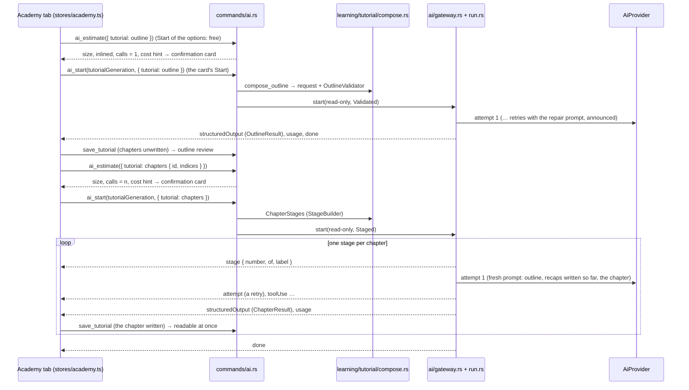

# Phase 5 — Tutorials (Hoot's Academy) implementation plan

Status: **done** (0.5.0); the §16 questions were answered as recommended, recorded in ADRs 0025 to 0028 · Branch: `phase-5-tutorials` · Release: `v0.5.0`

Phase 5 adds the second learning feature ([ADR 0016](../decisions/0016-learning-features-grounded-in-the-project.md)):
**tutorials** about the open project, written by the AI provider from the **whole project**,
taken as a card-based, animated course guided by **Hoot**, kept privately in app data, optionally
**shared with the project** as plain markdown, checked for **freshness** locally and, on request,
reviewed by the AI with changes the user accepts or rejects. Every step is about *this* project
and cites its files; nothing generic survives validation; the AI never changes a tutorial or marks
it verified on its own.

Almost everything the generator needs already exists and is **reused, not rebuilt**:

- From Phase 3: the single AI gateway and its "no token without a user action" rule, the
  provider abstraction (Claude through its CLI, a mock in the browser and the tests), the "uses
  AI" marker, the confirmation card with its size estimate, the usage line, Cancel, the read-only
  policy, structured output, and the **rendered markdown diff** with Accept / Reject
  ([ADR 0017](../decisions/0017-rendered-markdown-diff-at-block-level.md)).
- From Phase 4: the **project profile** with its Edit dialog, the corpus and its scopes, the
  agent-file and secret rules, the subject detection, the roles, the **validated runs** with
  capped visible retries ([ADR 0022](../decisions/0022-grounded-generation-pipeline.md)), the
  quiz prompt rules (audience, grounding, Hoot's voice, documentation gaps), the quiz question
  card (written without a store so it can be embedded), Hoot and its states, the effects, the
  shareable-file conventions ([ADR 0024](../decisions/0024-shareable-learning-files-as-markdown.md)),
  the Learn menu and the Learning settings.
- From the **tutorial proof of concept** (branch `poc-tutorials`, [report](poc-tutorials.md),
  [ADR 0025](../decisions/0025-tutorial-format-json-schema-and-shared-markdown.md)): the tutorial
  schema (outline and chapter, ten step types), the prompts, the validator, the shared markdown
  format with a lossless round trip, the local freshness check with relocation of moved citations,
  the composition of the outline and chapter requests, and six real tutorials generated on five
  projects. The PoC is backend only and not wired to IPC; Phase 5 merges it first and builds on it
  (the report and ADR 0025 exist only on that branch until step 2 of §14 merges it).

Two explicit user actions of this phase write inside the opened folder: **Share with the
project** (the tutorial as a folder of markdown files, after a confirmation that lists the exact
files) and the acceptance of changes to a shared tutorial (proposed updates, relocations, the
user's own "Mark as verified"), each after the same confirmation. Nothing else writes there.

---

## 1. Scope

### 1.1 In scope (definition of done)

| Area | Deliverable |
|---|---|
| Academy home | A new **Academy** tab (Learn → Academy…, `Ctrl+Alt+A`, a button over the view): the **project profile** card with **Edit** (the Phase 4 dialog as is), **Continue where you left off**, the **library** (private and shared tutorials, with their freshness badge, progress and tags), the big **"What do you want to learn?"** prompt with the **subject cards** below it, **"I'm new to…"**, and **Suggest more subjects** (carries the AI marker). Opening the tab, the profile, the cards, the library and the badges are local: no token. |
| Subject cards (local) | `learning/tutorial/families.rs`: **universal families** (The Big Picture, Tech Stack as used here, Architecture Tour, Feature Deep Dive, Trace It, Dependencies, Build Run Test Ship, Conventions and Patterns, Decisions, Your First Contribution, Project Story, Glossary) and **domain families** from the profile (games on any engine, web, mobile, services and back ends, libraries / CLIs / desktop apps, data / ML / infrastructure / embedded), each card **phrased about this project** with its anchor files and a material score, **shown only when the project has enough material**. Domains proposed for "I'm new to…" from the engines, frameworks and detected concepts. Mirrored by a hand-written list in the mock. |
| Generation | **Outline first, then chapters**, each with consent. Options: familiarity (new here / already contributing / deep dive for maintainers), the domain gap, length (quick ~5 min / standard ~15 / deep ~30), the model (the chat's list), the role (the quiz wizard's roles, developers by default). One read-only validated run for the outline; the **outline review** (reorder, remove, rename chapters; the "not enough material" answer with suggested subjects); then **one operation** that writes the chapters the user picked as a **staged run** (one validated run per chapter under one operation id, bounded by the accepted outline, cancellable, each chapter shown as soon as it is accepted). Every step validated (citations, generic content, type rules), retries capped and visible per stage, rejected items repaired within the stage. |
| Step types | Explain, Concept bridge, Code tour (a read-only code viewer with the cited lines highlighted and the annotation beside them, stops as slides), Diagram (Mermaid), Put in order, Match, Spot it (click the line), Quick check (the quiz's card), Try it yourself (a command to copy, a change to try, or an engine / IDE action; the app never runs it), Recap. **Keyboard navigation for every type**, good contrast in the three themes. |
| Taking a tutorial | The **course map** (a winding path, nodes locked / current / done, animated on completion, freshness marks), card transitions, a progress bar per chapter, **XP** and a **streak** counter, confetti on a completed chapter, the **graduation** screen with a badge, Hoot narrating with the quiz's states, **"Quiz me on this tutorial"** (a quiz limited to the tutorial's subject and sources, through the quiz's confirmation card). |
| Storage and sharing | Private tutorials and all **progress** in app data (per folder; progress keyed by the tutorial id, surviving updates: steps changed since they were completed are marked **"updated since you read it"**). **Share with the project** writes `README.md` plus one file per chapter under `<tutorials folder>/<slug>/` (default `docs/tutorials`, in Settings) after a confirmation listing the files. **Shared tutorials are found by the scan** (the README's `igrasp: tutorial` front matter) and listed beside the private ones; they stay normal markdown (tree, search, preview with a **Take this tutorial** banner and the `igrasp-*` blocks as readable cards). **Save as…** exports a private tutorial to a folder picked in a dialog; **Delete** removes a private one. |
| Freshness | **Local check on open** (no token): every cited range hashed and compared; **Up to date** / **Maybe outdated (n of m changed)** / **Sources missing**; moved ranges relocated silently in a private copy, offered as a change for a shared one; affected steps marked on the map. **Check with Claude** (consent, read-only): a report per chapter (still correct / outdated with the reason / a missing topic) and a **proposed new version of each outdated step**, reviewed in the **rendered diff** with Accept / Reject per change and Accept all / Reject all; accepted changes update the private copy, or the shared files after the confirmation. **Mark as verified** by the user only (date, commit, who). |
| Mock backend | Every new command and event in `src/ipc/mock/`: scripted outline, chapters, suggestions and reviews (valid, retry, exhausted, thin material, text-only, slow, cancel), the tutorial store and progress, the freshness check over the fake disk, the share that writes real markdown files to the fake disk, a shared tutorial in the fixture with one stale and one moved citation. The browser dev mode runs every flow without Claude. |
| Quality | Rust and Vitest coverage of every new module, the shared validator and format fixtures asserted by both suites, the no-call tests, the neutrality scan and the marker test extended, Playwright smoke tests (generate, take with the keyboard, share, freshness and review, accessibility), docs, ADRs, README and CHANGELOG updated, `v0.5.0` released from `main`. |

### 1.2 Explicitly out of scope (later phases)

- **Editing a tutorial by hand in the app** (Phase 6, editing). Phase 5 changes a tutorial only
  through accepted proposals, relocations and the verification stamp.
- **Authors and history from git** (Phase 9): the library shows the `generated` date and the
  verification's `by` when the local `.git/config` names a user; the commit hashes come from
  `.git/HEAD` read as a file, never from the git CLI.
- **Project Story from the git history**: the card is offered only when a repository is detected,
  and the generator works from what the files say (changelog, release notes, ADR dates); the
  commit log itself arrives with Phase 9.
- **Interactive `igrasp-*` blocks inside the preview.** As for quiz files, the preview renders the
  blocks as readable cards (answers folded) with a banner that opens the Academy; the tutorial is
  taken in the Academy tab, where the step components live.
- **Opening a tutorial folder from outside the opened project** (the quiz's Open quiz file…). A
  tutorial is private (app data) or shared in the open folder; Save as… exports one.
- **A second provider**, API-key providers, images in tutorials, generating a chapter the user did
  not ask for (prefetching is forbidden by rule 1), any automatic freshness check with the AI.
- **Running "Try it yourself"**: the app shows and copies a command; it never runs it.

---

## 2. What Phases 3 and 4 and the PoC give us, and what changes

| Existing piece | Phase 5 |
|---|---|
| `ai/types.rs` neutral contracts | **Extended**: `AiStartRequest.tutorial: Option<TutorialRequest>` (the user's choices; the backend composes everything), `AiEstimateInput.tutorial`, `AiEvent::Stage { number, of, label }` (a staged run moves to its next stage), `AiUserAction::SubjectSuggestion`. `TutorialGeneration` and `TutorialReview` already exist. |
| `ai/run.rs` validated runs | **Extended** with the **staged run** (§4.6): up to `MAX_STAGES = 8` validated runs under one operation id, each with its own capped retries, built one after the other by a `StageBuilder` that sees the accepted outputs so far; `StructuredOutput` is emitted once per stage; cancel stops between stages or inside one. Only the gateway starts one. |
| `ai/gateway.rs`, `ai/policy.rs` | `start` takes an `Option<RunPlan>` (`Validated(validator)` or `Staged(builder)`) instead of `Option<Box<dyn OutputValidator>>`; still the only door, one at a time, read-only denies everything. |
| `ai/estimate.rs` | Reused; the tutorial card shows the composed prompt's size and a **cost range per length** from the PoC's numbers, replaced by the folder's own last usage once there is one. |
| `providers/claude_cli/`, `providers/mock.rs` | The Claude provider is unchanged (one process per attempt; `--resume` for repairs). The Rust mock gets outline, chapter, review and suggestion scripts. |
| `learning/tutorial/` (PoC) | **Merged and wired**: `#![allow(dead_code)]` removed; `TutorialInput`, `Familiarity`, `Length`, `Tutorial`, `Chapter`, `Step` and the result types gain `TS` exports; `compose_chapter` becomes the staged run's builder (fresh prompt per chapter with the recaps of the chapters written, resume only for repairs); new `families.rs`, `suggest.rs`, `review.rs`, `share.rs`, `repo.rs`, `progress.rs`. |
| `learning/tutorial/markdown.rs`, `freshness.rs` | Kept as the owner of the format and of the check (§4.9 explains why Rust owns the format here, unlike the quiz); `info()` added for the graph; `write` used by share, export and shared updates; `read` by the shared library. |
| `learning/quiz/` | `QuizGenerationInput.tutorial: Option<TutorialRef>` for **Quiz me on this tutorial** (§4.12), `QuizCategory::Tutorial`; the quiz validator already exposes `names_project` for the tutorial validator (PoC). |
| `learning/subjects.rs`, `role.rs`, `corpus.rs`, `agent_files.rs`, `hoot.rs` | Reused as they are: the families are built on the subjects' detections; the role sets the audience; the corpus and the agent-file rules are the validator's. |
| `learning/save.rs` `SaveDialog` | Gains `pick_folder(directory) -> Option<PathBuf>` for **Save as…** (export) with a stub in tests. |
| `graph/parse.rs`, `graph/mod.rs` | A document's `tutorial: Option<TutorialFileInfo>` beside `quiz`: README (`igrasp: tutorial`) or chapter (`igrasp: tutorial-chapter`); `list_tutorials` reads the graph, the watcher keeps it current. |
| `appdata/learning.rs`, `settings.rs` | `FolderLearning` gains `tutorial_progress`, `suggested_subjects`, `tutorial_usage`; a new `appdata/tutorials.rs` stores one JSON file per private tutorial. `settings.learning` gains `tutorial_familiarity`, `tutorial_length`, `tutorials_folder`. |
| `features/profile/` | `ProfileCard` and `ProfileEditDialog` embedded on the Academy home as they are. |
| `features/quiz/QuestionCard.tsx`, `LookUpDialog.tsx`, `effects/` | The question card is the **Quick check**; the look-up dialog's code viewer is extracted to a shared `CodeView` (§6.1) used by Code tour and Spot it; the particle system fires on chapter completion and graduation. |
| `features/diff/RenderedDiff.tsx` | Embedded as is for the review of proposed updates: old and new markdown of a step rendered through the tutorial writer, decisions per change group, `renderToolbar` for Accept / Reject, A / R keys. |
| `features/mermaid/MermaidBlock.tsx` | The Diagram step. |
| `features/code/CodeTab.tsx` | Unchanged; "Read more →" and Try it's "Open in the code viewer" open tabs through `PendingScroll { line, endLine }` as the quiz does. |
| `features/preview` | A README with the tutorial front matter shows a **Take this tutorial** banner (a chapter file: **Part of a tutorial** with a link to its README and to the Academy); `igrasp-code-tour`, `igrasp-put-in-order`, `igrasp-match`, `igrasp-spot-it`, `igrasp-try-it` fences render as folded cards like `igrasp-quiz`, tagged after sanitization. |
| `features/hoot/` | New moments and lines (§7.9); the states are the five existing ones. |
| `stores/tabs.ts`, `menuActions.ts`, `keymap.ts` | `TabKind 'academy'`; actions `learn.academy`, `academy.next`, `academy.prev`, `academy.map`, `academy.hint`, `academy.copy`; the Learn menu gains Academy… above Quiz Me…. |
| `ViewportToolbar.tsx` | A graduation-cap button (Academy, with the marker because the tab's Start spends tokens) next to Hoot's quiz button. |
| `noTokenWithoutAction.test.ts`, `no_start.rs`, `neutrality.test.ts` | Extended (§10): the home, the cards, the library, opening and taking a tutorial, the freshness check, share, export, verify spend nothing; a staged run is bounded; `features/academy` and the new stores are provider-neutral. |

---

## 3. AI integration principles applied to tutorials

1. **No token without a user action.** The calls are: the outline's **Start** on its confirmation
   card; **Write chapters** (the chapters the user ticked, or chapter 1 only) on its card;
   **Rewrite this chapter** and **Write this chapter** (a missing topic) on a card;
   **Suggest more subjects** on a card; **Check with Claude** on a card; **Quiz me on this
   tutorial** through the quiz's card. Everything else is local: opening the Academy, the profile,
   the cards, the domains, the library, the badges (the freshness check reads and hashes files, no
   provider), opening and taking a tutorial, XP, the map, the graduation, share, export, delete,
   accepting or rejecting a proposal, marking as verified. No call on folder open, on file
   change, on a timer, on idle, on opening a tutorial, no prefetching of a chapter, no automatic
   review, no automatic retry beyond the operation's caps.
2. **One action, one bounded operation.** The outline is one validated run (at most 3 attempts).
   Writing chapters is **one staged run** (§4.6): the card says "n chapters, n AI calls in one
   operation", the stages are the chapters the user ticked (bounded by the outline's `≤ 8`
   chapters), each stage has the validated run's cap, a stage that reaches its cap **stops the
   run** (the chapter stays unwritten with the reason; the user may rewrite it later), Cancel stops
   at any moment. Nothing starts a stage but the operation the user started, and nothing continues
   after `Done`.
3. **Read-only.** `AiPolicy::ReadOnly` on every tutorial request (outline, chapters, suggestions,
   review): the provider reads, lists and searches only; the gateway denies any permission
   request whatever the settings. The review **proposes** text; the app applies it only on the
   user's Accept.
4. **Shared UI, same look.** Every control that spends tokens carries the **"uses AI" marker**
   with the provider's name; the **confirmation card** always shows (title, provider, model, what
   is inlined, the size class, the number of calls, the cost line); the **usage line** sums the
   stages and attempts and is kept in the tutorial record; **Cancel** is available throughout; the
   status bar item shows the running operation when the tab is not active.
5. **Provider-neutral and owned by the app.** The prompts, the schemas, the validators and the
   repair prompts live in `src-tauri/src/learning/tutorial/` and never name a provider (the PoC's
   test stays). The frontend sends only a `TutorialRequest` and never sees or builds a prompt; the
   same `neutrality.test.ts` scan covers `features/academy`, the new stores, `ipc` and the mock.
6. **The AI never changes a tutorial on its own.** Relocations are local and silent for a private
   copy only (they are the app's, not the AI's); every AI proposal is a diff the user accepts;
   **Mark as verified** is a user button and records who clicked it. A shared tutorial changes on
   disk only after a confirmation listing the files.
7. **Recorded.** Every tutorial records the provider, the model, the generation commit, the
   usage per operation (outline, each chapter, each review) and the attempts, in app data and in
   the shared front matter (provider and model).

---

## 4. Backend design (Rust)

### 4.1 Module layout

```
src-tauri/src/
├─ ai/
│  ├─ types.rs                 + AiEvent::Stage, AiUserAction::SubjectSuggestion,
│  │                             AiStartRequest.tutorial, AiEstimateInput.tutorial
│  ├─ run.rs                   + StagedRun, StageBuilder, MAX_STAGES, RunPlan
│  ├─ gateway.rs               start(…, plan: Option<RunPlan>, …)
│  └─ no_start.rs              + staged runs only through the gateway; bounded by the plan
├─ learning/
│  ├─ tutorial/                PoC merged, wired, extended
│  │  ├─ mod.rs                TutorialInput, Familiarity, Length (+ TS), TutorialRef, TutorialRequest
│  │  ├─ schema.rs             outline and chapter schemas, Step, Tutorial (+ TS exports)
│  │  ├─ prompt.rs             outline, chapter (fresh, with recaps), repair prompts
│  │  ├─ validate.rs           outline and chapter validators (shared fixtures added)
│  │  ├─ compose.rs            compose_outline, ChapterStages (StageBuilder), estimate
│  │  ├─ markdown.rs           write / read / normalize / info (the graph's summary)
│  │  ├─ freshness.rs          hashes, check, relocate, affected_steps (+ TS types)
│  │  ├─ families.rs           NEW subject cards and domains from the profile and corpus
│  │  ├─ suggest.rs            NEW "Suggest more subjects": schema, prompt, validator
│  │  ├─ review.rs             NEW "Check with Claude": schema, prompt, validator, proposals
│  │  ├─ share.rs              NEW write plans and writes in the folder (share, update, export)
│  │  ├─ progress.rs           NEW TutorialProgress, step hashes, XP rules shared with the mock
│  │  ├─ repo.rs               NEW head commit and user name read from .git files (no CLI)
│  │  └─ snapshots/            prompt snapshots (outline, chapter, review, suggestions)
│  ├─ quiz/compose.rs          + the tutorial scope (Quiz me on this tutorial)
│  └─ save.rs                  + SaveDialog::pick_folder
├─ appdata/
│  ├─ tutorials.rs             NEW one JSON file per private tutorial, per folder
│  ├─ learning.rs              + tutorial_progress, suggested_subjects, tutorial_usage
│  └─ settings.rs              + tutorial_familiarity, tutorial_length, tutorials_folder
├─ graph/parse.rs, mod.rs      + ParsedDoc::tutorial (TutorialFileInfo)
└─ commands/
   ├─ ai.rs                    + tutorial in ai_estimate and ai_start (operation_request)
   └─ tutorials.rs             NEW the commands of §5.1
```

### 4.2 Subject cards and domains (`learning/tutorial/families.rs`)

Local, no token, built from the corrected `ProjectProfile`, the `Corpus` and the Phase 4
`subjects::propose` result (features and concepts with anchors and material). Cached with the
subjects per disk revision.

```rust
pub enum FamilyKind { Universal, Domain }

pub struct TutorialSubject {
    /// Stable within a folder: `family:big-picture`, `family:trace-it:feature:…`,
    /// `domain:game:replication`, `suggested:<n>` (from the AI, kept in app data).
    pub id: String,
    pub kind: FamilyKind,
    /// The family's name for grouping: "Trace It", "Games", …
    pub family: String,
    /// Phrased about this project: "How igrasp is put together, in 5 minutes".
    pub title: String,
    /// One line: what the tutorial will cover here.
    pub blurb: String,
    /// What the generator starts from (anchors, inlined), most relevant first.
    pub anchors: Vec<String>,
    pub material: Material,
    /// A family that needs a pick (Feature Deep Dive, Trace It): the options, as subjects.
    pub picks: Vec<SubjectPick>,
    /// The domain this card teaches, pre-filling "I'm new to…" when chosen.
    pub domain: Option<String>,
}

pub struct TutorialSubjects {
    pub cards: Vec<TutorialSubject>,
    /// Domains the reader may lack, for "I'm new to…": engines, frameworks, detected concepts.
    pub domains: Vec<String>,
    /// The project has too little material for tutorials at all (an empty or binary folder).
    pub too_thin: bool,
}
```

Universal families and when they show (each title is built with the project's name and vocabulary
from `summary.rs`, never a bare family name):

| Family | Needs | Anchors |
|---|---|---|
| The Big Picture | ≥ 2 text files | README, architecture page, the main manifest, the largest module's entry |
| Tech Stack, as used here | ≥ 1 language and (an engine, a framework or a manifest) | manifests, lock files, config files of the frameworks |
| Architecture Tour | ≥ 2 modules, or an architecture page | the architecture page, each module's entry |
| Feature Deep Dive | ≥ 1 feature subject | picks = the feature subjects |
| Trace It | ≥ 1 entry point (a `main`, a route file, a command table, an input handler, a scene) | picks = detected entry points, each phrased as an action ("a file changes on disk", "a request hits `/login`", "the player presses jump") |
| Dependencies | ≥ 3 dependencies in a manifest | the manifests and the files that import the top dependencies |
| Build, Run, Test, Ship | build, tests or CI detected | scripts, build config, workflows, packaging |
| Conventions and Patterns | ≥ 2 modules and ≥ 20 text files | the largest files per language, a lint or format config, a contributing page |
| Decisions | ADRs or design docs (`docs/decisions`, `docs/adr`, `*.adr.md`, RFCs) | the decisions, newest first |
| Your First Contribution | a contributing page, or build + tests | contributing, the test folders, one module's entry |
| Project Story | a repository and (a changelog, release notes or dated docs) | changelog, release notes, ADRs |
| Glossary | the material is Rich overall | the README, the architecture page, docs pages |

Domain families are keyed by the profile's kinds and engines; each topic is a card only when the
corpus has files whose path words match it (the detection of `subjects.rs`, extended with a
per-domain word table):

| Domain (kinds) | Topics (examples; the table lives in `families.rs`) |
|---|---|
| Games (engine known or `Game`) | the gameplay framework as used here (Actors / Components / GameMode, MonoBehaviours / ScriptableObjects, scenes / nodes / signals, ECS), game loop and tick order, input, the player, rendering and materials, shaders, the asset pipeline, levels and scenes, networking and replication, save and load, UI, AI and behaviour trees, physics, audio, build targets, performance |
| Web (`WebFrontend`, `WebBackend`) | routing, rendering strategy, state management, API design, authentication and authorization, web security as handled here, data access and migrations, caching, background jobs, observability, deployment |
| Mobile | app structure and navigation, platform bridges, offline and sync, permissions, push, lifecycle, store build |
| Services and back ends (`Service`, `WebBackend`) | service boundaries, messaging, persistence, configuration and secrets, resilience, observability |
| Libraries, CLIs, desktop (`Library`, `Cli`, `Desktop`) | the public API surface, extension points, the command structure, IPC, packaging and distribution |
| Data, ML, infrastructure, embedded | pipelines, models and training, infrastructure as code, environments, hardware abstraction, drivers |

Rules: a card's title and blurb name the project or its own terms; the material threshold is the
subjects' (`MIN_FILES`, `MIN_BYTES`); at most 24 cards, universal first, then domain by material;
the `domains` list is the engines and frameworks of the profile plus the domain topics with
material ("Unreal replication", "web security"). Tests: one case per profile fixture of Phase 4
(an Unreal game offers the games domain and not web; a docs-only folder offers The Big Picture and
Glossary only; an empty folder is `too_thin`), the dogfooding test on this repository, and the
mock's hand-written list for the fixture.

### 4.3 The request (`learning/tutorial/mod.rs`)

```rust
/// What the frontend sends; the backend composes prompts, schemas and validators.
#[serde(tag = "kind", rename_all = "camelCase")]
pub enum TutorialRequest {
    /// The outline of a new tutorial.
    Outline { input: TutorialInput },
    /// Writes these chapters (0-based indices of the accepted outline) of a private tutorial,
    /// one stage each, in this order.
    Chapters { id: String, indices: Vec<usize> },
    /// Rewrites one chapter (one stage), optionally with a new goal (a missing topic).
    Chapter { id: String, index: usize, goal: Option<String> },
    /// Check with Claude.
    Review { tutorial: TutorialRef },
    /// Suggest more subjects.
    Suggest,
}

/// A tutorial the user can open: private (app data) or shared (a README in the folder).
#[serde(tag = "type", rename_all = "camelCase")]
pub enum TutorialRef { Private { id: String }, Shared { rel_path: String } }
```

`TutorialInput` keeps the PoC's fields (`subject`, `familiarity`, `domain_gap`, `length`, `role`)
and gains `subject_id: Option<String>` (a card, so the prompt gets its anchors and family focus)
and `picks: Vec<String>` (the Feature Deep Dive or Trace It choice). `normalized()` clamps as the
quiz does.

### 4.4 Schemas, prompts and validators (PoC, with Phase 5 additions)

The PoC's two schemas stay as ADR 0025 describes them. Additions:

- **Ids.** A tutorial id is `<slug of the subject, ≤ 40 chars>-<yyyymmdd>-<4 hex>` (the PoC's
  embedded the whole subject). Chapter ids stay positional.
- **Outline prompt.** The card's family focus (a paragraph per family: what The Big Picture covers,
  what Trace It follows) and its anchors; the picks; the role's audience block from `role.rs`.
- **Chapter prompt.** The PoC's fresh prompt with the accepted outline, the goal and key sources
  of the chapter, and the **recaps of the chapters already written** (to avoid repetition), as the
  PoC recommended; `resume_id` only for repairs inside the stage. A soft rule asks for at least
  one interactive step per chapter (the validator reports it as a rejection reason only when the
  chapter has none and more than four steps).
- **Validator.** The PoC's rules; the key-source identifiers count as project words (done in the
  PoC); the shared fixtures move to `src/test/fixtures/tutorial/cases/*.json` (outline and chapter
  cases) asserted by Rust and by `mockTutorialValidate.ts`.
- **Review schema** (`review.rs`): per chapter `{ id, status: stillCorrect | outdated |
  missingTopic, reason, change: Option<Citation> }`, and `proposals: [{ chapter, step,
  replacement: Step }]`; a missing topic carries a `goal` the user may turn into a chapter. The
  prompt inlines the tutorial as markdown (the writer's output, which is what a teammate reads),
  the freshness report (changed and missing ranges), the profile and the grounding rules; it
  asks for a proposal only where the text is wrong now, never a rewrite for style. The validator
  checks every proposal as a chapter step (citations, generic content, type rules) and every
  `change` citation; a proposal that fails is dropped and reported, the chapter status stays.
- **Suggestion schema** (`suggest.rs`): 5 to 8 `{ title, blurb, anchors, selfCheck }`; the
  validator checks the anchors are citable files and the title names the project; the prompt
  lists the cards already offered so the model proposes others.

### 4.5 Composition (`compose.rs`) and the estimate

- `compose_outline(root, profile, walk, agent_names, input, model)` (PoC) → `Composed` with the
  `OutlineValidator`.
- `ChapterStages` implements `StageBuilder` (§4.6): built from the tutorial in app data and the
  indices; `next(stage, accepted)` composes chapter `indices[stage]` with the recaps of every
  chapter already written (in the record or accepted in this run) and returns the request with a
  fresh `ChapterValidator`; `label` is the chapter's title.
- `compose_review(root, …, tutorial, freshness)` and `compose_suggest(root, …, offered)`.
- `estimate(request)` in `commands/ai.rs`: the composed prompt's bytes and inlined documents
  (as the quiz), plus `calls: u32` (1, or the number of chapters) and `cost_hint: Option<String>`:
  the folder's last usage for the same kind of operation from `tutorial_usage`, else the PoC's
  range for the length ("outline $0.15–0.6 with sonnet in the PoC; this folder's last outline:
  $0.41").

### 4.6 Staged runs (`ai/run.rs`, `gateway.rs`)

The chapters of a tutorial are several provider operations that the user authorized with one
click. Rule 1 says one user action authorizes one bounded operation, so the sequence is **one
gateway operation** that runs validated runs one after the other, under one id:

```rust
pub const MAX_STAGES: u32 = 8; // the outline's MAX_CHAPTERS

pub trait StageBuilder: Send {
    fn stages(&self) -> u32;
    /// The request and validator of stage `n` (1-based), given the accepted outputs so far.
    fn next(&mut self, n: u32, accepted: &[Value]) -> AppResult<(AiRequest, Box<dyn OutputValidator>, String)>;
}

pub enum RunPlan {
    Validated(Box<dyn OutputValidator>),
    Staged(Box<dyn StageBuilder>),
}
```

`StagedRun` emits `AiEvent::Stage { number, of, label }`, starts a `ValidatedRun` for the stage
with a sink that forwards everything but its `Done`, keeps its `StructuredOutput` (emitted as is,
so the frontend saves the chapter at once) and, on the stage's `Done(Completed)`, builds the next
stage; a stage that ends `Failed` (its validator gave up) or an error from the provider ends the
run with `Done(Failed, detail)`; `cancel` cancels the current stage and prevents the next; the run
ends with exactly one `Done`. `stages()` is capped at `MAX_STAGES` when the plan is built. The
gateway's `start` takes `Option<RunPlan>`; `no_start.rs` asserts that `StagedRun::start` is called
only from the gateway and that a plan with more stages than the cap is refused. Usage: each stage's
`Usage` event is forwarded; the frontend sums them like attempts.

### 4.7 Freshness (`freshness.rs`, PoC) and the open check

`check(root, &tutorial) -> Report` as the PoC; the command `check_tutorial_freshness(ref)`:

- reads the tutorial (app data or the shared folder), runs the check, and for a **private**
  tutorial applies `relocate` and saves the copy when something moved;
- for a **shared** one, returns the report with `relocated: Option<Tutorial>` (the copy with
  the moved citations), which the UI offers as a change through the write plan (§4.8);
- returns `FreshnessReport { badge, checks, affected: Vec<(chapter, step)>, moved, relocated }`
  (all `TS`), cached per `(tutorial id, disk revision)` in the `Workspace` so the library's badges
  cost one check per tutorial per change on disk.

The badge is the PoC's: *Up to date*, *Maybe outdated (n of m changed)*, *Sources missing*; a
`SourceState::Unchecked` (binary asset, existence only) never degrades the badge.

### 4.8 Sharing, exporting and updating files in the folder (`share.rs`)

The only writes inside the opened folder in this phase, each in two steps so the confirmation can
list the exact files:

```rust
#[serde(tag = "type", rename_all = "camelCase")]
pub enum WriteTarget {
    /// Share a private tutorial: `<settings.learning.tutorials_folder>/<slug>/`.
    Share { id: String },
    /// Update a shared tutorial in place (accepted proposals, relocations, verification).
    Shared { rel_path: String },
    /// Save as…: a folder picked in a dialog (outside or inside the folder), for a private one.
    Export { id: String },
}

pub struct WritePlan {
    /// Root-relative folder (or absolute for an export) the files go to.
    pub folder: String,
    pub files: Vec<PlannedFile>, // { name, bytes, state: New | Unchanged | Changed | Removed }
    /// Chapter files of a shared tutorial that the new version no longer has.
    pub removed: Vec<String>,
}
```

`plan_tutorial_write(target, tutorial)` renders the files with `markdown::write` and compares them
with the disk (through the root guard); `write_tutorial(target, tutorial)` renders again and writes
atomically (a temp file renamed over each target, so the watcher reports *modified*), creating the
folder only now; for `Export`, the dialog (`SaveDialog::pick_folder`) runs inside this command,
`SaveCancelled` when dismissed. The slug is `markdown::slug(title)`; a shared folder that already
exists with another tutorial's id is refused (`TutorialFolderTaken`). The frontend never passes a
path other than the `rel_path` of an existing shared README; `tutorials_folder` is validated like
the quiz folders. A write updates the progress's step hashes for the writing user, so their own
share never shows "updated since you read it".

### 4.9 The format: Rust owns it, the frontend mirrors the writer for the mock

ADR 0024 made the frontend the owner of the quiz file format and Rust a mere recogniser. For
tutorials the PoC built the writer and the tolerant reader in Rust, lossless on six real tutorials,
and the backend needs them anyway: the freshness check and the review read a shared tutorial from
its markdown, and share, export and updates write it. Phase 5 therefore keeps **Rust as the owner
of the tutorial format** (ADR 0025 amended), and the frontend holds:

- `features/academy/tutorialBlocks.ts`: the parser of one `igrasp-*` fenced block (YAML through
  the `yaml` package, as `QuizBlock.tsx`), for the preview's folded cards;
- `src/ipc/mock/mockTutorialMarkdown.ts`: a **writer** that mirrors `markdown::write`, so the
  mock's share writes real files to the fake disk (the e2e opens them in the preview) and so the
  fixture's shared tutorial is generated from JSON. Both writers are asserted on
  `src/test/fixtures/tutorial/format/*.json` → `*.md` (the Rust side also asserts
  `read(write(t)) == t`).

The mock's `read` of a shared tutorial returns the JSON it holds for the path (the fixture's, or
what it shared); there is no TypeScript reader of the full format.

### 4.10 Progress and XP (`progress.rs`, `appdata/learning.rs`)

```rust
pub struct TutorialProgress {
    pub tutorial_id: String,
    pub started_ms: i64,
    pub last_opened_ms: i64,
    pub finished_ms: Option<i64>,
    /// Current position: chapter and step indices.
    pub position: (u32, u32),
    /// Completed steps: `(chapter, step)` → the SHA-256 of the step's normalized JSON when
    /// completed, so a step changed since then is marked "updated since you read it".
    pub completed: BTreeMap<String, String>,
    /// Answers of the interactive steps (first try right, hint used, tries).
    pub answers: BTreeMap<String, StepAnswer>,
    pub xp: u32,
    pub best_streak: u32,
    pub chapters_done: Vec<u32>,
    pub graduated: bool,
}
```

XP rules (also in `academyEngine.ts`, asserted on a shared fixture): reading an explain, bridge,
diagram or recap 5; a code tour 10 (all stops seen); try it 10 ("I did it"); an interactive step
right at the first try 20, right after a hint or a second try 10, otherwise 5 for the explanation
read; a completed chapter 25; a streak of 3 or more right answers multiplies the step's points by
1.5. The streak is consecutive right interactive steps within a tutorial. `FolderLearning` holds
`tutorial_progress: BTreeMap<String, TutorialProgress>` (small, rewritten on each step like the
quiz's current record), `suggested_subjects: Vec<TutorialSubject>` (the AI's suggestions, kept)
and `tutorial_usage: Vec<TutorialUsage>` (the last 20 operations: kind, length, usage, model).

### 4.11 App data for tutorials (`appdata/tutorials.rs`)

A deep tutorial is about 100 KB of JSON; the per-folder learning file is rewritten on each
answer, so tutorials get their own files: `learning/tutorials/<folder id>/<tutorial id>.json`
(the `Tutorial` plus `provider_id`, `usage`, `attempts`, `created_ms`, `updated_ms`), written
atomically, listed by reading the folder, recovered when corrupt (`appdata://recovered`), deleted
with the private tutorial; `forget_tutorials` deletes the folder's files and progress. Shared
tutorials have no copy in app data: only their progress and freshness cache.

### 4.12 Quiz me on this tutorial (`learning/quiz/compose.rs`)

`QuizGenerationInput.tutorial: Option<TutorialRef>`: the backend loads the tutorial, sets the
subject to its title and subject, the scope to `SourceScope::Paths` with its cited files, the
category to `QuizCategory::Tutorial`, and adds a prompt block with the chapter goals and recaps
("ask what a reader who took this tutorial should now understand"), using the **understanding
style**, not the code check's line-level style (the style block is chosen by `tutorial.is_some()`
before the scope). The quiz record keeps `tutorial: Option<String>` (the id) so the graduation
screen and the history show "about the tutorial …". The quiz store's `start` remains the only
quiz call to `ai_start`; the graduation button calls `useQuiz.prepareForTutorial(ref)`, which
shows the quiz's confirmation card in the Quiz tab.

### 4.13 Repository facts (`repo.rs`)

`head_commit(root) -> Option<String>`: `.git/HEAD` (a hash, or a `ref:` resolved through
`.git/refs/...` or `.git/packed-refs`), also for a `.git` file of a worktree; `user_name(root)`:
`[user] name` of `.git/config` only. No git CLI (Phase 9). Used for `generation_commit` and the
verification stamp.

### 4.14 Errors

`AppError` gains `TutorialNotFound`, `NotATutorialFile`, `TutorialFolderTaken`, `ChapterNotWritten`
(a chapter asked for review or quiz before it exists); `SaveCancelled` is reused for the export
dialog.

---

## 5. IPC contracts

### 5.1 Commands

| Command | Returns | Token |
|---|---|---|
| `list_tutorial_subjects()` | `TutorialSubjects` (cards, domains, too_thin), cached per disk revision | no |
| `ai_estimate({ tutorial })` | `AiSizeEstimate` + `calls`, `cost_hint` | no |
| `ai_start(tutorialGeneration, { tutorial: outline / chapters / chapter })`, `ai_start(tutorialReview, { tutorial: review })`, `ai_start(subjectSuggestion, { tutorial: suggest })` | operation id; events as `ai://event` | **yes** |
| `list_tutorials()` | `Vec<TutorialSummary>`: private (app data) and shared (the graph's READMEs), with progress and the cached badge | no |
| `get_tutorial(ref)` | `Tutorial` (shared: read from the folder through the root guard) | no |
| `save_tutorial(tutorial)` | saves a private tutorial (after the outline, each chapter, accepted proposals, a verification) | no |
| `delete_tutorial(id)`, `forget_tutorials()` | | no |
| `get_tutorial_progress(id)`, `save_tutorial_progress(progress)` | | no |
| `check_tutorial_freshness(ref)` | `FreshnessReport` (private: relocations applied and saved) | no |
| `plan_tutorial_write(target, tutorial)` | `WritePlan` (nothing written) | no |
| `write_tutorial(target, tutorial)` | `WrittenTutorial { folder, rel_path: Option<String> }`; export opens the folder dialog | no |
| `mark_tutorial_verified(ref)` | the updated `Tutorial` (private: saved; shared: the caller then plans and writes) | no |
| `save_suggested_subjects(subjects)` | keeps the AI's suggestions with the folder | no |
| `ai_estimate({ quiz: { tutorial } })`, `ai_start(quizGeneration, { quiz: { tutorial } })` | the quiz about a tutorial | **yes** |

### 5.2 Events

| Event | Change |
|---|---|
| `ai://event` | `stage { number, of, label }` before each stage of a staged run; `structuredOutput` once per stage; `usage` per stage; one `done`. |
| `graph://ready`, `graph://changed` | Unchanged; the Academy refreshes its shared list when a changed document is a tutorial README (the payload's docs). |
| `fs://changes` | Unchanged; a shared tutorial's chapter file changed on disk invalidates its freshness cache and progress markers are recomputed on open. |

### 5.3 Frontend IPC layer and mock

`Backend` gains the methods above; `tauri.ts` maps them; `ipc/mock/`:

- `mockTutorial.ts`: `composeMockOutline`, `composeMockChapters` (a `StageBuilder`-like
  iterator), `composeMockReview`, `composeMockSuggest`, the scripts
  `MockTutorialScript = 'valid' | 'retry' | 'exhaust' | 'thin' | 'textOnly' | 'slow' | 'stageFail'`
  and `MockReviewScript = 'upToDate' | 'outdated' | 'missingTopic' | 'retry'`, chosen with
  `__igraspMock.state.ai`;
- `mockTutorialPool.ts`: a hand-written outline (4 chapters) and chapters with **every step
  type** over the fixture project, citing real lines of the fake disk;
- `mockTutorialValidate.ts`: the outline and chapter rules on the shared fixtures;
- `mockAi.ts`: the staged loop (a `stage` event, then the validated loop per stage, one `done`),
  like `quizScript`;
- `mockTutorialStore.ts`: private tutorials, progress, suggestions, usage per root;
- `mockTutorialMarkdown.ts`: the writer (§4.9); `mockTutorialFreshness.ts`: hashes with
  `sha256Hex`, moved-window search, the badge;
- `mockFamilies.ts`: the cards and domains of the fixture;
- fixture: `docs/tutorials/getting-started/README.md` and `01-the-greeting-flow.md` generated by
  the writer at fixture build time from `fixtureTutorial.json`, with one citation whose hash is
  stale and one whose lines moved; the mock graph flags both files.

---

## 6. Frontend architecture

### 6.1 Component tree (additions in bold)

```
App
├─ TitleBar (Learn menu: Academy…, Quiz Me…, Open Quiz File…, Project Profile…)
├─ ViewportToolbar (+ Academy button with AiMark)
└─ TabsHost
   └─ **AcademyTab** (TabKind 'academy')
      ├─ **AcademyHome**
      │  ├─ ProfileCard + ProfileEditDialog (features/profile, as is)
      │  ├─ **ContinueCard** (last opened tutorial, position, XP)
      │  ├─ **LearnPrompt** ("What do you want to learn?": free text, Enter → options)
      │  ├─ **SubjectCards** (universal, domain, suggested; a pick dialog for Deep Dive / Trace It)
      │  ├─ **NewToDomain** ("I'm new to…": chips from `domains` + free text)
      │  ├─ **SuggestMoreButton** (AiMark) → ConfirmCard → suggestions appended
      │  └─ **Library** (VirtualRows: private and shared, badges, progress, tags, Delete, Save as…)
      ├─ **TutorialOptions** (familiarity, domain gap, length, role, model, Start with AiMark)
      ├─ ConfirmCard (features/ai, as is: outline / chapters / review / suggestions)
      ├─ **OutlineReview** (chapters: drag or Shift+arrows to reorder, Remove, Rename, tick to
      │     write; the "not enough material" answer: note + suggested subjects + Start again)
      ├─ **GenerationScreen** (Hoot thinking, activity, stage line "Chapter 2 of 4: …", attempts,
      │     elapsed, Cancel; chapters appear as they are accepted; "Start reading" when chapter 1 is in)
      ├─ **CourseMap** (SVG path, nodes, freshness marks, "updated since you read it" marks)
      ├─ **ChapterPlayer**
      │  ├─ **ChapterHeader** (title, progress bar, XP, streak, Hoot with the chapter's intro)
      │  ├─ **StepCard** → one of:
      │  │  ├─ **ExplainStep**, **ConceptBridgeStep**, **DiagramStep** (MermaidBlock), **RecapStep**
      │  │  ├─ **CodeTourStep** (CodeView with the highlighted range + annotation, stop dots)
      │  │  ├─ **SpotItStep** (CodeView with clickable lines)
      │  │  ├─ **PutInOrderStep**, **MatchStep**
      │  │  ├─ **QuickCheckStep** (QuestionCard, LookUpDialog)
      │  │  └─ **TryItStep** (command with Copy, Open in the code viewer / Reveal, I did it, Skip)
      │  └─ **StepNav** (Previous, Next, Map, sources line with Read more →)
      ├─ **GraduationScreen** (badge, XP, time, Quiz me on this tutorial, Share, Back)
      ├─ **FreshnessPanel** (badge, changed sources, affected steps, Check with Claude, Mark as verified)
      ├─ **ReviewScreen** (report per chapter; proposals in RenderedDiff with Accept / Reject,
      │     Accept all / Reject all; missing topics with Write this chapter)
      └─ **WriteConfirmDialog** (the WritePlan: folder and files, New / Changed / Removed; Write)
features/preview
├─ **TutorialBanner** (README: Take this tutorial; chapter: Part of a tutorial)
└─ **TutorialBlock** (igrasp-code-tour / put-in-order / match / spot-it / try-it, folded)
components
└─ **CodeView** (extracted from LookUpDialog: read-only highlighted lines, a highlighted range,
      optional line click, scroll to a range; used by Look it up, Code tour, Spot it)
```

### 6.2 Stores

- `stores/academy.ts`: screen, the library, the cards and domains, the wizard's setup, the
  pending confirmation, the generation progress (stage, attempts, activity), the suggestions, the
  freshness report of the open tutorial, the review in progress and its decisions. **Its
  `startOutline`, `startChapters`, `startChapter`, `startReview` and `startSuggestions` are the
  only tutorial calls to `aiStart`**, each reached from a confirmation card's Start. It saves the
  tutorial after each accepted `structuredOutput` and owns `owns(operationId)` for the event
  bridge like the quiz store.
- `stores/tutorialPlayer.ts`: the open `Tutorial`, its `TutorialProgress`, the position, the
  step engines' state (order, pairs, spot-it pick, tour stop), XP and streak through
  `academyEngine.ts` (pure, tested), autosave of the progress after each step, the "updated since
  you read it" set computed from the step hashes, graduation.
- `stores/quiz.ts`: `prepareForTutorial(ref)` (the card for a quiz about the tutorial).
- `stores/eventBridge.ts`: routes `ai://event` to the academy store when it owns the operation;
  routes `graph://changed` with tutorial READMEs to the library refresh.
- `stores/session.ts`: the Academy tab is a special tab like the quiz; the open tutorial and
  position are app data (progress), not session.

### 6.3 Data flows

**Generating a tutorial**



**Taking a tutorial**: `get_tutorial(ref)` and `get_tutorial_progress(id)` → `check_tutorial_freshness(ref)`
(local; the badge, affected steps, relocations applied to a private copy) → the course map →
the chapter player saves the progress after each step → chapter done: confetti, XP, map
animation → graduation.

**Sharing**: Share → `plan_tutorial_write(share)` → the confirmation lists the files → Write →
`write_tutorial(share)` → the watcher reports the new files → the graph flags the README → the
library lists the shared copy (the private one stays, with a "shared as …" tag).

**Review**: Check with Claude → `ai_estimate({ tutorial: review })` → card → `ai_start(tutorialReview)`
→ `structuredOutput` (report and proposals) → ReviewScreen: for each proposal `RenderedDiff(old
markdown of the step, new markdown)` → Accept / Reject → accepted proposals applied to the
`Tutorial` in the store → private: `save_tutorial`; shared: `plan_tutorial_write(shared)` →
confirmation → `write_tutorial`. Mark as verified → `mark_tutorial_verified` → same path.

---

## 7. Feature details

### 7.1 Entry points

Learn → **Academy…** (`Ctrl+Alt+A`), the Academy button over the view, the **Take this
tutorial** banner on a shared README in the preview, **Continue** on the Welcome screen when a
tutorial is in progress, and the graduation's **Quiz me on this tutorial** towards the Quiz tab.
Opening is free; the Start buttons inside carry the marker.

### 7.2 Academy home

Top: Hoot (idle, a home line) and the profile card with **Edit** (the Phase 4 dialog; a correction
rebuilds the cards). **Continue where you left off**: the last opened unfinished tutorial, its
chapter and step, XP, a Resume button. **What do you want to learn?**: a large input; Enter or
the arrow goes to the options with the typed subject; below, the **subject cards** grouped by
family (universal first), each with its title about the project, blurb, material dots and the
family tag; Feature Deep Dive and Trace It open a pick list; a domain card pre-fills "I'm new to…".
**I'm new to…**: chips from `domains` plus a free field; the chosen domain goes to the options.
**Suggest more subjects** (marker): the card, then the suggestions appear as cards tagged
"suggested", kept with the folder. **Library**: private and shared tutorials, each row with the
title, subject, familiarity, length, chapters written / total, the badge (Up to date / Maybe
outdated / Sources missing, or "checking…" until the local check runs), progress (steps done,
graduated), "updated since you read it" count, tags (private, shared as `docs/tutorials/…`,
verified on …), and actions: Open, Share, Save as…, Delete (private), Reveal (shared). Provider
problems show the same status line and **Check again** as the quiz.

### 7.3 Options and the confirmation card

Familiarity (three radio cards with one line each), **I'm new to…** (pre-filled or typed),
length (quick / standard / deep with the chapter and minute ranges), role (the quiz wizard's
proposed roles, developers by default), model (the chat's picker), the subject summary, Start
(marker). The card: "Write the outline of a tutorial", provider and model, the inlined
documents (anchors, agent files as context), the size class, "1 call", the cost line ("the last
outline in this folder cost $0.41" or the PoC range), Start and Cancel. For the chapters:
"Write n chapters", "n calls in one operation, cancellable", the ticked chapters, the cost line
per chapter.

### 7.4 Outline review

The title and intro, Hoot explaining, the chapters as cards with their goal and minutes: reorder
(drag, or `Shift+↑/↓`), Remove, Rename (inline), a tick per chapter to write now (all ticked by
default; "Chapter 1 only" shortcut), the documentation gap note when reported. **Not enough
material**: the material note, the suggested subjects as cards, Start again. **Write chapters**
(marker) → the card. The outline is already saved privately, so closing the tab keeps it (the
library shows "outline only").

### 7.5 Generation screen

Hoot thinking, the stage line ("Chapter 2 of 4: The frontend fan-out"), the activity line (files
read), the attempt line in plain words ("Checking the steps… retry 1 of 2: a citation whose lines
did not check out"), elapsed time, **Stop**. Chapters appear in a side list as they are accepted;
**Start reading** opens chapter 1 while the rest is written (the player works on the saved
tutorial; the map shows the chapters still being written as "writing…"). A stage that fails stops
the run: the chapter shows the reason and **Rewrite this chapter** (marker).

### 7.6 Course map

An SVG winding path (`CourseMap.tsx`) with a node per chapter: locked (not written or not
reached), current, done; a freshness mark (orange dot: a changed source; red: missing) and an
"updated" mark on chapters with steps changed since completion; the node's tooltip lists the
affected steps. Completing a chapter animates the path to the next node (CSS, off with reduced
motion). Keyboard: arrows between nodes, Enter opens, `M` toggles the map from the player.

### 7.7 Step types and their keyboard

| Step | Rendering | Keyboard | Completes on |
|---|---|---|---|
| Explain | Title, body (sanitized markdown through the preview pipeline, in its render cache), Hoot explaining, Sources with Read more → | `Enter` / `→` next, `←` previous, `R` Read more | Next |
| Concept bridge | A `[!NOTE]`-styled card: Concept (one or two sentences), Applied here (the cited code), Official docs link (opens externally) | as Explain, `D` docs | Next |
| Code tour | `CodeView` of the stop's file around its lines, the range highlighted, the annotation beside; stop dots | `→`/`←` or `N`/`P` stops, `Enter` next step when on the last stop, `O` open in the code viewer | last stop seen |
| Diagram | MermaidBlock (strict), caption, sources | as Explain, `F` full screen (the Mermaid viewer) | Next |
| Put in order | The items shuffled as cards; drag, or `Space` picks, `↑/↓` moves, `Space` drops; Check; wrong positions shake, right ones lock; explanation on success or after two tries | `↑/↓` focus, `Space` pick/drop, `Enter` check | Check right (or 2 tries) |
| Match | Two columns; click a left then a right item (a line is drawn); Check | `↑/↓` focus, `Enter` select, `Tab` column, `Backspace` unpair, `Enter` on Check | Check right (or 2 tries) |
| Spot it | `CodeView` of the snippet, lines clickable; Check; the right line glows, the explanation | `↑/↓` line cursor, `Enter` pick | right pick (or 2 tries) |
| Quick check | `QuestionCard` (choices `1–4`, `T`/`F`, `H` hint, `L` look it up) with the quiz's reveal and Read more → | the quiz's | answer |
| Try it | Instruction, the command in a block with **Copy** (`C`), Where (the engine, the IDE), Expected, **Open in the code viewer** when a cited text file, **Reveal in file manager** for a binary asset; **I did it** / **Skip** | `C`, `O`, `Enter` I did it, `S` skip | I did it or Skip |
| Recap | Three takeaways as a checklist, sources, Hoot cheering; **Finish chapter** | `Enter` | Finish |

Every step shows its sources line (Read more → opens the file at its lines in a tab, documents in
the preview, code in the viewer) and a "source changed" or "source missing" notice when the
freshness report says so. `Esc` returns to the map and keeps the position. A wrong answer plays
Hoot encouraging and shows the explanation gently, as the quiz does.

### 7.8 XP, streak, effects, graduation

The chapter header shows the progress bar (steps done / steps), XP (counting up on a gain) and
the streak badge from 2. Confetti on a completed chapter, a ring when a streak reaches 3, the
map animation; all off under reduced motion or `settings.learning.effects = false`. The
**graduation** screen: a badge (Hoot with a mortarboard, SVG, themed), the tutorial's title, XP,
time, right-first-try count, the documentation gap note if any, **Quiz me on this tutorial**
(marker, through the quiz's card), **Share with the project**, **Back to the Academy**.
`progress.graduated` is set; the library shows a cap on the row.

### 7.9 Hoot

States: thinking during generation and review, explaining on explain and bridge cards, cheering
on a right answer, a completed chapter and the graduation, encouraging on a wrong answer and on an
outdated badge, idle on the home and the map. The AI writes **one** line per chapter
(`hootIntro`, in Hoot's voice as the prompt asks); every other line is local in `hootLines.ts`:
new moments `academyHome`, `outline`, `writing`, `chapterDone`, `graduation`, `outdated`,
`verified`, `shared`.

### 7.10 Freshness panel, review and verification

Opening a tutorial runs the local check and shows the badge in the header; the **Freshness
panel** lists the changed and missing sources with the steps they affect, **Check with Claude**
(marker) and **Mark as verified** (no marker; a confirmation: "You confirm this tutorial is
correct for the project as it is now. IGrasp records the date, the commit and your name.").
The **review screen** shows the report per chapter (still correct / outdated with the reason and
the cited change / missing topic with its goal); each proposal is a `RenderedDiff` of the step
(old and new markdown from the writer) with Accept / Reject on each change group, Accept all /
Reject all, `A` / `R` keys; a missing topic has **Write this chapter** (marker: one stage with the
goal appended to the outline). Applying: private → saved; shared → the write confirmation
listing the chapter files that change. A relocation offered for a shared tutorial appears in the
same screen as a change group per moved citation.

### 7.11 Settings → Learning

Added: default familiarity, default length, the tutorials folder (`docs/tutorials`, validated as
the quiz folders), "Forget tutorials and progress" (private tutorials deleted after a confirmation;
shared ones untouched). The effects toggle and the model are shared with the quiz.

### 7.12 Preview

A tutorial README shows **Take this tutorial** (title, chapters, the badge after a local check,
Open in the Academy) instead of the front matter card; a chapter file shows **Part of a
tutorial** linking to the README and the Academy; the five new `igrasp-*` fences render as folded
cards (YAML parsed as text, never as markup, like `QuizBlock`); Mermaid blocks render as usual.
Nothing in the preview runs or navigates.

### 7.13 Keyboard and accessibility

Every control reachable with Tab; the map and the step types as in §7.7; live announcements for
XP gains, right / wrong, chapter done, stage changes; the badge and the marks have text
equivalents; focus moves to the step card on each transition; High Contrast outlines for the map
nodes and the highlighted code range; the shortcuts listed in the Keyboard Shortcuts tab.

---

## 8. The two rules: enforcement checklist

- [ ] `ai_start` is the only command that reaches the gateway; `StagedRun::start` is called only
      from `AiGateway::start` (`no_start.rs`: source scan and the counting test).
- [ ] A staged run's stages are bounded by its plan (`≤ MAX_STAGES`), a stage's attempts by
      `MAX_RETRIES`; a failed stage stops the run; cancel stops between and inside stages; one
      `Done` (Rust mock scripts `stageFail`, `cancelBetweenStages`).
- [ ] Opening the Academy, listing cards, domains and tutorials, opening a tutorial, the
      freshness check, taking steps, sharing, exporting, deleting, verifying, replaying a quiz
      about a tutorial from the history: zero provider starts (`noTokenWithoutAction.test.ts`
      with the new tab and flows; Rust `no_start.rs` with the new commands).
- [ ] Every tutorial request is `AiPolicy::ReadOnly` and ignores the frontend's prompt, context,
      capture, images, policy and schema (the `operation_request` test extended).
- [ ] No provider name in `features/academy`, `stores/academy.ts`, `stores/tutorialPlayer.ts`,
      `ipc`, the mock, the prompts (`neutrality.test.ts`, the Rust prompt test).
- [ ] Every AI control carries `AiMark` (the marker test extended to the Academy's buttons).
- [ ] Writes inside the folder only through `write_tutorial` after `plan_tutorial_write` and the
      confirmation (a Rust test writes nothing without the plan's confirmation flow being the
      caller; the e2e checks the fake disk before and after).
- [ ] The AI never writes a tutorial: proposals are applied by the frontend on Accept only; the
      verification stamp is written only by `mark_tutorial_verified` from the user's button.

---

## 9. Libraries

### 9.1 Backend

`serde_yaml 0.9.34` (the PoC; unmaintained but stable, used only to read and write the blocks;
`serde_yml` is not an option, see the risk in §13), `sha2 0.10` (hashes), both already in the
PoC. Nothing else new.

### 9.2 Frontend

No new dependency: `yaml` (quiz files) for the blocks, the in-house effects, pointer-event
drag for Put in order and the outline (no dnd library), SVG for the map and the badge.

---

## 10. Testing strategy

**Rust (`cargo test`)**: the PoC's 23 tests kept; `families` per profile fixture plus the
dogfooding test; `StagedRun` (stages in order, outputs per stage, a failed stage stops, cancel
between stages, the cap); the chapter stages' prompt includes the recaps and never a provider
name (snapshot); `review` and `suggest` validators on fixtures; `share` plans and writes on a temp
root (slug, taken folder, atomic rename, export through the stub dialog, `SaveCancelled`);
`progress` XP rules on the shared fixture; `repo` on fabricated `.git` folders (detached, ref,
packed, worktree); `appdata/tutorials` (list, save, delete, corrupt file recovered);
`graph/parse` flags README and chapter files; `commands/ai.rs` operation_request for the four
tutorial requests (read-only, frontend fields discarded, a review of an unwritten chapter refused);
the quiz's tutorial scope; the shared fixtures (`validator cases`, `format`, `xp`) asserted; the
ts-rs exports.

**Vitest**: `academyEngine.test.ts` (XP, streak, step completion rules, updated-since markers),
`tutorialBlocks.test.ts`, `mockTutorialMarkdown.test.ts` (fixtures equal Rust's output),
`mockTutorialValidate.test.ts` (fixture cases), `mockTutorialFreshness.test.ts`, the stores
(`academy.test.ts`: the staged events update the tutorial chapter by chapter, cancel, failure;
`tutorialPlayer.test.ts`), every step component with the keyboard (`steps/*.test.tsx`),
`CourseMap.test.tsx`, `OutlineReview.test.tsx`, `ReviewScreen.test.tsx` (accept / reject applied,
nothing applied otherwise), `TutorialBanner` and `TutorialBlock` in the preview (no script runs),
`noTokenWithoutAction.test.ts` and `neutrality.test.ts` extended, the marker test.

**Playwright**: `e2e/academy.spec.ts` (home → card → options → card → outline → review → write
chapters → read chapter 1 while chapter 2 is written → every step type with the keyboard →
graduation; `starts` has exactly two entries), `e2e/academy-share.spec.ts` (share → the
confirmation lists two files → files on the fake disk → the library lists the shared copy →
preview banner and folded cards), `e2e/academy-freshness.spec.ts` (the fixture's shared tutorial
shows Maybe outdated with the moved citation relocated on offer → Check with Claude `outdated`
script → accept one proposal, reject one → the confirmation lists one chapter file → Mark as
verified → the badge and the stamp), `e2e/academy-a11y.spec.ts` (focus order, announcements,
High Contrast screenshot of the map and a code tour). Helpers in `e2e/helpers.ts`: `openAcademy`,
`startTutorial(card, options)`, `acceptOutline`, `completeStep`, `tutorialOnDisk(path)`.

**Manual, recorded in `docs/features/academy.md`**: one real tutorial per length on this
repository and on a game and a web project with the real CLI (the PoC's projects), the cost table
updated, the three themes, Windows and Linux.

---

## 11. Architecture Decision Records to write

- **0025 (amend)** — Tutorial format: Rust owns the reader and writer; the frontend parses blocks
  for the preview and mirrors the writer for the mock; the id scheme; the README banner.
- **0026** — Staged runs: several validated runs under one user action, bounded by the accepted
  outline, one operation id, a failed stage stops the run; why not a click per chapter (the
  specification wants chapters streaming after one consent) and why not a single giant call.
- **0027** — Tutorial storage, sharing and verification: private tutorials as one JSON file each
  in app data, progress keyed by the tutorial id with step hashes, sharing as a folder written
  after a confirmation through a write plan, relocations silent for private copies and offered
  for shared ones, verification by the user only with the commit read from `.git` files.
- **0028** — Subject families built locally from the profile: universal and domain families,
  material thresholds, phrasing about the project, "I'm new to…" domains, AI suggestions kept as
  cards.

---

## 12. Documentation to update

`docs/architecture.md` (the `learning/tutorial/` row, `ai/run.rs` staged runs, the commands and
events table, a "Generating a tutorial" sequence, the state on disk), `docs/features/academy.md`
(new: using it, the cards, the step types and keys, sharing, freshness and review, settings, the
real-run notes), `docs/features/quiz.md` (Quiz me on this tutorial), `docs/features/markdown-preview.md`
(the banners and blocks), `docs/features/keyboard.md`, `docs/features/themes-and-settings.md`,
`docs/features/README.md`, `docs/decisions/README.md`, `CLAUDE.md` (the tutorial module, the
Academy feature folder, the write rule), `README.md` (features, roadmap, a GIF of a code tour),
`CHANGELOG.md` `[0.5.0]`, `docs/plan/poc-tutorials.md` (a line saying what Phase 5 kept and
changed).

---

## 13. Risks and mitigations

| Risk | Mitigation |
|---|---|
| Cost: a deep tutorial is $3–5 with `sonnet` on a mid-size project (PoC). | The card shows calls and the folder's last cost; chapters are ticked (Chapter 1 only is one click); the default length is standard; the model picker; a failed stage stops the run. |
| The staged run is new gateway code. | Built on `ValidatedRun` without changing it; the cap, the single `Done`, cancel and failure are unit-tested with the Rust mock before any UI; `no_start.rs` covers it. |
| The lexical generic check rejects correct steps or accepts a generic one with a project word. | Kept as a backstop (the PoC: one false rejection class, fixed); the self-check and the prompt do the work; the repair prompt recovers; the review and the reader remain the truth check. |
| `serde_yaml` is unmaintained. | Pinned; used only for small blocks; the format is asserted on fixtures so a swap (hand-written emitter, or another crate) is a contained change. |
| Relocation is exact: a moved and edited range reads as changed; a renamed file as missing. | By design; the badge says "maybe"; Check with Claude handles it; the panel shows the ranges so the user judges. |
| Writing shared files triggers the watcher, the graph and toasts. | Atomic rename over each file (reported as modified); the write updates the progress's hashes first; toasts are the normal ones ("2 files added"). |
| Progress markers flap when a teammate reformats a chapter file. | The hash is of the normalized step JSON, not of the markdown text, so whitespace and wrapping changes do not mark a step. |
| Large tutorials in the preview (a chapter with eight blocks). | The folded cards render lazily like Mermaid blocks; a chapter file is small (< 50 KB in the PoC). |
| Reading a shared tutorial with hand edits that break a block. | The reader is tolerant: the block is skipped and counted; the Academy shows "1 step could not be read" and the preview still renders. |
| Rust and TypeScript rules drift (validator, XP, writer). | Shared JSON fixtures asserted by both suites, as the quiz does. |

---

## 14. Order of work (small, committable steps)

Each step is one commit (Conventional Commits, `Co-Authored-By` trailer) on `phase-5-tutorials`,
builds, and passes `npm run check`. Rust commands land **with** their mock implementation and
`Backend` method; ts-rs types are regenerated by an unfiltered `cargo test` before each commit.
"Verify" is what to run or try before committing.

**M0 — Plan and the proof of concept**
1. `docs: add phase 5 implementation plan` (this file; §16 answers after review).
2. `merge: poc-tutorials into phase-5-tutorials` — the PoC's two commits (the `learning/tutorial/`
   module, ADR 0025, the report and the six tutorials, `serde_yaml` and `sha2`); then
   `chore(learning): wire the tutorial module for Phase 5` — `#![allow(dead_code)]` removed
   module by module as items get callers (a `#[allow]` per not-yet-used item in between), the id
   scheme, the shared fixtures moved to `src/test/fixtures/tutorial/`. Verify: `cargo test
   tutorial` green; `npm run check`.

**M1 — Contracts and the gateway**
3. `feat(ai): staged runs in the gateway` — `StageBuilder`, `RunPlan`, `StagedRun`,
   `MAX_STAGES`, `AiEvent::Stage`, `gateway.start(plan)`, the Rust mock's staged scripts,
   `no_start.rs` additions. Verify: exactly n stages, one `done`, cancel between stages.
4. `feat(learning): tutorial request types and ts-rs exports` — `TutorialRequest`,
   `TutorialRef`, `TutorialInput` with `subject_id` and `picks`, `AiStartRequest.tutorial`,
   `AiEstimateInput.tutorial`, `AiUserAction::SubjectSuggestion`, the exports of `Tutorial`,
   `Chapter`, `Step`, `Familiarity`, `Length`, `FreshnessReport`. Verify: `src/ipc/generated`
   current; `ipc/types.ts` compiles with the new types.
5. `feat(learning): subject families and domains from the profile` — `families.rs`,
   `list_tutorial_subjects`, the cache, `mockFamilies.ts`, tests per fixture and dogfooding.
   Verify: `IGRASP_SUBJECTS_ROOT` prints the cards of this repository and of a game fixture.
6. `feat(appdata): private tutorials, progress and settings` — `appdata/tutorials.rs`,
   `FolderLearning` additions, `settings.learning` additions with validation, the commands
   `list_tutorials` (private only for now), `get_tutorial`, `save_tutorial`, `delete_tutorial`,
   `forget_tutorials`, `get_tutorial_progress`, `save_tutorial_progress`; `progress.rs` with the
   XP fixture; `mockTutorialStore.ts`. Verify: round trip in the browser console.

**M2 — Generation wiring**
7. `feat(ai): compose the tutorial outline and chapters in ai_start and estimate them` —
   `ChapterStages`, `operation_request` for `Outline`, `Chapters`, `Chapter`, the estimate with
   `calls` and `cost_hint`, `tutorial_usage`, the read-only and discarded-fields tests;
   `mockTutorial.ts`, `mockTutorialPool.ts`, `mockTutorialValidate.ts` on the fixtures, the
   staged loop in `mockAi.ts` (`valid`, `retry`, `exhaust`, `thin`, `textOnly`, `slow`,
   `stageFail`). Verify: from the console, an outline then `chapters` with two indices yields
   two `stage` events and two `structuredOutput`s.
8. `feat(learning): suggest more subjects` — `suggest.rs`, `SubjectSuggestion` in
   `operation_request`, `save_suggested_subjects`, the mock script. Verify: suggestions appended
   and kept across a reload.
9. `feat(learning): quiz me on this tutorial` — `QuizGenerationInput.tutorial`,
   `QuizCategory::Tutorial`, the prompt block and the understanding style, the record's
   `tutorial` field, the mock. Verify: the composed scope is the tutorial's cited files.

**M3 — Academy UI: home to generation**
10. `feat(academy): academy tab, home with profile, prompt, cards and library` — `TabKind
    'academy'`, `AcademyTab`, `AcademyHome`, `SubjectCards` with the pick dialog, `NewToDomain`,
    `Library` (private only), `academy` store (`openHome`), Learn menu, `Ctrl+Alt+A`, the
    toolbar button, `eventBridge` routing. Verify: the no-call test with the new tab.
11. `feat(academy): options, confirmation card and the outline generation` — `TutorialOptions`,
    `prepareOutline`, `startOutline`, `GenerationScreen` (activity, attempts, elapsed, Cancel),
    failure back home with the reasons. Verify: `retry`, `exhaust`, `thin`, `slow` scripts.
12. `feat(academy): outline review and the chapters as a staged run` — `OutlineReview` (reorder,
    remove, rename, ticks, not-enough-material), `prepareChapters`, `startChapters`, the stage
    line, chapters saved as they arrive, Start reading, `Rewrite this chapter`. Verify: reload the
    browser during stage 2 and find chapter 1 in the library ("2 of 4 written").
13. `feat(academy): suggest more subjects on the home` — the button, the card, the suggested
    cards. Verify: `starts` grows by one on the card's Start only.

**M4 — Taking a tutorial**
14. `feat(components): shared read-only CodeView extracted from the look-up dialog` — a
    highlighted range, optional line click, scroll to a range; the dialog uses it; tests moved.
15. `feat(academy): course map and the chapter player with explain, bridge, diagram and recap`
    — `CourseMap`, `ChapterPlayer`, `StepNav`, `tutorialPlayer` store with `academyEngine.ts`
    (tests first), progress autosave, XP and the progress bar, Hoot's intro and states, Read
    more →. Verify: read a chapter with the keyboard only; reload and resume at the step.
16. `feat(academy): code tour and spot it` — `CodeTourStep`, `SpotItStep` on `CodeView`,
    keyboard, Open in the code viewer. Verify: the fixture tour's stops and the right line.
17. `feat(academy): put in order and match` — pointer drag and keyboard, Check, two tries, the
    explanation, XP rules. Verify: keyboard-only completion of both.
18. `feat(academy): quick check and try it yourself` — `QuickCheckStep` on `QuestionCard` with
    Look it up, `TryItStep` (Copy, Open, Reveal, I did it, Skip). Verify: the app never runs the
    command (no IPC call but the clipboard and the tab).
19. `feat(academy): streak, effects and graduation` — the streak badge and ring, confetti on a
    chapter, the map animation, `GraduationScreen` with the badge, Quiz me on this tutorial
    (through the Quiz tab's card), Share, Back. Verify: effects off under reduced motion.

**M5 — Storage, sharing, discovery**
20. `feat(learning): tutorial files recognised by the graph and listed with the private ones` —
    `markdown::info`, `ParsedDoc::tutorial`, `list_tutorials` with the shared READMEs,
    `get_tutorial` for `Shared`, the fixture's shared tutorial generated by
    `mockTutorialMarkdown.ts` (writer asserted against Rust on the format fixtures), the mock
    graph flag. Verify: the fixture's tutorial appears under Shared; `read(write(t)) == t` in
    Rust on every fixture.
21. `feat(learning): share with the project, save as and delete` — `share.rs`,
    `plan_tutorial_write`, `write_tutorial`, `SaveDialog::pick_folder`, `WriteConfirmDialog`,
    the Share and Save as… actions, Delete with a confirmation, `TutorialFolderTaken`, the
    mock's share writing to the fake disk. Verify: share → two files on the fake disk → listed
    as shared → the private row says "shared as …".
22. `feat(preview): tutorial banners and folded igrasp blocks` — `TutorialBanner`,
    `TutorialBlock` for the five fences, `tutorialBlocks.ts`, the pipeline tag, High Contrast.
    Verify: open the fixture README and chapter; no script runs.
23. `feat(academy): updated-since-you-read-it markers` — step hashes in the progress, the
    markers on the map and the cards, the library count, cleared on completing again. Verify:
    change a step in the fixture's shared chapter through the mock disk → the marker appears.

**M6 — Freshness and review**
24. `feat(learning): local freshness check on open with relocation` — `check_tutorial_freshness`,
    the cache per disk revision, relocation saved for private copies, offered for shared ones,
    `FreshnessPanel`, the badge in the header and the library, the marks on the map and the
    steps' notices, `mockTutorialFreshness.ts`. Verify: the fixture shows Maybe outdated (1 of n)
    with one relocation offered.
25. `feat(learning): check with Claude` — `review.rs` (schema, prompt with the markdown and the
    freshness report, validator), `TutorialReview` in `operation_request`, the card,
    `ReviewScreen` with `RenderedDiff` per proposal, Accept / Reject, Accept all / Reject all,
    the missing topic's Write this chapter, the mock review scripts. Verify: `outdated` script →
    accept one, reject one → only the accepted step changes in the saved tutorial.
26. `feat(learning): apply accepted changes to shared tutorials and mark as verified` — the
    write plan for `Shared`, `mark_tutorial_verified` with `repo.rs` (commit, name), the
    confirmation texts, the stamp in the front matter and the library. Verify: a verification on
    the fixture's shared tutorial rewrites only `README.md`; the AI's report never sets it.

**M7 — Settings, Hoot, accessibility**
27. `feat(settings): tutorial defaults and the tutorials folder` — familiarity, length, folder,
    Forget tutorials. Verify: settings round trip; an invalid folder falls back.
28. `feat(hoot): academy moments and lines` — `hootLines.ts` additions, states wired in every
    screen, the gallery updated. Verify: the gallery and a full run in the three themes.
29. `feat(academy): accessibility and theme pass` — focus order, roles, announcements, the
    shortcuts tab, High Contrast for the map, the code range and the badge.

**M8 — Tests, docs, release**
30. `test: Playwright smoke tests for the academy, sharing, freshness and accessibility` — the
    four specs and the helpers of §10.
31. `perf: families and freshness budgets on the generated project` — the ignored perf test (the
    cards under 1 s, a 20-source check under 200 ms on the 10k-file project), recorded in the
    feature page.
32. `docs: ADRs 0025 (amended) to 0028, feature pages, architecture, CLAUDE.md, README, CHANGELOG
    for 0.5.0` — §11 and §12; the real-run table of §10; a GIF of a code tour.
33. `chore: release 0.5.0` — version bump in `package.json`, `src-tauri/Cargo.toml` and the
    lockfiles. Merge to `main` and tag `v0.5.0` happen in the close-phase step, when the
    maintainer asks.

Optional if time allows (after 29): a "Regenerate the outline" from the review screen when
several chapters are outdated; a per-card "last taken" line; the badge of a shared tutorial in
the Explorer's tooltip; a `?academy=1` dev gallery of every step type on the fixture pool.

---

## 15. Definition of done checklist

- [ ] Every row of §1.1 demonstrable on Windows 11 and Ubuntu 22.04 builds with the real CLI on
      this repository, a game project and a web project (manual check recorded in
      `docs/features/academy.md` with the cost table).
- [ ] The PoC's module is merged, wired and no longer `dead_code`; its six real tutorials replay
      (read, freshness, open in the Academy) from `docs/plan/poc-tutorials/`.
- [ ] `npm run check` green on both OSes in CI; the e2e suite extended per §10; the no-call tests
      (Rust and Vitest), the neutrality scan and the marker test cover the new code; the shared
      fixtures (validator cases, format, XP) agree between Rust and the mock.
- [ ] No write inside the opened folder except `write_tutorial` after the plan's confirmation
      (share, update, verify) and the export dialog; nothing runs without a user action; a staged
      run is bounded by the accepted outline, its stages' retries capped and visible; every
      tutorial operation read-only; the AI never applies a change or sets the verification.
- [ ] A shared tutorial written on Windows reads on Linux and the other way round (paths with
      `/`, LF); the fixture's shared tutorial opens with the provider logged out.
- [ ] Private tutorials, progress, suggestions, usage and settings live in the OS app-data
      folder; a corrupt tutorial file is recovered like the other app-data files.
- [ ] ADR 0025 amended, 0026–0028 written, 0016 updated with the Phase 5 notes; feature pages,
      architecture, `CLAUDE.md`, README, CHANGELOG updated; §16 answers recorded.
- [ ] Phase summary given to the maintainer before Phase 6 starts, listing what Phase 6 inherits
      (the write plan and confirmation flow as the first in-folder write path, the staged runs,
      the `CodeView` component, the step hashes, the tutorial format in Rust).

---

## 16. Questions for the plan review

| # | Question | Recommendation |
|---|---|---|
| 1 | **Rust owns the tutorial format** (the PoC's writer and reader; the frontend parses blocks for the preview and mirrors the writer for the mock) versus the quiz's arrangement (ADR 0024: the frontend owns the format, Rust recognises it). | Rust: the reader and writer exist, are lossless on six real tutorials, and the backend needs them for the freshness check, the review and the writes; a full TypeScript mirror would be a thousand lines with no caller but the mock. ADR 0025 is amended, not contradicted (it already says the PoC keeps everything in Rust). |
| 2 | **Chapters as one staged run** (one consent for the ticked chapters, one operation id, one validated run per chapter, a failed stage stops the run) versus a click per chapter (the quiz's adaptive rounds) versus one giant call for all chapters. | Staged run: the specification wants chapters streaming after one consent so the reader can start chapter 1; the operation is bounded by the outline the user accepted and says its number of calls on the card; one giant call would lose the per-chapter validation, repair and early reading. The click-per-chapter path exists anyway (Chapter 1 only, Rewrite this chapter). |
| 3 | **Fresh prompt per chapter** with the accepted outline and the recaps written so far, resume only for repairs (the PoC's recommendation) versus continuing the outline's conversation. | Fresh: bounded cost per chapter, chapters in any order, regenerate one later; the PoC measured the resumed chapter in the same cost range. |
| 4 | **A failed stage stops the run** versus continuing with the next chapters. | Stop: a project that lacks material for chapter 2 is unlikely to have it for chapter 3; the user keeps the written chapters and may rewrite or continue with a new click. |
| 5 | **Relocations applied silently to a private copy**, offered as a change for a shared one. | Yes, as the specification says; a relocation is the app's own bookkeeping of line numbers, not a change of content, and a shared file is the team's. |
| 6 | **Private tutorials as one JSON file each** in app data versus inside the folder's learning file. | One file each: a deep tutorial is ~100 KB and progress saves happen on every step; the learning file stays small. |
| 7 | **The review inlines the tutorial as markdown** (what a teammate reads) plus the freshness report, and asks for proposals only where the text is wrong now. | Yes: the model reviews the exact text the user sees; the freshness report focuses it on the changed ranges and keeps the cost down; style rewrites are refused by the prompt and would be noise in the diff. |
| 8 | **Mark as verified records the commit from `.git/HEAD` read as a file** and the name from the local `.git/config`, no git CLI until Phase 9. | Yes: cheap, no subprocess, correct for the common case; Phase 9 replaces it with the git layer. |
| 9 | **XP rules fixed in a shared fixture** (Rust and TypeScript) rather than tuned per tutorial by the model. | Fixed: predictable, testable, no tokens; the model never sees XP. |
| 10 | **"Quiz me on this tutorial" uses the understanding style** limited to the tutorial's cited files, tagged `QuizCategory::Tutorial`, through the Quiz tab's card. | Yes: the scope is the code check's, the style is a concept quiz's; the tag keeps the history sortable. |
| 11 | **Subject cards are Rust-only** (`list_tutorial_subjects`), the mock hand-writes the fixture's. | Yes, as the quiz subjects; no detection logic in TypeScript. |
| 12 | **Project Story is offered without the git log** (from the changelog, release notes and dated docs) when a repository is detected. | Yes, with the card's blurb saying so; the log arrives with Phase 9 and the prompt gains it then. |
| 13 | **The Academy is its own tab** beside the Quiz tab rather than one Learn tab with two modes. | Separate: the Quiz tab's screens and store stay untouched; the two link to each other (Quiz me on this tutorial, the graduation). |
| 14 | **The preview keeps the tutorial blocks folded and non-interactive** (as quiz files), with a banner to the Academy. | Yes, as planned in Phase 4 (§1.2); the step components need the player's state and the Academy's layout. |
