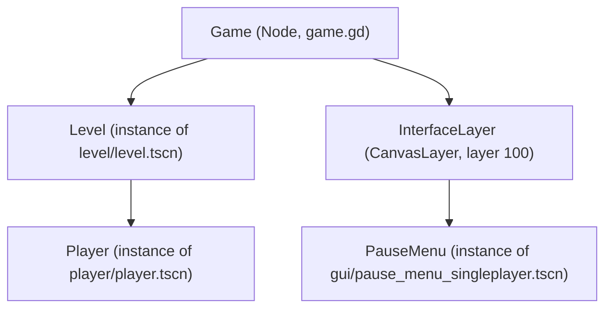

# 1. Game scenes: Level, Player and the interface layer

> **Hoot:** Platformer 2D is a handful of scenes stacked like blocks: game_singleplayer.tscn instances Level, Player and a PauseMenu, and game.gd keeps watch over them.

## 1. The entry point: game_singleplayer.tscn

`project.godot` sets `run/main_scene` to `res://game_singleplayer.tscn`, so that scene is what runs on Play. Its root is a plain `Node` named `Game` with `game.gd` attached. Everything else is a child, and most children are **instances of other scenes** (`level/level.tscn`, `player/player.tscn`, `gui/pause_menu_singleplayer.tscn`), not nodes defined inline. The folders mirror that: `player/`, `level/`, `enemy/`, `gui/` each own a scene plus its script and assets.

Sources: [`project.godot:22`](../../../project.godot#L22) — main_scene points at game_singleplayer.tscn · [`game_singleplayer.tscn:1-24`](../../../game_singleplayer.tscn#L1-L24) — the whole scene file

## 2. Scene instancing, Unity-prefab style

> [!NOTE]
> **Concept:** In Godot a scene is a reusable tree of nodes saved to a .tscn file; instancing it inside another scene is close to nesting a prefab in Unity, and the instance can override properties locally.
> Official docs: <https://docs.godotengine.org/en/stable/tutorials/scripting/instancing_with_signals.html>

In `game_singleplayer.tscn`, `Level` is an instance of `level.tscn` (line 12) and `Player` is an instance of `player.tscn` parented under `Level` (line 14). The instance then overrides `z_index`, `position` and `scale` (lines 15-17), much like a prefab instance override, without touching `player.tscn` itself.

Sources: [`game_singleplayer.tscn:3-22`](../../../game_singleplayer.tscn#L3-L22) — ext_resource PackedScenes and instance= nodes

## 3. The singleplayer node tree



Game owns the world (Level, with Player inside) and a CanvasLayer at layer 100 for the UI. Boxes marked (instance) come from separate .tscn files.

Sources: [`game_singleplayer.tscn:8-22`](../../../game_singleplayer.tscn#L8-L22) — the node declarations drawn

## 4. Game as the root script

```igrasp-code-tour
stops:
- path: game.gd
  lines: 1-6
  annotation: '`class_name Game` registers a global type; `@onready` fetches the PauseMenu by path `InterfaceLayer/PauseMenu` once the tree is ready. The splitscreen script later does `extends Game`.'
- path: game.gd
  lines: 8-16
  annotation: Fullscreen toggle runs in `_unhandled_input`, so it only fires if no UI consumed the event. `set_input_as_handled()` stops it propagating.
- path: game.gd
  lines: 18-25
  annotation: Pause flips `tree.paused` and calls `PauseMenu.open()` or `close()`. This works while paused only because the scene sets `process_mode = 3` (Always) on the Game root, see `game_singleplayer.tscn:9`.
```

## 5. Why Game keeps running while paused

```igrasp-spot-it
prompt: Click the line that lets the Game root keep receiving input while the tree is paused.
path: game_singleplayer.tscn
lines: 8-17
answerLine: 9
explanation: '`process_mode = 3` is PROCESS_MODE_ALWAYS. Without it, `Game._unhandled_input` would stop firing once `tree.paused` is true, and `toggle_pause` could never unpause. The Level and Player inherit the default and freeze.'
```

## 6. Recap

- `game_singleplayer.tscn` is the main scene: a `Game` root (game.gd) that instances `Level`, `Player` (inside Level) and a `PauseMenu` under a CanvasLayer at layer 100.
- `Game._unhandled_input` handles fullscreen and pause, and relies on `process_mode = 3` on the root so it still runs while the tree is paused.
- `Music` (music.tscn) is an autoload in project.godot, so it outlives the scene swaps done by PauseMenu.

Sources: [`project.godot:26-28`](../../../project.godot#L26-L28)
