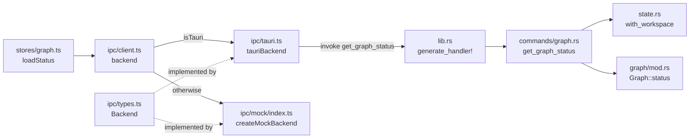

# 1. The map: one command, five places

> **Hoot:** Before you write a line, let's trace get_graph_status through every file a new IGrasp command has to touch.

## 1. A command is one name spelled in five files

A command has no registry that generates the others: `get_graph_status` is typed by hand in the Rust handler (`commands/graph.rs`), the `generate_handler!` list (`lib.rs`), the `Backend` interface (`ipc/types.ts`), `tauriBackend` (`ipc/tauri.ts`) and the mock (`ipc/mock/index.ts`). A sixth place, a zustand store, is where the UI actually calls it. The snake_case string in `invoke('get_graph_status')` is the only link between the Rust and TypeScript halves, so a typo there is a runtime error, not a compile error.

Sources: [`docs/architecture.md:70-80`](../../../docs/architecture.md#L70-L80) — The command table lists get_graph_status among the IPC commands. · [`src/ipc/tauri.ts:84-91`](../../../src/ipc/tauri.ts#L84-L91) — The string-to-method mapping.

## 2. Follow get_graph_status through the code

```igrasp-code-tour
stops:
- path: src-tauri/src/commands/graph.rs
  lines: 64-76
  annotation: 'The Rust end. `with_graph` takes the workspace read lock via `with_workspace`, so with no folder open the command fails with `AppError::NoRootOpen`. The handler itself is one line: `g.status(generation)`.'
- path: src-tauri/src/lib.rs
  lines: 84-92
  annotation: '`tauri::generate_handler!` is the allow-list of callable commands. A `#[tauri::command]` function missing here compiles fine and is simply unreachable from the webview.'
- path: src/ipc/types.ts
  lines: 266-276
  annotation: 'The contract. `getGraphStatus(): Promise<GraphStatus>` sits in `Backend` next to the other graph queries, with the generated `GraphStatus` type imported at the top of the file (line 20) and re-exported (line 68).'
- path: src/ipc/tauri.ts
  lines: 84-91
  annotation: The real implementation is a one-liner over the local `invoke` wrapper. Arguments are camelCase objects (`{ relPath }`) matching the Rust parameter names, which Tauri converts from snake_case.
- path: src/ipc/mock/index.ts
  lines: 502-512
  annotation: 'The mock re-implements the same rule in TypeScript: reject with `NoRootOpen` when `state.root` is null, then answer from `state.graph` and `state.index`, with `ready` false until the fake build finishes.'
- path: src/stores/graph.ts
  lines: 87-103
  annotation: The caller. `loadStatus` imports `backend` from `ipc/client`, remembers the generation before the await, and drops the answer if the generation moved on. Conventions say IPC calls live in stores, not components.
```

## 3. Who talks to whom



Stores see only `Backend`; client.ts picks which implementation sits behind it. Only the left branch crosses the process boundary.

Sources: [`src/ipc/client.ts:1-19`](../../../src/ipc/client.ts#L1-L19) — The selection of the implementation. · [`src/ipc/types.ts:240-242`](../../../src/ipc/types.ts#L240-L242) — The Backend interface both sides implement. · [`src-tauri/src/commands/graph.rs:64-76`](../../../src-tauri/src/commands/graph.rs#L64-L76) — The Rust end of the call.

## 4. client.ts is the only switch

`select()` returns `tauriBackend` when `'__TAURI_INTERNALS__' in window`, otherwise it builds the mock and publishes its controls on `window.__igraspMock`. The choice is made once, at module load, and exported as the constant `backend`, so no store or component ever branches on the environment. The cost: `tauri.ts` is imported even in the browser (its comment says it is unused there, with window calls resolved lazily by `win()`), and a bundle in the wrong environment cannot swap implementations at runtime. The gain is that Vitest, `npm run dev` and Playwright exercise the exact same store code as the desktop app.

Sources: [`src/ipc/client.ts:8-19`](../../../src/ipc/client.ts#L8-L19) — isTauri, select and the exported backend. · [`src/ipc/tauri.ts:31-32`](../../../src/ipc/tauri.ts#L31-L32) — Lazy window access because the module is imported outside Tauri.

## 5. Spot the environment test

```igrasp-spot-it
prompt: Click the line that decides, at runtime, that the app is running inside the Tauri webview.
path: src/ipc/client.ts
lines: 8-19
answerLine: 9
explanation: '`isTauri()` looks for `__TAURI_INTERNALS__` on `window`. `select()` uses it on line 13 to return `tauriBackend`; everything else gets the mock, with its controls exposed for tests on line 15.'
```

## 6. You add `getFoo()` to the `Backend` interface and implement it in `tauriBackend` and the mock, but forget to list the Rust command in `generate_handler!` in lib.rs. What happens?

```igrasp-quiz
kind: multipleChoice
choices:
- tsc and Vitest pass; the call fails only when the real app invokes it
- The TypeScript build fails on the unknown command name
- cargo test fails because the command is unregistered
- The mock throws, since it checks lib.rs at startup
answer: 0
hint: Which of these checks ever reads the string passed to `invoke`?
explanation: 'The command name is a plain string in `tauri.ts`, and the mock never touches lib.rs, so typecheck and unit tests are green. Only a run of the real app (or a manual check) reveals the missing handler. Omitting a method from either implementation, by contrast, is caught by `tsc`: `tauriBackend` is typed `Backend` and the mock returns `Backend & { controls }`.'
sources:
- path: src-tauri/src/lib.rs
  lines: 67-90
  why: The handler list that must be extended by hand.
- path: src/ipc/tauri.ts
  lines: 67-68
  why: tauriBackend is typed as Backend.
- path: src/ipc/mock/index.ts
  lines: '150'
  why: The mock's return type is Backend & { controls }.
```

## 7. Match the file to its job

```igrasp-match
prompt: Match each file to what it does for a command.
pairs:
- left: src-tauri/src/commands/graph.rs
  right: 'The #[tauri::command] handler and the response structs'
- left: src-tauri/src/lib.rs
  right: The generate_handler! list that exposes the command
- left: src/ipc/types.ts
  right: The Backend interface and re-exports of generated types
- left: src/ipc/tauri.ts
  right: The real implementation over invoke, with error mapping
- left: src/ipc/mock/index.ts
  right: The in-memory implementation used in browser, Vitest and Playwright
explanation: 'Each file owns exactly one role, which is why a command needs all five. `client.ts` is the sixth file in the picture but touches no command: it only chooses between the last two.'
sources:
- path: docs/architecture.md
  lines: 101-103
  why: The ipc/ folder's role in the architecture table.
- path: src-tauri/src/lib.rs
  lines: 67-70
  why: The handler registration.
```

## 8. Why a hand-kept mock is a deliberate cost

ADR 0007 chose an in-memory mock because Playwright cannot drive WebView2 or WebKitGTK, so the whole UI is tested against `createMockBackend`. The ADR states the consequence plainly: the mock must be kept in step with the Rust commands, since only the TypeScript interface and the generated event types are shared. That is why `mock/index.ts` reproduces Rust details such as the `NoRootOpen` and `IndexNotReady` rejections and generation numbers. Parity is a convention backed by tests, not by the compiler.

Sources: [`docs/decisions/0007-e2e-with-playwright-and-mock-ipc.md:12-36`](../../../docs/decisions/0007-e2e-with-playwright-and-mock-ipc.md#L12-L36) — The decision and its consequences. · [`src/ipc/mock/index.ts:1-2`](../../../src/ipc/mock/index.ts#L1-L2) — What the mock is used for.

## 9. Trace a command yourself

```igrasp-try-it
instruction: Search the repo for `list_broken_links` and then for `listBrokenLinks`. Note which files show up for each spelling, and where both meet on one line of `src/ipc/tauri.ts`. Then check that every file you found is one of the five places from this chapter, plus the store and the panel that call it.
command: rg "list_broken_links|listBrokenLinks" src src-tauri/src docs/architecture.md
where: terminal
expected: Snake_case in lib.rs, commands/graph.rs, tauri.ts and architecture.md; camelCase in types.ts, tauri.ts, the mock, the store and the panel.
sources:
- path: src/ipc/tauri.ts
  lines: '90'
  why: Both spellings meet on this line.
- path: src/ipc/types.ts
  lines: 275-276
  why: The interface entry for listBrokenLinks.
```

## 10. Recap

- A new command lives in five hand-synced places: commands/*.rs, the generate_handler! list in lib.rs, the Backend interface in ipc/types.ts, tauriBackend in ipc/tauri.ts and the mock in ipc/mock/index.ts, plus a store that calls it.
- src/ipc/client.ts picks the implementation once, from __TAURI_INTERNALS__, so stores always import `backend` and never test the environment.
- tsc catches a missing method on either implementation, but a missing lib.rs entry or a mistyped invoke string only fails at runtime in the real app.

Sources: [`src/ipc/client.ts:8-19`](../../../src/ipc/client.ts#L8-L19) — The single switch.
