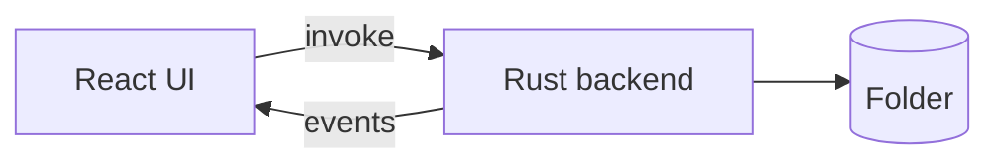

# 3. The architecture page of igrasp-demo

> **Hoot:** Hoot adjusts his glasses over docs/architecture.md.

## 1. The two halves



The flowchart of docs/architecture.md: only the Rust backend touches the folder.

Sources: [`docs/architecture.md:3-8`](../../../docs/architecture.md#L3-L8)

## 2. Invoke and events

> [!NOTE]
> **Concept:** In a desktop app split in two processes, the UI asks the native side with commands and listens to its events.
> Official docs: <https://v2.tauri.app/develop/calling-rust/>

In igrasp-demo, docs/architecture.md draws `React UI -->|invoke| Rust backend` and `Rust -->|events| UI`: the backend owns the file system.

Sources: [`docs/architecture.md:3-12`](../../../docs/architecture.md#L3-L12)

## 3. Who owns the folder

docs/architecture.md says "The backend owns the file system; the frontend renders" (line 12).

Sources: [`docs/architecture.md:10-12`](../../../docs/architecture.md#L10-L12)

## 4. In docs/architecture.md, the React UI of igrasp-demo reads the folder itself.

```igrasp-quiz
kind: trueFalse
choices:
- 'True'
- 'False'
answer: 1
hint: Follow the arrow to the Folder node in docs/architecture.md.
explanation: Only `Rust --> FS[(Folder)]` reaches the folder; the UI invokes the backend.
sources:
- path: docs/architecture.md
  lines: 3-8
```

## 5. Recap

- docs/architecture.md splits igrasp-demo in a React UI and a Rust backend.
- The UI invokes the backend; the backend sends events.
- Only the backend touches the folder.
