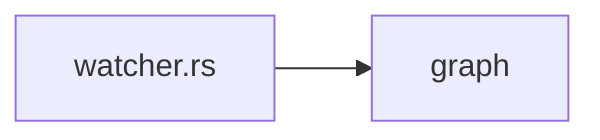

# 1. The watcher

> **Hoot:** Let us follow a change.

## 1. The watcher debounces

The watcher of Orbit waits `DEBOUNCE_MS` before it re-walks.

Then it classifies.

Sources: [`src/index/watcher.rs:2-6`](../../../src/index/watcher.rs#L2-L6) — the debounce

## 2. Debouncing

> [!NOTE]
> **Concept:** Debouncing merges a burst of events into one.
> Official docs: <https://docs.rs/notify-debouncer-full>

Here `WatchContext` keeps the generation so a late batch is dropped.

Sources: [`src/index/watcher.rs:2-6`](../../../src/index/watcher.rs#L2-L6) — the debounce

## 3. From event to batch

```igrasp-code-tour
stops:
- path: src/index/watcher.rs
  lines: '2'
  annotation: The debounce constant.
- path: src/index/watcher.rs
  lines: 4-6
  annotation: The context carries the generation.
```

## 4. The flow



Events reach the graph after the index.

Sources: [`src/index/watcher.rs:2-6`](../../../src/index/watcher.rs#L2-L6) — the debounce

## 5. A file changes

```igrasp-put-in-order
prompt: Put the watcher's steps in order.
items:
- debounce
- classify
- re-walk
explanation: watcher.rs debounces, classifies, then re-walks.
sources:
- path: src/index/watcher.rs
  lines: 2-6
  why: the debounce
```

## 6. Who does what

```igrasp-match
prompt: Match each module to its job.
pairs:
- left: watcher.rs
  right: debounces events
- left: model.rs
  right: keeps the index
- left: scanner.rs
  right: walks the folder
explanation: Each file of src/index has one job.
sources:
- path: src/index/watcher.rs
  lines: 2-6
  why: the debounce
```

## 7. Find the debounce

```igrasp-spot-it
prompt: Click the line that sets the debounce.
path: src/index/watcher.rs
lines: 1-6
answerLine: 2
explanation: DEBOUNCE_MS on line 2 of watcher.rs.
```

## 8. Which constant sets Orbit's debounce?

```igrasp-quiz
kind: multipleChoice
choices:
- DEBOUNCE_MS
- POLL_MS
- DELAY
answer: 0
hint: Top of the watcher.
explanation: DEBOUNCE_MS in src/index/watcher.rs is 200.
sources:
- path: src/index/watcher.rs
  lines: 2-6
  why: the debounce
```

## 9. Watch it happen

```igrasp-try-it
instruction: Open the folder in Orbit, then touch a file and watch the toast.
command: touch README.md
where: terminal
expected: One toast, after 200 ms.
sources:
- path: src/index/watcher.rs
  lines: 2-6
  why: the debounce
```

## 10. Recap

- watcher.rs debounces for 200 ms.
- WatchContext carries the generation.
- Late batches are dropped.
